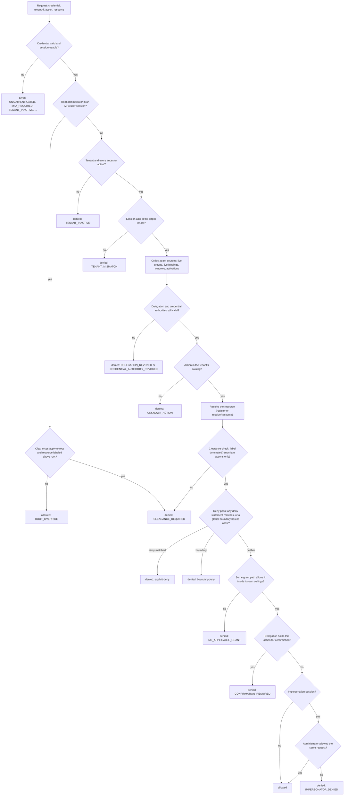

import { ClipboardCheck, FileBraces, BadgeCheck, Funnel, Split, UserCog } from '@/lib/icons';

Every authorization check in Better IAM, whether it comes from `iam.require`, `iam.authorize`, the browser client,
or an administrative API call such as `roles.create`, runs through one function on the server: the decision service
in `packages/server/src/decisions.ts`. This page describes what that function does, step by step, in the order the
code does it. Use it when a decision surprises you, when you design boundaries and delegations, or when you need to
predict what a policy change will do.

The short version: a request is refused early when the caller or tenant is not usable, then the server collects
every **grant path** the caller holds, applies every **boundary** that caps them, lets any **explicit deny** win,
and allows the request only when at least one grant path allows it inside its own ceilings.

## The whole pipeline



The sections below follow the chart from top to bottom. Each step names the decision reason it produces, so you can
map a reason from [`policies.simulate`](/docs/authorization/reviews#explain-one-decision) back to the step that
produced it.

## 1. Authenticate and revalidate the caller

Before any policy is read, the credential (the `headers` with a session cookie or `Authorization: Bearer`, or a
`token`) is resolved to a principal and checked again against the current state of the database. These checks
**throw errors**; they do not return a decision:

| Check | Error |
| --- | --- |
| The token is unknown, revoked, or past its lifetime or idle timeout | `UNAUTHENTICATED` (401) |
| The identity is past its scheduled `expiresAt` | `UNAUTHENTICATED` (401) |
| The tenant or an ancestor is not active | `TENANT_INACTIVE` (403) |
| A user session did not pass MFA, and the person now requires it | `MFA_REQUIRED` (403) |
| The email is unverified while `requireEmailVerification` is on | `EMAIL_UNVERIFIED` (403) |
| The recorded client address is outside the tenant's `allowedIpRanges`, or blocked | `IP_NOT_ALLOWED`, `IP_BLOCKED` (403) |
| A session bound to its network is presented from another address | `SESSION_NETWORK_MISMATCH` (401) |

[Sessions](/docs/authentication/sessions#revalidation-on-every-use) lists every revalidation rule. Nothing is cached
between requests, so a revoked session or a disabled person is refused on the next call in every process.

## 2. The root override

A **root administrator** skips policy evaluation entirely and is allowed with reason `ROOT_OVERRIDE`. The server
treats a principal as root only when all four hold (`rootPrincipal` in `context.ts`):

- the identity belongs to the root tenant (type `root`, no parent);
- the identity has `rootAdmin: true`;
- the credential is a `user` session, not an API key, role session, or session token;
- that session passed MFA.

A root API key or a root role session is therefore evaluated like anyone else. Every allowed root override is written
to the audit log as an override.

The override does not skip [catalog and resource resolution](#8-catalog-and-resource-resolution): an action outside
the tenant's catalog is still `UNKNOWN_ACTION` for root, and a resource that cannot be resolved still throws.

With [security clearances](/docs/features/security-clearances#root-administrators) enabled and
`clearances.appliesToRoot` left on, the override keeps one exception: an application action on a resource labeled
above root's own clearance is refused with `CLEARANCE_REQUIRED`. `iam:*` actions always pass.

## 3. Tenant state and tenant scope

For every other principal, two refusals come before anything that depends on the resource:

1. **`TENANT_INACTIVE`**: the target tenant or any ancestor up to the root is not `active` (suspended, pending, or
   deleted).
2. **`TENANT_MISMATCH`**: the session acts in a different tenant than the one named in the request. A session acts
   in exactly one tenant; membership in a parent tenant grants nothing in its descendants.

Because these run first, a caller from another tenant learns nothing about the target's actions or resources, and
your `resolveResource` callback never runs for them. A `TENANT_MISMATCH` refusal is audited in the caller's own
tenant, not the target's.

## 4. Grant sources

Next the server collects what the principal holds in the target tenant. For a person, service account, or agent
acting through a user session, API key, session token, or delegated session, the sources are:

| Source | Counts when |
| --- | --- |
| Group memberships | The membership has no `expiresAt`, or it is still ahead. |
| Bindings to the identity or to one of those groups | The binding is **live**: `startsAt` is unset or reached, and `expiresAt` is unset or still ahead. |
| Bindings with an access window | The current time is inside the window (`days`, `from`, `to`, `timeZone`). Outside it the binding grants nothing. |
| Eligible bindings | The identity holds a live activation of that binding: not expired, and not `pending` or `denied`. |

A future-dated binding is listed by `identities.listBindings` but grants nothing until its `startsAt`. See
[Temporary access](/docs/authorization/temporary-access) for expiring and future-dated bindings and access windows,
and [Just-in-time elevation](/docs/features/privileged-access/elevation) for eligible bindings.

**Role sessions** are the exception. A session from `roles.assume` (or a web-identity exchange) has no bindings and
no groups: its only source is the assumed role, and only while the trust it was started through still exists and is
not revoked. Relationships held by the source identity do not apply either.

### Activation rules for eligible bindings

Whether an activation can be created is decided when the person activates, not at decision time. The rules come from
the binding itself, tightened by the tenant's access policy (`tenants.setAccessPolicy`, validated in
`access-policy.ts`):

| Field | Binding value combined with tenant value | Limits |
| --- | --- | --- |
| `requireJustification` | Required if either requires it. | boolean |
| `requireMfa` | Required if either requires it. | boolean |
| `requireApproval` | Required if either requires it. | boolean |
| `maxActivationMs` | The smaller of the two. The binding defaults to one hour. | one minute to seven days |
| `approvalLifetimeMs` | The tenant's value, or 24 hours. | five minutes to 30 days |

Once an activation exists and is live, the binding counts as a grant source like any other binding.

## 5. Grant paths and authority ceilings

Each binding becomes one or more **grant paths**. A grant path is a set of policy documents plus the ceilings that
bound them, and every path is evaluated on its own:

- The role's inline `document` is one path, bounded by the ceilings of the authority that issued the **binding** and
  the authority that created the **role**.
- Each attached policy is one path, bounded by the binding's and role's ceilings plus the ceilings of the authority
  that created the **policy**. A higher authority that attaches a lower authority's policy cannot remove the limits
  the policy was created under.
- Each inherited role contributes its own paths, bounded by everything above it plus its own ceilings, so
  inheriting a broader role never widens what a narrow authority can grant. Protected roles such as _Owner_ are
  never followed through inheritance.

An authority's ceilings are the ceiling documents of the authority and of every parent up its chain (see
[Grant authorities](/docs/authorization/roles#grant-authorities)). If any authority in the chain is revoked or
missing, the chain is broken and the grants issued under it **lapse**: the path is dropped. The **deny statements**
of a lapsed binding, role, or policy are kept as a path that grants nothing. Revoking an administrator takes away
what they granted, never what they forbade.

For a role session, the assumed role is expanded the same way, with the trust's `ceiling` as the outermost bound.

## 6. Global boundaries

Some ceilings apply to every grant path of the request. They are collected once:

| Boundary | Source |
| --- | --- |
| Tenant boundaries | The `boundary` of the target tenant and of every ancestor (`tenants.setBoundary`). |
| Agent ceiling | The acting agent's `boundary`, for an agent's own API key or a delegated session. |
| Delegation scope | The delegation's `policy` for a delegated session, plus the scope of every delegation above it and the ceilings of every agent that handed the work on. |
| Hand-off issuers | The authority ceilings of the key issuers behind sessions that handed work on. A revoked one refuses the request with `CREDENTIAL_AUTHORITY_REVOKED`. |
| Principal boundary | The identity's boundary in this tenant (`identities.setBoundary`). |
| Guest ceiling | For a B2B guest acting in this tenant, the tenant's guest boundary. |
| Session policy | The scope-down `policy` of a role session or an API key (`roles.assume`, `credentials.create`). |
| Source policy | For a session token, the policy of the credential it was minted from (API-key scopes, for example). |
| Credential authority | For an API key, the ceilings of its issuing authority. Revoked: `CREDENTIAL_AUTHORITY_REVOKED`. |
| Web-identity provider | For a web-identity session, the ceilings of the authority that registered the OIDC provider. Missing or revoked: `CREDENTIAL_AUTHORITY_REVOKED`. |

A delegated session whose agent or delegation (or a delegation above it) cannot be read, is not `active`, or no
longer matches the agent and person is refused outright with `DELEGATION_REVOKED`. Delegations are read live, so
narrowing or revoking one applies to the next decision. See
[AI agents](/docs/features/ai-agents#letting-an-agent-act-for-a-person).

## 7. The evaluation context

[Conditions](/docs/authorization/conditions) read a flat map of context keys. The server builds it in this order,
where later sources overwrite earlier ones:

1. Your `resolveContext(principal)` callback, then each plugin's `resolveContext`.
2. Keys only the server may set are removed from those results, so an application or plugin value can never stand
   in for `principal.mfa`, `principal.id`, or any other server-owned key.
3. The identity's declared attributes as `principal.{name}`. A role session receives them only when its trust
   passes source attributes.
4. The server-derived keys: `principal.id`, `principal.tenantId`, `principal.mfa`, `principal.kind`,
   `principal.owner`, `principal.rootAdmin`, `principal.sessionKind`, `principal.authMethod`,
   `principal.impersonated`, `principal.groups`, `principal.roles`, guest and agreement keys, `request.time`, and the
   session keys (`principal.sessionId`, `principal.authTime`, `principal.mfaTime`, `request.sourceIp`, session tags).
5. Agent and delegation keys (`principal.delegated`, `principal.agentId`, `principal.delegationId`, and others).
6. Keys that cost a read, loaded only when some grant or boundary document mentions them: `tenant.features`,
   onboarding, teams and departments, spend and budgets, consents, licenses, risk level, and device posture.
7. Per resource: every resource attribute as `resource.{name}`, then `resource.tenantId`, `resource.relations` (the
   relations the principal holds on the resource, directly or through a group), `resource.parentRelations`, and,
   with clearances, the classification keys.

`principal.owner` and `principal.rootAdmin` are true only for a user session or API key acting in the account's own
tenant; an assumed role never carries them. [Context keys](/docs/authorization/conditions#context-keys) lists every
key with its type.

## 8. Catalog and resource resolution

Two more steps run before evaluation:

1. **The action must exist** in the tenant's [permission catalog](/docs/authorization/catalog). Otherwise the
   decision is `UNKNOWN_ACTION`. This check runs after the tenant checks, so an outsider cannot probe which actions
   exist.
2. **The resource is resolved.** Platform resources (`iam/...`) are taken as given. A managed type is loaded from the
   resource registry, and an unregistered ID fails with `NOT_FOUND`. Any other type goes to your `resolveResource`
   callback, which must return the same `tenantId`, `type`, and `id` that were requested. Without a resolver the call
   fails with `RESOURCE_RESOLVER_REQUIRED`, and a mismatching answer fails with `RESOURCE_MISMATCH` (403).

Resolution failures are thrown as errors, so `iam.authorize` rejects instead of returning a decision for them.

## 9. Clearances first

With the `clearances` option on and a classification scheme in the tenant, the mandatory check runs before any
policy statement. For every action except `iam:*`, every party of the session (the person, an acting agent and its
sponsor, each agent of a hand-off) must hold a clearance that dominates the resource's label. Otherwise the decision
is `CLEARANCE_REQUIRED`, and no grant, ownership, relationship, or confirmation can lift it. See
[How decisions apply clearances](/docs/features/security-clearances#how-decisions-apply-clearances).

## 10. Explicit denies and global boundaries

The first policy pass looks only for reasons to refuse. It evaluates, against the global boundaries from step 6:

- a synthetic allow-everything grant, so that only denies and boundaries can refuse; and
- every deny statement from every grant path, including the deny-only paths of lapsed authorities.

| Outcome | Reason |
| --- | --- |
| Any deny statement matches, in any grant path or in a global boundary | `explicit-deny` |
| A global boundary has no matching allow | `boundary-deny` |
| Evaluation exceeds its work budget | `evaluation-limit` |

This is why an <Term id="explicit-deny">explicit deny</Term> in one role cancels an allow in another role: denies
are pooled across all paths before any path is asked to allow.

A deny statement inside an **authority ceiling** is different: a ceiling belongs to its path, so such a deny only
blocks the paths issued under that authority, not grants from other authorities.

## 11. Grant paths allow

The second pass walks the grant paths in order. Each path is evaluated with its own documents as grants and the
global boundaries plus the path's own ceilings as boundaries, using the core evaluator `evaluatePolicy`:

1. A deny matching in the path or its ceilings refuses that path.
2. The path needs at least one matching allow statement.
3. Every boundary, global and per path, must contain a matching allow. Each boundary is an independent intersection.

The **first path that allows** decides the request. If no path allows, the decision is `NO_APPLICABLE_GRANT`, the
server's form of the core evaluator's `no-grant`. A grant that a ceiling cuts off is reported the same way, because
from the request's point of view no path allowed it.

```ts title="The core evaluator, for one path"
import { evaluatePolicy } from 'better-iam';

const decision = evaluatePolicy({
  action: 'invoices:approve',
  resource: 'invoice/2024-118',
  grants: [{ version: 1, statements: [{ sid: 'Approve', effect: 'allow', actions: ['invoices:*'], resources: ['invoice/*'] }] }],
  // A grant-authority ceiling: the support lead's authority only covers reads.
  boundaries: [{ version: 1, statements: [{ effect: 'allow', actions: ['invoices:read'], resources: ['*'] }] }],
  context: {},
});
// { allowed: false, reason: 'boundary-deny', matched: ['grant:0:Approve'] }
```

On the server that path fails its ceiling, and if no other path allows the action the request is reported as
`NO_APPLICABLE_GRANT`.

## 12. Delegation confirmations

An allowed decision for a delegated session goes through one more gate. A delegation can name actions in `confirm`
that the person must approve one at a time. When the allowed action is one of them and no approved confirmation
exists for that exact action and resource, the decision is `CONFIRMATION_REQUIRED`. A single `iam.authorize` call
that is allowed uses the confirmation up; `authorizeMany` and `listAccessible` never do. See
[Confirming sensitive actions](/docs/features/ai-agents#confirming-sensitive-actions-one-at-a-time).

## 13. Impersonation is intersected

When the request comes from an [impersonation](/docs/authentication/impersonation) ("view as") session and the
member's decision is allowed, the server prepares and evaluates the **same request again as the administrator**,
through the administrator's own session. If the administrator would be refused, the decision becomes
`IMPERSONATOR_DENIED` (or the administrator's own `CLEARANCE_REQUIRED`). An impersonation session is therefore never
allowed more than both people may do.

## 14. After the decision

What happens to the result depends on how it was asked for:

| Entry point | Behavior |
| --- | --- |
| `iam.authorize`, `client.authorize` | Returns `{ allowed, reason, matched: [] }`. Every denial reason is replaced with `ACCESS_DENIED`. |
| `iam.require` | Throws `IamError` `ACCESS_DENIED` (403) when not allowed. |
| `iam.authorizeMany` | Up to 50 checks in one transaction, each recorded like `authorize`; no confirmation is used up. |
| `iam.listAccessible`, `iam.planResources` | Mirror the same evaluation over every resource of a type. See [Data filtering](/docs/authorization/data-filtering). |
| Administrative API (`iam.api.*`) | The action is checked on `iam/{resourceId}`; a refusal throws `ACCESS_DENIED`. |
| `policies.simulate`, `policies.effectiveActions` | Return the precise reason and `matched` statements, for administrators. See [Testing policies](/docs/authorization/testing-policies). |

Every refused decision is written to the audit log as a `deny` event. A root override is audited as an override.
An allowed decision is recorded as access usage for the person, except root overrides and actions an impersonating
administrator took. See [Usage and role mining](/docs/features/governance/usage-and-mining).

## Write-time rules: separation of duties and invariants

Two rules are not part of the per-request evaluation at all. They are enforced when access is **changed**, inside
the same transaction as the change:

- **[Separation of duties](/docs/authorization/separation-of-duties).** Operations that can give someone a role
  (`iam:bindings:create`, `iam:groups:update`, `iam:identities:create`, `iam:access-requests:review`,
  `iam:config:apply`, `iam:packages:assign`, `iam:packages:approve`, `iam:teams:create`, `iam:teams:update`, and
  `iam:roles:update`) take a snapshot of existing conflicts with the tenant's `prevent` rules, run, and then check
  again. A conflict that did not exist before rolls the change back with `SOD_CONFLICT` (409). Conflicts that predate
  the rule never block unrelated work, and `detect` rules only report.
- **[Access invariants](/docs/features/governance/change-safety#access-invariants).** Enforced invariants are
  checked the same way, and a change that would newly break one is rolled back with `INVARIANT_VIOLATION` (409).

Because both are checked at write time, a decision never returns an SoD reason: a person who already holds two
conflicting roles (for example, granted before the rule existed) is evaluated normally and reported by
`analysis.findings` as a `separation-of-duties` finding.

## Decision reasons

Every reason a server decision can carry, in the order the steps above can produce them:

| Reason | Step | Meaning |
| --- | --- | --- |
| `ROOT_OVERRIDE` | 2 | Root administrator in an MFA user session; allowed. |
| `TENANT_INACTIVE` | 3 | The tenant or an ancestor is not active. |
| `TENANT_MISMATCH` | 3 | The session acts in another tenant. |
| `DELEGATION_REVOKED` | 6 | A delegated session's agent or delegation is gone or no longer active. |
| `CREDENTIAL_AUTHORITY_REVOKED` | 6 | An API key's issuing authority, a hand-off issuer, or a web-identity provider's registrar was revoked. |
| `UNKNOWN_ACTION` | 8 | The action is not in the tenant's catalog. |
| `CLEARANCE_REQUIRED` | 2, 9 | A party of the session lacks a clearance that dominates the resource's label. |
| `explicit-deny` | 10 | A deny statement matched in a grant path or a global boundary. |
| `boundary-deny` | 10 | A global boundary has no matching allow. |
| `evaluation-limit` | 10, 11 | Matching exceeded the evaluator's work budget; refused like a deny. |
| `NO_APPLICABLE_GRANT` | 11 | No grant path allowed the request inside its ceilings. |
| `CONFIRMATION_REQUIRED` | 12 | A delegation holds this action until the person confirms it. |
| `IMPERSONATOR_DENIED` | 13 | The member is allowed, but the impersonating administrator is not. |
| `allowed` | 11 | A grant path allowed it and nothing refused it. |

Public responses report every denial as `ACCESS_DENIED`. Only the administrator-only simulation APIs return these
reasons.

## Errors

These codes are thrown during a decision rather than returned as a reason:

| Code | When |
| --- | --- |
| [`UNAUTHENTICATED`](/docs/reference/errors#unauthenticated) | The credential is missing, unknown, revoked, or expired. |
| [`MFA_REQUIRED`](/docs/reference/errors#mfa_required) | The session did not pass MFA and the person now requires it. |
| [`TENANT_INACTIVE`](/docs/reference/errors#tenant_inactive) | Thrown during revalidation when the caller's own tenant is not active. |
| [`RESOURCE_RESOLVER_REQUIRED`](/docs/reference/errors#resource_resolver_required) | An application-owned resource type is checked without `resolveResource`. |
| [`RESOURCE_MISMATCH`](/docs/reference/errors#resource_mismatch) | `resolveResource` returned a different tenant, type, or ID. |
| [`NOT_FOUND`](/docs/reference/errors#not_found) | The tenant does not exist, or a managed resource is not registered. |
| [`ACCESS_DENIED`](/docs/reference/errors#access_denied) | `iam.require` or an administrative call was refused. |
| [`SOD_CONFLICT`](/docs/reference/errors#sod_conflict) | A granting change would create a new separation-of-duties conflict. |
| [`INVARIANT_VIOLATION`](/docs/reference/errors#invariant_violation) | A change would break an enforced access invariant. |

## Next steps

<Cards>
  <Card icon={<BadgeCheck />} title="Testing policies" href="/docs/authorization/testing-policies">
    Simulate, explain, lint, and preview changes before they reach production.
  </Card>
  <Card icon={<FileBraces />} title="Policy documents" href="/docs/authorization/policies">
    Statements, boundaries, and variables.
  </Card>
  <Card icon={<Funnel />} title="Conditions" href="/docs/authorization/conditions">
    Every operator and context key.
  </Card>
  <Card icon={<UserCog />} title="Roles and bindings" href="/docs/authorization/roles">
    Bindings, inheritance, and grant authorities.
  </Card>
  <Card icon={<Split />} title="Separation of duties" href="/docs/authorization/separation-of-duties">
    Roles nobody may hold together.
  </Card>
  <Card icon={<ClipboardCheck />} title="Access reviews" href="/docs/authorization/reviews">
    Explain a decision for a real person.
  </Card>
</Cards>
