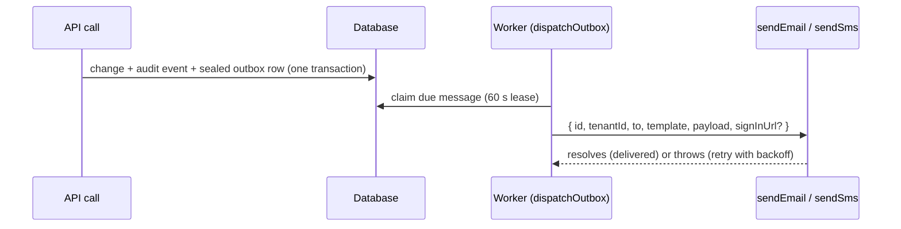

Better IAM never talks to a mail or SMS provider itself. Every message it needs to send (a verification link, a
password reset, an invitation, a security notice, a reminder) is written to the <Term id="outbox">outbox</Term>
with a **template name** and a **payload**, in the same transaction as the change that caused it. A worker then
hands each message to a callback you supply, `authentication.sendEmail` or `authentication.sendSms`, which renders
it and sends it through your own provider, sender domain, and branding.

Use this page to wire up delivery, render the built-in templates, and look up every template name your callback
can receive.



- **Transactional.** A rolled-back change sends nothing, and a committed change is never lost.
- **Sealed at rest.** The payload (which can hold a single-use token) is encrypted with the deployment `secret`
  while it waits, and erased once the message is delivered or abandoned.
- **Outside the request.** Your callback runs from the worker, after commit, so a slow provider never holds a
  write lock or delays a sign-in.
- **At least once.** A message can reach your callback more than once; deduplicate by `message.id`.

## Setup

<Steps>
<Step>

### Add the delivery callbacks

`authentication.sendEmail` and `authentication.sendSms` receive one `DeliveryMessage` each. Resolve when the
provider accepted the message; throw to have the outbox retry it later.

```ts title="iam.ts"
import { betterIam } from 'better-iam';
import { sqliteAdapter } from 'better-iam/adapter-sqlite';
import { renderDeliveryMessage } from 'better-iam/auth/templates';
import { mailer, sms } from './providers';

const origin = 'https://app.example.com';

export const iam = betterIam({
  database: sqliteAdapter({ filename: './iam.db' }),
  secret: process.env.BETTER_IAM_SECRET!,
  baseURL: origin,
  authentication: {
    async sendEmail(message) {
      const rendered = renderDeliveryMessage(message, {
        appName: 'Acme Cloud',
        links: {
          invitation: ({ kind, tenantId, token }) => `${origin}/join?kind=${kind}&tenant=${tenantId}&token=${token}`,
          passwordReset: ({ tenantId, token }) => `${origin}/reset?tenant=${tenantId}&token=${token}`,
          verifyEmail: ({ tenantId, token }) => `${origin}/verify?tenant=${tenantId}&token=${token}`,
          emailChange: ({ tenantId, token }) => `${origin}/email?tenant=${tenantId}&token=${token}`,
          magicLink: ({ tenantId, token, destination }) =>
            `${origin}/magic?tenant=${tenantId}&token=${token}&to=${encodeURIComponent(destination)}`,
          account: ({ tenantId }) => `${origin}/${tenantId}/account`,
        },
      });
      // Templates the renderer does not know (plugin templates, phone-verify, ...) return undefined.
      if (!rendered) throw new Error(`No renderer for ${message.template}`); // retried later
      await mailer.send({ to: message.to, idempotencyKey: message.id, ...rendered });
    },
    async sendSms(message) {
      // SMS templates are `code` (passwordless sign-in) and `phone-verify`; both carry a six-digit `token`.
      await sms.send({ to: message.to, body: `Your Acme code is ${message.payload.token}` });
    },
  },
});
```

Features that send email fail or switch off without `sendEmail`; see [Errors](#errors).

</Step>
<Step>

### Schedule the outbox worker

Nothing leaves the outbox until something dispatches it. Run `iam.auth.dispatchOutbox()` from your worker every
minute (or more often, if people wait for sign-in codes), or the `outbox` CLI command from cron.

```ts title="worker.ts"
import { iam } from './iam';

setInterval(async () => {
  const { delivered, failed, abandoned } = await iam.auth.dispatchOutbox();
  if (abandoned > 0) console.warn(`outbox: ${abandoned} message(s) abandoned`);
  await iam.events.dispatch(); // audit hooks and subscribers share the schedule
}, 60_000);
```

```sh
* * * * *  better-iam outbox --config better-iam.config.mjs
```

The CLI command needs a configuration module whose `authentication.sendEmail` and `sendSms` are the same
callbacks your server uses. See [background jobs](/docs/operations/jobs#outbox-and-audit-hooks).

</Step>
<Step>

### Serve the pages your links point to

Token-carrying templates link to pages in your application. Each page reads the token from the URL and calls the
matching public method:

| Link builder | Page calls |
| --- | --- |
| `verifyEmail` | `auth.verifyEmail({ tenantId, token })` |
| `passwordReset` | `auth.resetPassword({ tenantId, token, password })` |
| `emailChange` | `auth.confirmEmailChange({ tenantId, token })` |
| `magicLink` | `auth.finishPasswordless({ tenantId, destination, token })` |
| `invitation` (`kind: 'owner'`) | `tenants.acceptInvitation({ tenantId, token, name, password })` |
| `invitation` (`kind: 'member'`) | `identities.acceptInvitation({ tenantId, token, password })` |
| `guestInvitation` | `guests.redeem({ tenantId, token, name, password })` |

</Step>
</Steps>

## Usage

### The delivery message

Your callback receives one `DeliveryMessage`:

<TypeTable
  type={{
    id: { type: 'string', required: true, description: 'The outbox message ID. Stable across retries: use it as the idempotency key with your provider.' },
    tenantId: { type: 'string', required: true, description: 'The tenant the message belongs to. Sign-in emails carry their tenant here rather than in the payload.' },
    to: { type: 'string', required: true, description: 'The destination: an email address for sendEmail, an E.164 phone number for sendSms.' },
    template: { type: 'string', required: true, description: 'Which message this is, such as verify-email or member-invitation; every name is listed under Template reference.' },
    payload: { type: 'Record<string, string>', required: true, description: 'The template variables, decrypted. Every value is a string; structured values (lists, reports) are JSON-encoded strings.' },
    signInUrl: { type: 'string', description: "The organization's own sign-in address. Added only when the hosts or regions option is configured, so links can open on the organization's subdomain, custom hostname, or home region." },
  }}
/>

Never log `payload`: several templates carry single-use tokens or codes that sign a person in.

### Render the built-in templates

`renderDeliveryMessage(message, { appName, links })` from `better-iam/auth/templates` turns a message into
`{ subject, text, html }` with HTML escaping, header-safe subjects, and a plain layout. The subpath has no native
dependencies, so it also runs in email workers and edge runtimes. It is also exported from `better-iam/auth` and
`@better-iam/auth` (not from the `better-iam` root).

```ts title="render.ts"
import { renderDeliveryMessage, type TemplateLinks } from 'better-iam/auth/templates';

const links: TemplateLinks = {
  account: ({ tenantId, signInUrl }) => `${signInUrl ?? 'https://app.example.com'}/${tenantId}/account`,
};

const rendered = renderDeliveryMessage(
  { template: 'new-sign-in', to: 'alice@example.com', tenantId: 'ten_1', payload: { time: new Date().toISOString(), method: 'password' } },
  { appName: 'Acme Cloud', links },
);
// rendered?.subject, rendered?.text, rendered?.html
```

- `appName` (default `'Better IAM'`) names your product in subjects and the footer. It is a render option, not
  `authentication.appName`.
- A missing link builder falls back to showing the raw token or code, or to the `account` link for notices.
- Templates the renderer does not know return `undefined`; render those yourself (see the table below).
- `describeUserAgent(userAgent)` turns a User-Agent into a short phrase such as "Chrome on Windows". The built-in
  security notices use it so a crafted header never reaches a message verbatim; do the same in your own templates.

The `links` builders are:

| Builder | Receives | Used by |
| --- | --- | --- |
| `invitation` | `{ kind: 'owner' \| 'member', tenantId, token, signInUrl? }` | `owner-invitation`, `member-invitation` |
| `passwordReset` | `{ tenantId, token, signInUrl? }` | `password-reset` |
| `verifyEmail` | `{ tenantId, token, signInUrl? }` | `verify-email` |
| `emailChange` | `{ tenantId, token, signInUrl? }` | `email-change` |
| `magicLink` | `{ tenantId, token, destination, signInUrl? }` | `magic-link` |
| `account` | `{ tenantId, signInUrl? }` | Security notices, and the fallback of the feature builders in this table |
| `certification` | `{ tenantId, campaignId, signInUrl? }` | `certification-review`, `certification-reminder` |
| `delegation` | `{ tenantId, delegationId, signInUrl? }` | `delegation-request`, `delegation-confirmation` |
| `team` | `{ tenantId, teamId, signInUrl? }` | `team-join-request`, `team-join-decided`, `team-review-requested` |
| `billing` | `{ tenantId, statementId?, signInUrl? }` | Billing templates |
| `privacy` | `{ tenantId, requestId?, token?, handler?, signInUrl? }` | Privacy templates |
| `threats` | `{ tenantId, incidentId?, signInUrl? }` | `threat-alert` |
| `guestInvitation` | `{ tenantId, token, signInUrl? }` | `guest-invitation` |
| `guests` | `{ tenantId, guestId?, signInUrl? }` | `guest-review`, `guest-sponsor-missing` |
| `clearances` | `{ tenantId, identityId?, signInUrl? }` | `clearance-reminder`, `clearance-status` |

### Template reference

Every template name the server can queue. **Rendered** says whether `renderDeliveryMessage` knows it; for the
others, build the message yourself from the payload.

**Sign-in and account** (from `@better-iam/auth`):

| Template | Channel | Sent when | Payload | Rendered |
| --- | --- | --- | --- | --- |
| `verify-email` | email | `auth.signUp` (when verification is required) and `auth.requestEmailVerification` | `token` | Yes |
| `password-reset` | email | `auth.requestPasswordReset` and `identities.requestPasswordReset` | `token` | Yes |
| `email-change` | email (to the new address) | `auth.requestEmailChange` | `token` | Yes |
| `magic-link` | email | `auth.startPasswordless` with `kind: 'magic-link'` | `token` | Yes |
| `code` | email or SMS | `auth.startPasswordless` with `kind: 'code'` | `token` (six digits) | Yes |
| `phone-verify` | SMS | `auth.startPhoneVerification` | `token` (six digits) | No |
| `mfa-code` | email | `auth.requestMfaCode` (emailed MFA codes) | `code` | Yes |
| `new-sign-in` | email | A session starts from an unfamiliar client (`signInNotifications`) | `sessionId`, `time`, `method`, optional `userAgent`, `ip`, `label` | Yes |
| `sign-in-failures` | email | Failed attempts since the last sign-in reached `failedSignInAlerts` | `attempts`, `time`, optional `ip`, `userAgent` | Yes |

**Organizations and members**:

| Template | Channel | Sent when | Payload | Rendered |
| --- | --- | --- | --- | --- |
| `owner-invitation` | email | `tenants.create`, `tenants.resendInvitation` | `token`, `tenantId`, `tenantName` | Yes |
| `member-invitation` | email | `identities.invite`, `identities.resendInvitation` | `token`, `tenantId`, `tenantName`, `inviterName` | Yes |
| `access-digest` | email | `iam.sendAccessDigest()` (CLI `digest`), to each organization owner | `tenantName`, `generatedAt`, `withinMs`, `unusedForMs`, finding counts, `report` (JSON) | No |
| `expiry-reminder` | email | `iam.sendExpiryReminders()` (CLI `remind`), to people whose access ends soon | `tenantId`, `tenantName`, `identityName`, `count`, `earliest`, `items` (JSON) | No |

**Access requests and governance** (sent only when `sendEmail` is configured):

| Template | Sent when | Rendered |
| --- | --- | --- |
| `activation-request` | An eligible-binding activation needs approval; sent to each approver | No |
| `activation-decided` | An activation request was approved or denied; sent to the requester | No |
| `package-request` | A member requested an access package; sent to each approver | No |
| `package-decided` | A package request was approved or denied; sent to the requester | No |
| `certification-review` | `certifications.create` started a campaign; sent to reviewers | Yes |
| `certification-reminder` | `certifications.remind`; sent to reviewers with pending items | Yes |
| `delegation-request` | An AI agent asked a person to delegate access | Yes |
| `delegation-confirmation` | An agent acting for a person asked them to confirm an action | Yes |
| `team-join-request` | `teams.requestToJoin`; sent to the team's maintainers | Yes |
| `team-join-decided` | A join request was decided; sent to the requester | Yes |
| `team-review-requested` | `teams.startReview` opened a membership review | Yes |
| `workflow-message` | A joiner, mover, or leaver workflow step sends an email | Yes |

**Feature notices** (each feature's own settings decide whether it emails):

| Template | Feature | Rendered |
| --- | --- | --- |
| `spend-alert`, `spend-anomaly`, `billing-statement`, `payment-reminder` | [Billing](/docs/features/billing) | Yes |
| `privacy-request-verify`, `privacy-request-received`, `privacy-request-update`, `privacy-request-due` | [Privacy requests](/docs/features/governance/privacy) | Yes |
| `threat-alert` | [Threat detection](/docs/features/threat-detection) | Yes |
| `license-waiting`, `license-activated` | [Licenses](/docs/features/licenses) | Yes |
| `guest-invitation`, `guest-review`, `guest-sponsor-missing` | [Guests](/docs/features/guests) | Yes |
| `clearance-reminder`, `clearance-status` | [Security clearances](/docs/features/security-clearances) | Yes |

Plugins can queue their own template names (see [Queue messages from a plugin](#queue-messages-from-a-plugin)).
Your callback should throw, not silently drop, when it meets a template it cannot render, so the message stays in
the outbox and `doctor` reports it.

### Dispatch the outbox

`iam.auth.dispatchOutbox(limit?)` delivers up to `limit` due messages (default 100, 1 to 1000), oldest first, and
returns `{ delivered, failed, abandoned }`.

- Each message is claimed in its own short transaction with a 60-second lease, so several workers can run at once
  without sending the same message twice in parallel.
- A failed attempt waits `30 s × 2^(attempts − 1)`, capped at one hour, before the next one.
- After `authentication.maxDeliveryAttempts` failed attempts (default 25, about 18 hours of retries) the message
  is abandoned with `failedAt` and `lastError` (the error name and message, at most 256 characters).
- Webhook deliveries travel through the same outbox; see [webhooks](/docs/concepts/events/webhooks#retries).

### Queue messages from a plugin

A plugin endpoint handler receives `deliver`, which queues an email or SMS in the endpoint's transaction through
the same outbox and callbacks, and returns the message ID.

```ts title="plugins/reports.ts"
import { IamError, type IamPlugin } from 'better-iam/core';

export const reports: IamPlugin = {
  id: 'reports',
  actions: ['reports:share'],
  endpoints: [
    {
      method: 'POST',
      path: 'share',
      action: 'reports:share',
      validate(value) {
        const input = value as { tenantId?: unknown; email?: unknown; reportId?: unknown } | null;
        if (!input || typeof input.email !== 'string' || typeof input.reportId !== 'string')
          throw new IamError('INVALID_INPUT', 'email and reportId required');
        return { tenantId: input.tenantId, email: input.email, reportId: input.reportId };
      },
      async handler({ deliver }, input) {
        const messageId = await deliver({
          kind: 'email',
          to: String(input.email),
          template: 'report-shared', // your own template name; render it in sendEmail
          payload: { reportId: String(input.reportId) },
        });
        return { messageId };
      },
    },
  ],
};
```

`deliver` fails with `FEATURE_DISABLED` when the deployment has no callback for that `kind`, which rolls back the
endpoint's transaction. See [extensions](/docs/concepts/extensions#endpoints).

## Options

All delivery options live under `authentication` in the server options.

| Option | Type | Default | Description |
| --- | --- | --- | --- |
| `sendEmail` | `(message: DeliveryMessage) => Promise<void>` | none | Delivers email. Without it, email sign-in features, invitations, and every email notice are unavailable. |
| `sendSms` | `(message: DeliveryMessage) => Promise<void>` | none | Delivers SMS: passwordless SMS codes and phone verification. |
| `maxDeliveryAttempts` | `number` | `25` | Failed attempts (1 to 1000) before a message is abandoned. |
| `requireEmailVerification` | `boolean` | follows `signUpEnabled` | Refuse sign-in until the address is verified. Requires `sendEmail`. |
| `passwordlessEmail` | `boolean` | `false` | Enables magic links and email codes. Requires `sendEmail`. |
| `passwordlessSms` | `boolean` | `false` | Enables SMS codes. Requires `sendSms`. |
| `mfaEmailCodes` | `boolean` | `false` | Lets people without an authenticator satisfy MFA with an emailed `mfa-code`. Tenants override it. |
| `signInNotifications` | `boolean` | `false` | Queue `new-sign-in` when a session starts from an unfamiliar client. Tenants override it with `notifyNewSignIn`. |
| `failedSignInAlerts` | `number` | `0` (off) | Queue `sign-in-failures` once this many attempts have failed since the last sign-in (at most 1000). Requires `sendEmail`. |

Construction fails with `INVALID_CONFIG` when `requireEmailVerification`, `passwordlessEmail`, or
`failedSignInAlerts` is set without `sendEmail`, or `passwordlessSms` without `sendSms`. Related settings:
`observability.metrics.gauges` adds the `better_iam_outbox_messages{state}` gauge, and `iam.sweepExpired()`
deletes delivered and abandoned messages after `deliveryRetentionMs` (30 days by default).

## Schema

Messages are stored in the `outbox` collection (type `OutboxMessage` from `better-iam/core`):

| Field | Type | Description |
| --- | --- | --- |
| `id` | `string` | Message ID; also `DeliveryMessage.id`. |
| `tenantId` | `string` | Owning tenant. |
| `kind` | `'email' \| 'sms' \| 'webhook'` | Which callback delivers it. For webhooks, `to` is the subscription ID. |
| `to` | `string` | Destination address, phone number, or webhook ID. |
| `template` | `string` | Template name (for webhooks, the event action). |
| `payload` | `{ sealed?: string }` | The sealed payload; emptied after delivery or abandonment. |
| `createdAt` | `number` | Queue time, epoch milliseconds. Dispatch order. |
| `attempts` | `number` | Delivery attempts so far. |
| `deliveredAt` | `number` | Set when the callback resolved. |
| `failedAt` | `number` | Set when the message was abandoned. |
| `lastError` | `string` | The last failure, at most 256 characters. |
| `lease`, `leaseUntil` | `string`, `number` | The claiming worker's lease ID, and until when it holds the message (or when the next retry is due). |
| `reference` | `string` | What the message carries, such as the audit event ID behind a webhook delivery. |

## Errors

| Code | When |
| --- | --- |
| [`DELIVERY_REQUIRED`](/docs/reference/errors#delivery_required) | Invitations (`tenants.create`, `identities.invite`, their resend calls, and guest invitations), `certifications.remind`, the access digest, expiry reminders, guest review and clearance reminders, and turning on public privacy intake refuse to run without `sendEmail`. |
| [`FEATURE_DISABLED`](/docs/reference/errors#feature_disabled) | A flow or plugin queued a message of a kind with no callback, such as `auth.requestEmailVerification` without `sendEmail` or `startPhoneVerification` without `sendSms`. |
| [`INVALID_CONFIG`](/docs/reference/errors#invalid_config) | A delivery-dependent option is on without its callback, or `maxDeliveryAttempts` is out of range. |
| [`INVALID_INPUT`](/docs/reference/errors#invalid_input) | `dispatchOutbox` was called with a `limit` outside 1 to 1000. |
| [`RATE_LIMITED`](/docs/reference/errors#rate_limited) | A flow that sends a message was called too often for one address; see [rate limits](/docs/concepts/rate-limits). |

`doctor` reports `outbox-stalled` when messages have waited more than 15 minutes and `outbox-abandoned` for
messages abandoned in the last day.

## Next steps

<Cards>
  <Card title="Background jobs" href="/docs/operations/jobs#outbox-and-audit-hooks">
    Scheduling the outbox, audit hooks, and the retention sweep.
  </Card>
  <Card title="Passwordless sign-in" href="/docs/authentication/passwordless">
    Magic links and one-time codes over email and SMS.
  </Card>
  <Card title="Data and consistency" href="/docs/concepts/data-and-consistency#side-effects-leave-through-the-outbox">
    Why side effects leave through the outbox.
  </Card>
  <Card title="Rate limits" href="/docs/concepts/rate-limits">
    How often a single address can trigger a message.
  </Card>
</Cards>
