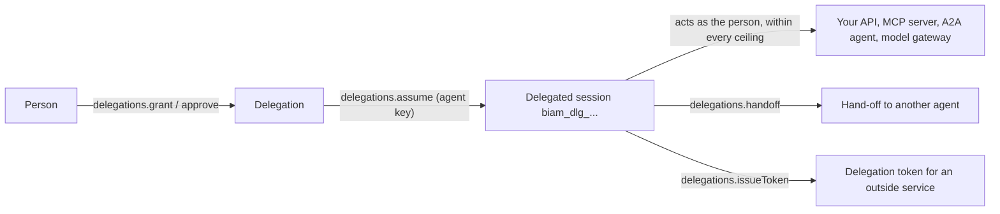

An AI agent that files tickets, schedules meetings, or edits documents needs credentials. Handing it a person's
session means nobody can tell afterwards whether a person or the agent acted, and the agent can do everything the
person can. Giving it an ordinary service account means nobody is answerable for it, and it keeps working long after
the person who set it up has left. Better IAM treats agents as accounts of their own, with three safeguards:

- **A sponsor.** Every agent has a person accountable for it. Its credentials work only while that sponsor is an
  active member of the same organization. When the sponsor leaves, offboarding hands the agent to their successor, or
  the agent stops until an administrator names a new sponsor. No agent outlives the person answerable for it.
- **A ceiling.** The agent's `boundary` policy caps everything it does, whatever its roles say and whoever it acts
  for.
- **Delegation.** A person can let an agent act for them, within a scope and for a limited time. The agent then opens
  short delegated sessions that act as the person, never with more than the person has.

An agent is an identity of kind `agent`. Like a service account it holds API keys and never signs in, and like every
identity it can have roles, groups, and policies. Use agents for any automated actor driven by a model: a support
triage bot with its own key, an assistant that acts for the signed-in person, or a chain of agents that hand work to
each other.



## Setup

<Steps>
<Step>

### Migrate the database

Agents, delegations, confirmations, and delegation tokens are built into `@better-iam/server`; no option turns them
on. Their records live in the same tables as everything else, so there is no feature-specific migration: a database
set up with the usual migration is ready.

```bash
npx better-iam migrate
```

</Step>
<Step>

### Declare what agents will do

Agents act through ordinary actions, so declare the actions their work needs in the
[permission catalog](/docs/authorization/catalog), as for any other caller:

```ts title="iam.ts"
import { betterIam } from 'better-iam';
import { sqliteAdapter } from 'better-iam/adapter-sqlite';

export const iam = betterIam({
  database: sqliteAdapter({ filename: './iam.db' }),
  secret: process.env.BETTER_IAM_SECRET!,
  baseURL: 'https://iam.example.com',
  permissions: {
    resourceTypes: {
      ticket: { actions: ['tickets:read', 'tickets:update'] },
      document: { actions: ['documents:read', 'documents:write', 'documents:delete', 'documents:share'] },
    },
  },
});
```

`ticket` and `document` are application resource types, so decisions on them also need your `resolveResource`
callback (see [Application-owned types](/docs/authorization/catalog#application-owned-types)).

</Step>
<Step>

### Add the optional parts

| Option | What it adds for agents |
| --- | --- |
| `authentication.sendEmail` | Emails the person a `delegation-request` when an agent asks for a delegation, and a `delegation-confirmation` when it asks to confirm an action. Point `links.delegation` in your email templates at your approval page. |
| `a2a` | Card signing for [agent-to-agent](/docs/features/a2a) discovery, and the keys that sign [delegation tokens](#calling-other-services-as-the-person). |
| `inference` | [Model access and budgets](/docs/features/inference), and the `spend` caps on delegations. |

</Step>
<Step>

### Give people a place to answer agents

People grant delegations, answer requests, and confirm held-back actions from their own session. Build that screen
with the [React hooks](#consent-screens-in-react) or the typed client; the console's Agents page covers the
administrator side.

</Step>
</Steps>

## Usage

### Register an agent

`agents.create` (requires `iam:agents:create`) creates the agent. `sponsorId` defaults to the caller only when the
caller is a person of the organization in their own session; an API key or temporary credential must name one. The
tenant plan limit `agents` caps how many an organization may register.

```ts title="scripts/create-agent.ts"
import { iam } from '../iam';

const admin = { token: process.env.ADMIN_TOKEN! };
const tenantId = process.env.TENANT_ID!;

const agent = await iam.api.agents.create(admin, {
  tenantId,
  name: 'Support triage',
  purpose: 'Labels and routes incoming support tickets',
  model: 'claude-sonnet-5',
  provider: 'anthropic',
  protocols: ['mcp'],
  sponsorId: process.env.ALICE_ID!,
  boundary: {
    version: 1,
    statements: [{ effect: 'allow', actions: ['tickets:*'], resources: ['ticket/*'] }],
  },
});
```

**Route:** `POST /agents/create`

Every profile field is listed under [Options](#options). Change them later with `agents.update`
(`POST /agents/update`, requires `iam:agents:update`). Agents can also be kept in
[configuration as code](/docs/features/privileged-access/config-as-code): the `agents` kind names each agent with its
sponsor's email and its profile, while keys stay runtime state.

### Give the agent an API key

Keys work as for service accounts: typed `biam_key_…` tokens, bounded by the issuer's authority. Keys are issued only
to an agent whose standing is `ok`.

```ts title="scripts/create-agent-key.ts"
import { iam } from '../iam';

const { token } = await iam.api.credentials.create(
  { token: process.env.ADMIN_TOKEN! },
  {
    tenantId: process.env.TENANT_ID!,
    identityId: process.env.AGENT_ID!,
    name: 'production',
    scopes: ['tickets:read', 'tickets:update'],
  },
);
```

**Route:** `POST /credentials/create`

The agent presents the key as `Authorization: Bearer biam_key_…` (or `x-api-key`) to your API, to an
[MCP server behind the gate](/docs/features/mcp-server), or to the [model gateway](/docs/features/inference#the-gateway).

### Check an agent's standing

`agents.get` (for the agent's sponsor, or with `iam:agents:read`) returns the agent with its keys, delegation counts,
live delegated sessions, and its **standing**: `ok`, `suspended`, `expired`, `deleted`, `sponsor-missing`, or `sponsor-inactive`. Anything but
`ok` means every credential of the agent is refused. `agents.list` filters by `sponsorId` and `standing`.

```ts
import { iam } from './iam';

const detail = await iam.api.agents.get(admin, { tenantId, agentId });
if (detail.standing !== 'ok') console.warn(`${detail.name} is ${detail.standing}`);
```

**Route:** `POST /agents/get`, `POST /agents/standing`, `POST /agents/list`

People choosing an agent to delegate to see `agents.catalog` (`POST /agents/catalog`): the active, delegable agents of
their organization with purpose, model, sponsor, and `tokenAudiences`.

### The kill switch

An agent that misbehaves must be stoppable by the person responsible for it, at once, without filing a ticket. A
sponsor manages their agents from their own session, with no extra permission: `agents.listMine` lists them, and
`agents.suspend` stops one immediately.

<Tabs items={['Server', 'Client']}>
<Tab value="Server">

```ts
import { iam } from './iam';

await iam.api.agents.suspend(aliceSession, { tenantId, agentId, reason: 'Looping on the wiki' });
```

</Tab>
<Tab value="Client">

```ts
import { createIamClient } from 'better-iam/client';
import type { iam } from './iam';

const client = createIamClient<typeof iam>();

const mine = await client.agents.listMine({ tenantId });
await client.agents.suspend({ tenantId, agentId: mine[0]!.id, reason: 'Looping on the wiki' });
```

</Tab>
</Tabs>

**Route:** `POST /agents/suspend`, `POST /agents/resume`, `POST /agents/listMine`

When something goes wrong across the board, such as a compromised model provider or a runaway release, an
administrator can stop every agent of the organization at once:

```ts
import { iam } from './iam';

// Every agent running on one provider's models, for example during that provider's security incident:
await iam.api.agents.suspendAll(admin, { tenantId, reason: 'Provider incident', provider: 'anthropic' });
```

**Route:** `POST /agents/suspendAll`

`agents.suspendAll` needs `iam:agents:update` but no recent sign-in, so it works in an emergency. It suspends every
active agent (or only those of one `sponsorId`, `provider`, or `model`), each exactly as `agents.suspend` would, and is
audited as `agent:suspend-all` plus one `agent:suspend` per agent. Agents come back one at a time with `agents.resume`.
The console's Agents page has a **Stop all agents now** button for it.

A suspended agent's keys are refused, and its live delegated sessions and session tokens end immediately. Keys are
kept, so `agents.resume` restores the agent as it was. A sponsor can resume only an agent they suspended themselves;
lifting an administrator's suspension takes `iam:agents:update` and a recent sign-in.

### Delete an agent

`agents.delete` (requires `iam:agents:delete` and a recent sign-in) ends the agent's keys and sessions, revokes every
delegation to it, removes its directory card, and leaves a tombstone so audit records stay readable.

**Route:** `POST /agents/delete`

## Letting an agent act for a person

A **delegation** lets one agent act for one person. The delegated session's identity is the person, so decisions use
the person's grants, with three ceilings on top:

1. the delegation's **scope** (`scopes` as an action list, or a `policy` document);
2. the agent's **boundary**;
3. an optional scope-down `policy` the agent passes when it opens a session;

and the limits of the agent key that opened the session (its scopes or session policy, and its issuer's authority), as
for session tokens. So an agent can never do more than the person could, more than the person agreed to, or more than
the agent and its key are allowed in general. Delegated sessions never count as a recent sign-in, never act as an
owner or root administrator, cannot manage delegations (apart from handing work on, when the person allows it) or mint
further credentials, and cannot obtain stateless assertions.

One pending request or active delegation may link an agent and a person at a time.

### Grant a delegation

The person grants it from their own, recently authenticated session:

<Tabs items={['Server', 'Client']}>
<Tab value="Server">

```ts
import { iam } from './iam';

const delegation = await iam.api.delegations.grant(aliceSession, {
  tenantId,
  agentId: agent.id,
  scopes: ['tickets:read', 'tickets:update'],
  expiresInSeconds: 30 * 86_400, // 5 minutes to 1 year; 30 days by default
  maxSessionSeconds: 900, // optional cap on each delegated session
});
```

</Tab>
<Tab value="Client">

```ts
import { createIamClient } from 'better-iam/client';
import type { iam } from './iam';

const client = createIamClient<typeof iam>();

const agents = await client.agents.catalog({ tenantId }); // agents the person may delegate to
const delegation = await client.delegations.grant({
  tenantId,
  agentId: agents[0]!.id,
  scopes: ['tickets:read', 'tickets:update'],
});
```

</Tab>
</Tabs>

**Route:** `POST /delegations/grant`

### Request a delegation and approve it

The agent asks with its own key, and the request waits up to seven days. When the deployment sends email
(`authentication.sendEmail`) and the person has an address, they get a `delegation-request` email. Requests are rate
limited per agent.

```ts title="agent/ask.ts"
import { iam } from '../iam';

const request = await iam.api.delegations.request(
  { token: process.env.AGENT_KEY! },
  {
    tenantId: process.env.TENANT_ID!,
    subjectEmail: 'alice@acme.test',
    scopes: ['calendar:read', 'calendar:write'],
    reason: 'Schedule your interviews for next week',
    expiresInSeconds: 7 * 86_400, // how long the delegation lasts once approved
  },
);
```

The person approves, possibly narrowing what was asked for, or denies:

<Tabs items={['Server', 'Client']}>
<Tab value="Server">

```ts
import { iam } from './iam';

await iam.api.delegations.approve(aliceSession, {
  tenantId,
  delegationId: request.id,
  scopes: ['calendar:read'],
});
// or: await iam.api.delegations.deny(aliceSession, { tenantId, delegationId: request.id });
```

</Tab>
<Tab value="Client">

```ts
import { createIamClient } from 'better-iam/client';
import type { iam } from './iam';

const client = createIamClient<typeof iam>();

const pending = (await client.delegations.listMine({ tenantId })).filter((d) => d.status === 'pending');
await client.delegations.approve({ tenantId, delegationId: pending[0]!.id, scopes: ['calendar:read'] });
```

</Tab>
</Tabs>

**Route:** `POST /delegations/request`, `POST /delegations/approve`, `POST /delegations/deny`

Approving needs a recent sign-in, like granting; denying does not. The agent polls `delegations.get`
(`POST /delegations/get`) until the status changes.

### Open a delegated session

To act, the agent opens a short delegated session with its key:

```ts title="agent/act.ts"
import { iam } from '../iam';

const tenantId = process.env.TENANT_ID!;

const { token, expiresAt, session } = await iam.api.delegations.assume(
  { token: process.env.AGENT_KEY! },
  { tenantId, delegationId: process.env.DELEGATION_ID!, durationSeconds: 600, sessionName: 'triage-run-42' },
);
// token is a `biam_dlg_…` bearer credential; session.identityId is the person, session.agentId the agent.
await iam.require({ token, tenantId, action: 'tickets:update', resource: { type: 'ticket', id: 'T-1' } });
```

**Route:** `POST /delegations/assume`

A delegated session lasts from 60 seconds up to the agent's `maxDelegatedSessionSeconds` and the delegation's
`maxSessionSeconds` (900 seconds or less by default), never past the delegation or the key that opened it, and at most
20 live sessions may exist per delegation. Every use re-validates the whole chain: the delegation (active, unexpired,
not revoked since the session began), the person (active), the agent (active, delegable, sponsor active), and the
agent's key (under its own rules, including its issuer's authority and network blocks). If any link breaks, the
session is refused with `UNAUTHENTICATED`.

### Revoke a delegation

The person, the agent's sponsor, the agent itself, or an administrator with `iam:delegations:revoke` can revoke a
delegation, which ends its sessions at once. Offboarding or deleting the person revokes every delegation they gave;
deleting the agent revokes every delegation to it.

<Tabs items={['Server', 'Client']}>
<Tab value="Server">

```ts
import { iam } from './iam';

await iam.api.delegations.revoke(aliceSession, { tenantId, delegationId, reason: 'No longer needed' });
```

</Tab>
<Tab value="Client">

```ts
import { createIamClient } from 'better-iam/client';
import type { iam } from './iam';

const client = createIamClient<typeof iam>();

await client.delegations.revoke({ tenantId, delegationId });
```

</Tab>
</Tabs>

**Route:** `POST /delegations/revoke`

People see their delegations with `delegations.listMine`, agents see theirs the same way with their key, and
administrators list them with `delegations.list` (`POST /delegations/list`, filtered by `agentId`, `subjectId`, or
`status`). Its permission, `iam:delegations:read`, also lets administrators read any delegation with
`delegations.get` and `delegations.activity`.

### Confirming sensitive actions one at a time

Some actions are too consequential to hand over for a month: deleting a document, sharing it outside the company,
sending money. A delegation can hold such actions back until the person confirms each call. Pass `confirm` (action
patterns, at most 50) when granting, requesting, or approving. A delegated session is then refused those actions
until the person approves that action on that exact resource. The approval opens one call made within
`validSeconds`; the call uses it up and its status becomes `used`. Batch and listing checks (`authorizeMany`,
`listAccessible`) see an approval without using it. It is a human-in-the-loop check in the spirit of OpenID CIBA: the
agent asks, and the person answers from wherever they are.

```ts
import { iam } from './iam';

await iam.api.delegations.grant(aliceSession, {
  tenantId,
  agentId: agent.id,
  scopes: ['documents:*'],
  confirm: ['documents:delete', 'documents:share'],
});

// The agent, with its delegated session, asks before deleting:
const request = await iam.api.delegations.requestConfirmation(delegated, {
  tenantId,
  action: 'documents:delete',
  resource: { type: 'document', id: 'q3-draft' },
  reason: 'You asked me to clean up the drafts folder',
  validSeconds: 120, // how long the approval stays usable: 30 to 3600; 300 by default
});
```

The person gets a `delegation-confirmation` email and answers from their own session:

<Tabs items={['Server', 'Client']}>
<Tab value="Server">

```ts
import { iam } from './iam';

await iam.api.delegations.decideConfirmation(aliceSession, {
  tenantId,
  confirmationId: request.id,
  approve: true,
});
```

</Tab>
<Tab value="Client">

```ts
import { createIamClient } from 'better-iam/client';
import type { iam } from './iam';

const client = createIamClient<typeof iam>();

const waiting = await client.delegations.listConfirmations({ tenantId, status: 'pending' });
await client.delegations.decideConfirmation({ tenantId, confirmationId: waiting[0]!.id, approve: true });
```

</Tab>
</Tabs>

**Route:** `POST /delegations/requestConfirmation`, `POST /delegations/decideConfirmation`,
`POST /delegations/getConfirmation`, `POST /delegations/listConfirmations`

The agent polls `delegations.getConfirmation`, then retries the call. A request waits up to 30 minutes for a decision,
asking again for the same action and resource returns the pending request, and requests are rate limited per
delegation. Only actions that match `confirm` can be requested. An unconfirmed call is refused like any denied
decision: callers see `ACCESS_DENIED`, and the recorded reason is `CONFIRMATION_REQUIRED`. So agents should read the
delegation's `confirm` list (`delegations.get`) and ask first. The [MCP gate](/docs/features/mcp-server) and the
[A2A gate](/docs/features/a2a) file the request for the agent automatically.

### Capping what an agent spends for you

An agent that calls AI models on your behalf spends money on your behalf, and a loop can spend a lot of it overnight.
A person can cap what an agent spends for them with `spend` on `grant`, `request`, or `approve`: `maxCostUsd`,
`maxTokens`, and/or `maxRequests` per `minute`, `hour`, `day`, or `month` (at least one limit).

```ts
import { iam } from './iam';

await iam.api.delegations.grant(aliceSession, {
  tenantId,
  agentId: agent.id,
  scopes: ['inference:invoke', 'documents:read'],
  spend: { period: 'day', maxCostUsd: 5 },
});
```

Every [model call](/docs/features/inference) made under the delegation, or under a hand-off below it, counts against the
cap like a budget. Past it, calls are refused with `BUDGET_EXCEEDED` until the window resets, and the first refusal is
audited as `inference:budget-exceeded` on `delegation:{id}`. The delegation's summary reports the cap with what the
current window has used (`spend.usedCostUsd`, `usedTokens`, `usedRequests`, `resetsAt`), so a consent screen can show
"$0.42 of $5 today". `approve` can change a requested cap or remove it with `spend: null`, and a hand-off may carry a
tighter cap of its own. The agent's own budgets and the organization's budgets apply as well.

### Handing work on to other agents

Agents increasingly call other agents: an assistant asks a research agent for sources, a planner hands a step to a
specialist. Sharing the assistant's own credential would hide who did what; asking the person for a second delegation
every time would be tedious. When the person allows it, the agent acting for them can **hand part of its delegation
on**. The other agent then acts for the same person, never with more than the handing agent had.

```ts
import { iam } from './iam';

// Alice lets her assistant hand work on, only to the research agent, one level deep:
const delegation = await iam.api.delegations.grant(aliceSession, {
  tenantId,
  agentId: assistant.id,
  scopes: ['documents:*'],
  handoff: { agents: [researcher.id], depth: 1 }, // omit agents for any delegable agent; depth 1 to 3
});

// The assistant, in its delegated session, hands a narrower part on:
const handoff = await iam.api.delegations.handoff(
  { token: assistantSession.token },
  { tenantId, agentId: researcher.id, scopes: ['documents:read'], reason: 'Find sources for the report' },
);

// It passes handoff.id to the researcher, which opens its own sessions for Alice:
const research = await iam.api.delegations.assume(researcherKey, { tenantId, delegationId: handoff.id });
```

**Route:** `POST /delegations/handoff`

Over A2A, pass the ID in the message metadata with `withHandoff(message, handoff.id)` and read it back with
`handoffOf(params)`; see [Hand work on to another agent](/docs/features/a2a#hand-work-on-to-another-agent).

The person sets `handoff` when granting. An agent can ask for it in `delegations.request`, but hand-offs widen what
happens in the person's name, so a requested hand-off counts only when the person states `handoff` themselves when
approving. A plain approval, or `null`, leaves hand-offs out.

A hand-off is a delegation of its own (`requestedBy: 'handoff'`, with `parentId` and the `chain` of agents above it),
so the receiving agent acts with its own key and every action is attributed to it. Its use is bounded by:

- its own scope, the delegation above it, and every delegation further up;
- the ceilings of every agent in the chain, and of the receiving agent;
- the limits of the session that handed it on: that session's scope-down policy, its key's scopes, and the key's
  issuer.

The whole chain is checked on every use: if a delegation above ends, or an agent in the chain is suspended or loses
its sponsor, the hand-off stops at once. Revoking a delegation revokes the hand-offs below it, and the person's
`confirm` list travels down the chain. No agent may appear twice in a chain, a delegation holds at most 20 live
hand-offs, and each lasts an hour by default (`expiresInSeconds`, never past the delegation above). A hand-off is also
bound to the API key the handing agent acted with: it ends when that key is revoked or expires, so revoking a
compromised agent's key stops everything it handed on. Opening a session under a delegation whose parent, agent, or
key has ended fails with `DELEGATION_INACTIVE`. The handing agent's own budgets count the hand-off's model calls too.

Hand-offs are audited as `delegation:handoff` and show in the person's `delegations.listMine`, where they can revoke
each one; when an agent revokes a hand-off from its delegated session, `revokedBy` names the agent.

`principal.delegationChain` lists the agents from the person's own delegate to the acting one, so a policy can keep an
agent away from some data however the work reached it:

```json title="Research agents never read HR documents, whoever hands them the work"
{
  "effect": "deny",
  "actions": ["documents:read"],
  "resources": ["document/hr-*"],
  "conditions": { "ArrayContains": { "principal.delegationChain": ["<research agent id>"] } }
}
```

### Calling other services as the person

A delegated session works wherever Better IAM decides. Other services, such as a partner's API or your own services
that do not call Better IAM, need proof they can check on their own. `delegations.issueToken` gives the agent a
**delegation token**: a short-lived JWT, signed with the deployment's card keys (the [`a2a` option](/docs/features/a2a#setup)),
that names the person as `sub` and the agent as the actor (`act`, as in OAuth token exchange, RFC 8693).

```ts title="agent/call-calendar.ts"
import { iam } from '../iam';

const delegated = { token: process.env.DELEGATED_TOKEN! }; // the agent's delegated session

const { token, expiresAt } = await iam.api.delegations.issueToken(delegated, {
  tenantId: process.env.TENANT_ID!,
  audience: 'https://api.calendar.example', // exactly one service
  scopes: ['calendar:read'], // optional: the delegation's own scopes by default
  lifetimeSeconds: 300, // 30 to 3600; 300 by default
});
await fetch('https://api.calendar.example/events', { headers: { authorization: `Bearer ${token}` } });
```

**Route:** `POST /delegations/issueToken`

The token's header is `{ alg, kid, typ: 'biam-delegation+jwt', jku }`. Its claims:

| Claim | Value |
| --- | --- |
| `iss`, `aud`, `iat`, `nbf`, `exp`, `jti` | The issuer (the `a2a` issuer), exactly one audience, the times, and the token ID. |
| `sub` | The person. |
| `tenant_id` | The person's organization. |
| `delegation_id` | The delegation the session acts under. |
| `act` | `{ sub: agentId }`. When the work was handed on, the agents that handed it are nested inside: `act: { sub: researcher, act: { sub: assistant } }`. |
| `scope` | Space-separated scopes, when the delegation was given as scopes. |

What the token may say is bounded twice:

- **Where it goes.** The audience must match the `tokenAudiences` of the agent's profile, and of every agent that
  handed the work on. An administrator sets them with `iam:agents:update`, and `agents.catalog` shows them to people
  choosing an agent. An agent without `tokenAudiences` gets no tokens. Entries are http(s) URLs or other absolute URIs
  (`urn:acme:ledger`), without user info, query, or fragment. In a URL, `*` may start the host (`https://*.acme.com`
  matches any subdomain of `acme.com`) and may appear in the path (`https://api.acme.com/v1/*`). A URL without a path
  matches only the root. Scheme, host, and port must otherwise match exactly. A requested audience never contains `*`.
- **What it claims.** Every scope must be allowed outright, on every resource and without conditions, by every limit
  the session is under: the delegation and those above it, the agents' ceilings, the session's scope-down policy, the
  key's scopes and issuer, and the person's and organization's boundaries (for a [guest](/docs/features/guests), the
  organization's guest boundary too). A delegation given as a resource-limited policy therefore carries no scopes. No
  scope may be an action the person confirms call by call (`confirm`, anywhere in the chain), and no scope may be one
  a deny statement among the person's own grants could touch, whatever its resources or conditions.

The scopes say what the person allowed; the receiving service still decides what the person may do there. Tokens
last 5 minutes by default and never outlive the delegated session or any delegation in the chain. Issuing is rate
limited per delegation and audited as `delegation:token-issue` (with the audience and token ID), so it shows in
`delegations.activity`. Each issued token is recorded until it expires, for live verification. Without the `a2a`
option, `issueToken` answers `FEATURE_DISABLED`.

The receiving service verifies the token offline with `verifyDelegationToken` from `@better-iam/a2a`:

```ts title="calendar-service/verify.ts"
import { DelegationTokenError, verifyDelegationToken } from '@better-iam/a2a';

const seen = new Map<string, number>(); // use a shared store with expiry in production

export async function verify(bearer: string) {
  try {
    const verified = await verifyDelegationToken(bearer, {
      audience: 'https://api.calendar.example',
      trustedIssuers: { 'https://iam.acme.test/api/iam': 'https://iam.acme.test/a2a/jwks.json' },
      replay: (tokenId, expiresAt) => {
        if (seen.has(tokenId)) return false;
        seen.set(tokenId, expiresAt);
        return true;
      },
    });
    return verified; // personId, agentId, chain, scopes, delegationId, tenantId, tokenId, expiresAt
  } catch (error) {
    if (error instanceof DelegationTokenError) return undefined; // error.reason says why
    throw error;
  }
}
```

It accepts only type `biam-delegation+jwt` signed with EdDSA or ES256 by a key of the trusted issuer the token names.
It checks the audience, the organization (`tenantId`, when given), the times (30 seconds of clock tolerance), and a
lifetime of at most an hour. Failures throw `DelegationTokenError` with a `reason`: `type`, `issuer`,
`untrusted-key`, `signature`, `audience`, `tenant`, `expired`, `not-yet-valid`, `lifetime`, `malformed`, `replay`, or
`fetch`.

Offline checks cannot see a revocation until the token expires, which is why tokens are short-lived. A service running
next to the deployment can call `iam.a2a.verifyDelegationToken(token, { audience, live: true, replay })` instead. With
`live` it re-checks everything the token stands on: the delegation chain, the person, and every agent are still in
good standing; the acting agent's API key still exists and the agent still accepts delegation; the audience is still
in every agent's `tokenAudiences`; and every scope is still allowed by the current limits. It refuses with
`DELEGATION_TOKEN_INVALID`.

On the agent side, `createDelegationTokenCache({ issue })` from `@better-iam/a2a` keeps one current token per audience
and scopes, asking for a new one only when the current one nears its end (less than a fifth of its lifetime, or 15
seconds, left):

```ts title="agent/tokens.ts"
import { createDelegationTokenCache } from '@better-iam/a2a';
import { iam } from '../iam';

const delegated = { token: process.env.DELEGATED_TOKEN! };

export const tokenFor = createDelegationTokenCache({
  issue: (audience, scopes) =>
    iam.api.delegations.issueToken(delegated, {
      tenantId: process.env.TENANT_ID!,
      audience,
      ...(scopes ? { scopes } : {}),
    }),
});

// const bearer = await tokenFor('https://api.calendar.example', ['calendar:read']);
```

### What did the agent do?

People who let an agent act for them want to see what it did. `delegations.activity` shows the person everything that
happened under a delegation, newest first: its lifecycle (grant, request, approval, sessions opened, confirmations,
revocation) and the audited actions of the agent's sessions acting for them, including everything done under
hand-offs below it: IAM operations, denied checks, and root overrides. Allowed `iam.authorize` and `iam.require`
checks in your own routes are not audited, so log those yourself if you need them. `agents.activity` shows the sponsor, or an administrator with `iam:agents:read`, everything
an agent did, with its own keys and for anyone it acted for.

```ts
import { iam } from './iam';

const trail = await iam.api.delegations.activity(aliceSession, { tenantId, delegationId, limit: 50 });
```

**Route:** `POST /delegations/activity`, `POST /agents/activity`

## Policies for agents

Decisions tell agents apart:

| Key | Value |
| --- | --- |
| `principal.kind` | `agent` for an agent's own key. In a delegated session, the person's kind (`user`). |
| `principal.delegated` | `true` while an agent acts for a person. Always present. |
| `principal.agentId` | The agent involved. |
| `principal.agentSponsorId` | The agent's sponsor. |
| `principal.agentModel` | The agent's `model`. |
| `principal.agentProvider` | The agent's `provider`, stored in lowercase. |
| `principal.delegationId` | The delegation of a delegated session. |
| `principal.delegationChain` | The agents from the person's own delegate to the acting one. |

In a delegated session `principal.mfa`, `principal.owner`, and `principal.rootAdmin` are always false, so test
`principal.delegated` to single out agents acting for people.

```json title="Keep agents out of billing and away from deletes"
{
  "version": 1,
  "statements": [
    {
      "sid": "NoAgentsInBilling",
      "effect": "deny",
      "actions": ["billing:*"],
      "resources": ["*"],
      "conditions": { "Bool": { "principal.delegated": true } }
    },
    {
      "sid": "AgentsNeverDelete",
      "effect": "deny",
      "actions": ["documents:delete"],
      "resources": ["*"],
      "conditions": { "StringEquals": { "principal.kind": "agent" } }
    },
    {
      "sid": "ReviewedModelsMayWrite",
      "effect": "allow",
      "actions": ["documents:write"],
      "resources": ["document/*"],
      "conditions": { "StringEquals": { "principal.agentModel": "claude-opus-5-5" } }
    }
  ]
}
```

The agent keys other than `principal.delegated` are absent when no agent is involved, so guard deny statements that
use them with `Exists`, as the [policy linter](/docs/authorization/policies#lint) suggests (see
[missing keys](/docs/authorization/conditions#missing-keys)).

## Consent screens in React

People need a place to see which agents act for them, answer requests, and confirm held-back actions.
`@better-iam/react` has the hooks for building it into your own product:

| Hook | Returns |
| --- | --- |
| `useDelegations({ tenantId })` | `delegations`, `requests` (pending), `active`, and `grant`, `approve`, `deny`, `revoke`. |
| `useConfirmations({ tenantId })` | `pending` confirmation requests, and `approve`, `reject`. |
| `useAgentCatalog({ tenantId })` | `agents` the person may delegate to. |
| `useModels({ tenantId })` | `models` the caller may use (`inference.listMine`). |

```tsx title="components/agent-inbox.tsx"
import { useConfirmations, useDelegations } from '@better-iam/react';

export function AgentInbox({ tenantId }: { tenantId: string }) {
  const { requests, approve, deny } = useDelegations({ tenantId });
  const { pending, approve: confirm, reject } = useConfirmations({ tenantId });
  return (
    <ul>
      {requests.map((request) => (
        <li key={request.id}>
          {request.agent.name} asks: {request.reason}
          <button onClick={() => approve(request.id)}>Allow</button>
          <button onClick={() => deny(request.id)}>Deny</button>
        </li>
      ))}
      {pending.map((item) => (
        <li key={item.id}>
          {item.agent.name} wants to {item.action} {item.resource.type}/{item.resource.id}
          <button onClick={() => confirm(item.id)}>Confirm</button>
          <button onClick={() => reject(item.id)}>Reject</button>
        </li>
      ))}
    </ul>
  );
}
```

The framework integrations pass delegated sessions through like any other credential. In `@better-iam/next`,
`apiRoute` principals carry `session.kind: 'delegated'` with `session.agentId` and `session.delegationId`, and an
agent's own key shows `identity.kind: 'agent'`.

## Protecting MCP servers

Agents reach tools through the Model Context Protocol. `@better-iam/mcp` (also `better-iam/mcp`) puts tool-level
authorization in front of any MCP server that speaks Streamable HTTP: it authenticates agent keys, delegated sessions,
and OAuth tokens, decides every `tools/call`, hides the tools a caller may not use from `tools/list`, and files
confirmation requests for delegated agents. See [MCP servers](/docs/features/mcp-server).

## Agent-to-agent (A2A)

With the `a2a` option, Better IAM signs an agent's Agent2Agent card (`agents.signCard`) and vouches for its
organization, sponsor, and model. `agents.directory` lists the attested cards of an organization's agents,
`discoverAgent` and `verifyAgentCard` check another agent's card, and `createA2aGate` authorizes requests to your own
A2A server. See [Agent-to-agent (A2A)](/docs/features/a2a).

## Options

Agent profile fields, on `agents.create` and `agents.update` (`null` clears a field on update):

| Option | Type | Default | Description |
| --- | --- | --- | --- |
| `name` | `string` | required on create | The agent's display name. |
| `description` | `string` | none | Up to 512 characters. |
| `sponsorId` | `string` | the caller, when a person in their own session | The accountable person: an active, unexpired user of the same organization. |
| `model` | `string` | none | What the agent runs on. Policies see `principal.agentModel`. |
| `provider` | `string` | none | Who serves the model. Stored in lowercase; policies see `principal.agentProvider`. |
| `purpose` | `string` | none | Shown to people deciding whether to let the agent act for them. |
| `url` | `string` | none | Where the agent is reached (http(s)). Required before `agents.signCard`. |
| `protocols` | `string[]` | none | Informational, such as `mcp` and `a2a`; also filters `agents.directory`. |
| `boundary` | `PolicyDocument` | none | The ceiling over everything the agent does. Changes apply to live sessions at once. |
| `delegable` | `boolean` | `true` | `false` refuses new delegations and stops existing ones from being used until turned back on. |
| `maxDelegatedSessionSeconds` | `number` | `3600` | The longest delegated session the agent may hold, 60 to 43200. |
| `tokenAudiences` | `string[]` | none | Services outside Better IAM the agent may present delegation tokens to. Without it, no tokens. |
| `expiresAt` | `number` | none | Scheduled deactivation (epoch milliseconds), as for service accounts. |
| `attributes` | `Record<string, Json>` | none | Identity attributes, as for any identity. |

Delegation scope, on `delegations.grant`, `delegations.request`, and `delegations.approve`:

| Option | Type | Default | Description |
| --- | --- | --- | --- |
| `scopes` | `string[]` | none | Actions the agent may take for the person (wildcards allowed). An alternative to `policy`. |
| `policy` | `PolicyDocument` | none | A scope-down policy document; the person's own grants still decide. |
| `confirm` | `string[]` | none | Action patterns the person confirms one call at a time (at most 50). |
| `handoff` | `{ agents?: string[]; depth?: number } \| null` | off | Lets the agent hand parts on: to `agents` or any delegable agent, `depth` 1 to 3 (1 by default). |
| `spend` | `{ period; maxTokens?; maxCostUsd?; maxRequests? } \| null` | none | Caps model use per `minute`, `hour`, `day`, or `month`. |
| `expiresInSeconds` | `number` | 30 days | How long the delegation lasts once active: 5 minutes to 1 year. |
| `maxSessionSeconds` | `number` | the agent's limit | The longest single delegated session. |
| `reason` | `string` | none | `delegations.request` only, required: shown to the person. |
| `subjectId` / `subjectEmail` | `string` | none | `delegations.request` only: the person asked. |

Other inputs:

| Method | Field | Type | Default | Description |
| --- | --- | --- | --- | --- |
| `delegations.assume` | `durationSeconds` | `number` | `900` or less | 60 up to the agent's and the delegation's session limits. |
| `delegations.assume` | `sessionName` | `string` | none | A label for the session in audit records. |
| `delegations.assume` | `policy` | `PolicyDocument` | none | A scope-down policy for this session only. |
| `delegations.handoff` | `expiresInSeconds` | `number` | `3600` | 60 seconds up to the delegation above. |
| `delegations.requestConfirmation` | `validSeconds` | `number` | `300` | How long an approval stays usable: 30 to 3600. |
| `delegations.issueToken` | `audience` | `string` | required | Exactly one service, matched against `tokenAudiences`. |
| `delegations.issueToken` | `scopes` | `string[]` | the delegation's scopes | What the token claims. |
| `delegations.issueToken` | `lifetimeSeconds` | `number` | `300` | 30 to 3600. |

Limits that are not configurable:

| Limit | Value |
| --- | --- |
| Pending delegation request | Waits up to 7 days. |
| Live delegated sessions per delegation | 20 |
| Live hand-offs per delegation | 20 |
| Hand-off depth | 1 to 3 |
| Confirmation request | Waits up to 30 minutes for a decision. |
| Delegation token lifetime | At most 1 hour. |

## Schema

| Collection | Key fields |
| --- | --- |
| `identities` | The agent: `kind: 'agent'` with an `agent` profile (`sponsorId`, `model`, `provider`, `purpose`, `url`, `protocols`, `delegable`, `maxDelegatedSessionSeconds`, `boundary`, `tokenAudiences`, `suspended`). |
| `delegations` | `agentId`, `subjectId` (the person), `status` (`pending`, `active`, `denied`, `revoked`), `policy`, `scopes`, `requestedBy` (`subject`, `agent`, `handoff`), `expiresAt`, `maxSessionSeconds`, `confirm`, `handoff`, `spend`; for hand-offs also `parentId`, `chain`, `ceilings`, `keyId`. |
| `delegationConfirmations` | `delegationId`, `agentId`, `subjectId`, `action`, `resourceType`, `resourceId`, `reason`, `status` (`pending`, `approved`, `rejected`, `used`), `expiresAt`, `validSeconds`. |
| `delegationTokens` | `id` (the `jti`), `delegationId`, `personId`, `agentId`, `keyId`, `audience`, `scopes`, `expiresAt`; kept until the token expires. |
| `sessions` | Delegated sessions: `kind: 'delegated'` with `agentId` and `delegationId`. |
| `agentCards` | The agent's latest signed A2A card, its directory entry (see [A2A](/docs/features/a2a#schema)). |

## Permissions

| Action | Allows |
| --- | --- |
| `iam:agents:create` | Registering agents. |
| `iam:agents:read` | Listing and reading agents, and `agents.activity`. |
| `iam:agents:update` | Changing agents, `suspendAll`, signing cards, lifting an administrator's suspension (with a recent sign-in). |
| `iam:agents:delete` | Deleting agents (with a recent sign-in). |
| `iam:delegations:read` | Listing and reading any delegation, and its activity. |
| `iam:delegations:revoke` | Revoking any delegation. |

Sponsors manage their own agents (`listMine`, `suspend`, `resume` of their own suspension, `activity`) without any of
these, and people manage their own delegations from their own session.

## Audit

Every event recorded for a delegated session names the person as the actor and carries `agentId` and `delegationId` in
its `sessionContext`, covered by the [audit chain](/docs/concepts/events/audit-chain). Events:

| Event | When |
| --- | --- |
| `agent:create`, `agent:suspend`, `agent:suspend-all`, `agent:resume`, `agent:sponsor-change`, `agent:card-sign` | Agent lifecycle. Deleting one is recorded as `iam:agents:delete` and `identity:delete` with `kind: 'agent'`. |
| `delegation:grant`, `delegation:request`, `delegation:approve`, `delegation:deny`, `delegation:assume`, `delegation:revoke` | Delegation lifecycle. Delegations revoked because their person was offboarded or deleted write no separate `delegation:revoke`. |
| `delegation:handoff` | A hand-off was created. |
| `delegation:token-issue` | A delegation token was issued, with the audience and token ID. |
| `delegation:confirmation-request`, `delegation:confirm`, `delegation:reject` | Confirmations. |

`sts.getCallerIdentity` shows `agentId` and `delegationId` for delegated sessions.

[Access analysis](/docs/reference/api/analysis) reports the risky cases:

| Finding | Severity | Meaning |
| --- | --- | --- |
| `agent-without-sponsor` | high | An agent without an active sponsor. |
| `agent-admin` | high | An agent with full administrator access. |
| `unbounded-agent` | low | A delegable agent without a ceiling. |
| `broad-delegation` | medium | A delegation that allows every action. |
| `unused-delegation` | low | An active delegation unused for the dormant window. |
| `open-handoff` | medium or low | A delegation that lets the agent hand work on to any agent (medium when more than one level deep). |
| `agent-denials` | medium | An agent refused 20 or more times in the last day, with its own keys or acting for people. |

`agent-denials` is a sign of an agent stuck in a loop or following instructions injected into something it read.
Check what it did with `agents.activity` and [suspend](#the-kill-switch) it if in doubt.

## Errors

| Code | When |
| --- | --- |
| [`INVALID_SPONSOR`](/docs/reference/errors#invalid_sponsor) | `sponsorId` is not an active, unexpired person of the tenant, or is missing when the caller is not a person in their own session. |
| [`LIMIT_EXCEEDED`](/docs/reference/errors#limit_exceeded) | The tenant's `agents` plan limit, 20 live sessions per delegation, or 20 live hand-offs per delegation. |
| [`RECENT_AUTH_REQUIRED`](/docs/reference/errors#recent_auth_required) | Granting, approving, deleting an agent, or lifting an administrator's suspension without a recent sign-in. |
| [`DELEGATION_EXISTS`](/docs/reference/errors#delegation_exists) | The agent and the person already have a pending request or an active delegation. |
| [`DELEGATION_PENDING`](/docs/reference/errors#delegation_pending) | `delegations.assume` on a request the person has not approved yet. |
| [`DELEGATION_INACTIVE`](/docs/reference/errors#delegation_inactive) | `delegations.assume` on a denied, revoked, lapsed, or expired delegation, or one whose person, parent, agent, or key has ended. |
| [`DELEGATION_NOT_ALLOWED`](/docs/reference/errors#delegation_not_allowed) | The agent has `delegable: false`, a hand-off the person did not allow, or a token audience or scope outside the limits. |
| [`INVALID_TRANSITION`](/docs/reference/errors#invalid_transition) | Approving or denying a request that is no longer pending, or deciding a confirmation that was already decided. |
| [`INVALID_IDENTITY`](/docs/reference/errors#invalid_identity) | The agent is not in good standing for the operation (for example `signCard`). |
| [`FEATURE_DISABLED`](/docs/reference/errors#feature_disabled) | `delegations.issueToken` without the `a2a` option. |
| [`DELEGATION_TOKEN_INVALID`](/docs/reference/errors#delegation_token_invalid) | `iam.a2a.verifyDelegationToken` refused a token. |
| [`RATE_LIMITED`](/docs/reference/errors#rate_limited) | An agent asks for delegations, confirmations, or tokens too often. |
| [`UNAUTHENTICATED`](/docs/reference/errors#unauthenticated) | A delegated session whose chain broke (delegation, person, agent, sponsor, or key). |
| [`ACCESS_DENIED`](/docs/reference/errors#access_denied) | A refused decision, including an unconfirmed `confirm` action (recorded reason `CONFIRMATION_REQUIRED`), or a method called with the wrong kind of credential. |

The [agents](/docs/reference/api/agents) and [delegations](/docs/reference/api/delegations) API references list the
errors of each method.

## Next steps

<Cards>
  <Card title="Agents acting for users" href="/docs/guides/ai-agents-on-behalf-of-users">
    A step-by-step guide from registering an agent to a delegated, confirmed call.
  </Card>
  <Card title="Model access and budgets" href="/docs/features/inference">
    Which models an agent may call, what it may spend, and a gateway that keeps provider keys away from it.
  </Card>
  <Card title="MCP servers" href="/docs/features/mcp-server">
    Tool-level authorization for MCP servers your agents call.
  </Card>
  <Card title="Agent-to-agent (A2A)" href="/docs/features/a2a">
    Attested agent cards, discovery, and a gate for A2A servers.
  </Card>
  <Card title="Agents API" href="/docs/reference/api/agents">
    Every agents method, with permissions and errors.
  </Card>
  <Card title="Delegations API" href="/docs/reference/api/delegations">
    Granting, requesting, assuming, and revoking delegations.
  </Card>
</Cards>
