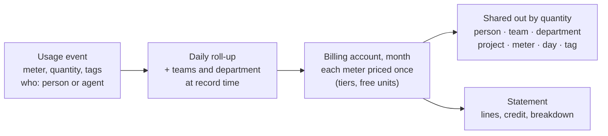
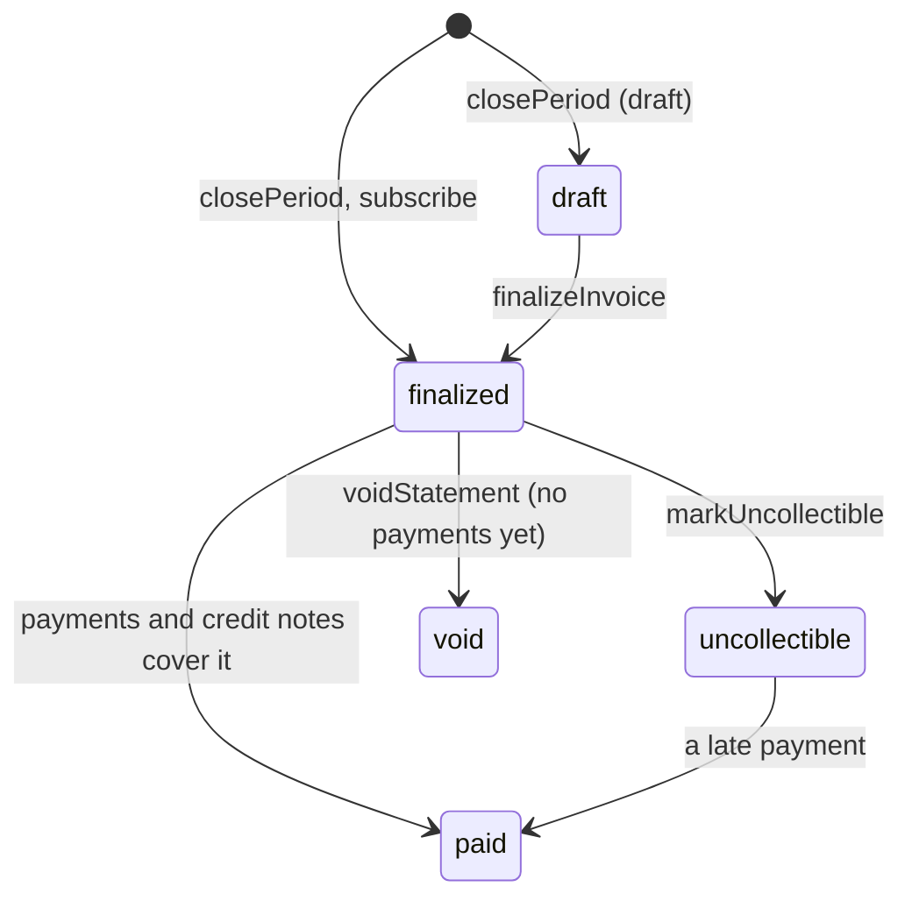

At the end of every month someone asks what the organization spent, and the next question is always who spent it.
The answer depends on things an IAM system already knows: which organization and project a request ran in, who made
it, which teams that person belongs to, which department they report into, and which agent acted for them. Billing
puts usage and money next to that directory, so finance sees the account's total, a team lead sees their team, a
department head sees their department, and everyone sees their own spend, and the numbers add up.

Everything lives in the `billing` API group (`client.billing.*` over HTTP) and the in-process runtime `iam.billing`
(recording usage and the scheduled jobs).

## Setup

Billing is always on. The `billing` server option only tunes it: currency, time zone, retention, team attribution,
and invoicing.

<Steps>
<Step>

### Configure the instance

Set the `billing` option, and `authentication.sendEmail` so budget alerts (`spend-alert`), spike alerts
(`spend-anomaly`), and payment reminders reach people.

```ts title="iam.ts"
import { betterIam } from 'better-iam';
import { sqliteAdapter } from 'better-iam/adapter-sqlite';
import { renderDeliveryMessage } from 'better-iam/auth/templates';
import { mailer } from './mailer';

export const iam = betterIam({
  database: sqliteAdapter({ filename: './iam.db' }),
  secret: process.env.BETTER_IAM_SECRET!,
  baseURL: process.env.BETTER_IAM_BASE_URL!,
  authentication: {
    sendEmail: async (message) => {
      const rendered = renderDeliveryMessage(message, { appName: 'Acme Cloud' });
      if (rendered) await mailer.send({ to: message.to, ...rendered });
    },
  },
  billing: {
    currency: 'EUR',
    timeZone: 'Europe/Berlin',
    teamAttribution: 'split',
    paymentTermsDays: 30,
    issuer: { name: 'Acme Cloud GmbH', taxId: 'DE123456789', email: 'billing@acme.test' },
  },
});
```

If you run the billing jobs with the CLI, put the same `billing` settings in `better-iam.config.mjs`, which the CLI
loads.

</Step>
<Step>

### Migrate

Meters, prices, usage, budgets, statements, plans, and subscriptions are stored in the shared `iam_records` table,
which the ordinary migration creates.

```bash
npx better-iam migrate --config better-iam.config.mjs
```

</Step>
<Step>

### Create the client

People read their own spend from the browser, and React apps use `useMySpend` and `useSpendCheck` inside `IamProvider`.

```ts title="lib/iam-client.ts"
import { createIamClient } from 'better-iam/client';
import type { iam } from './iam';

export const client = createIamClient<typeof iam>({ baseURL: 'https://app.acme.test' });
```

</Step>
<Step>

### Schedule the jobs

Budget alerts, seat recording, invoicing, reminders, and spike detection run as jobs. See
[Scheduled jobs](#scheduled-jobs).

```bash
npx better-iam billing-alerts --config better-iam.config.mjs   # hourly
npx better-iam billing-close --config better-iam.config.mjs    # daily
```

</Step>
</Steps>

## The model



- **Meters** name what is billed: API calls, seat-days, GB-days, CI builds, AI inference. The root tenant defines
  **platform meters** billed to every organization; an organization or project can define **chargeback meters** for
  its own subtree, which show in its spend but never on a platform statement.
- A **rate card** prices each meter: per unit, graduated or volume tiers, packages, a free allowance, and negotiated
  prices for individual organizations.
- A **billing account** is an organization, or a tenant below it with a billing profile of its own. Each meter's
  month total is priced once per account and then shared out to the usage that produced it by quantity (for
  active-user meters, equally per person), so every breakdown adds up to the account's charges.

## Usage

### Meters and prices

`billing.createMeter` and `billing.setPrice` (`iam:billing:manage`) define what is billed and its price. Price models are
`per-unit`, `graduated`, `volume`, and `package`.

```ts
await iam.api.billing.createMeter(root, {
  tenantId: rootTenantId,
  key: 'api-calls',
  name: 'API calls',
  unit: 'request',
});
await iam.api.billing.setPrice(root, {
  tenantId: rootTenantId,
  meter: 'api-calls',
  price: {
    model: 'graduated',
    includedQuantity: 10_000,
    tiers: [
      { upTo: 1_000_000, unitAmount: 0.0004 },
      { upTo: null, unitAmount: 0.0002 },
    ],
  },
});
// A negotiated price for one organization and its projects:
await iam.api.billing.setPrice(root, {
  tenantId: rootTenantId,
  meter: 'api-calls',
  targetTenantId: acmeId,
  price: { model: 'per-unit', unitAmount: 0.0003 },
});
```

**Route:** `POST /api/iam/billing/createMeter` (also `/billing/updateMeter`, `/billing/deleteMeter`,
`/billing/listMeters`, `/billing/setPrice`, `/billing/listPrices`)

| Setting                   | Meaning                                                                                |
| ------------------------- | -------------------------------------------------------------------------------------- |
| `aggregation: 'sum'`      | Quantities add up (default).                                                           |
| `aggregation: 'unique'`   | Distinct people and agents with usage in the month: active users or active seats.     |
| `pricing: 'rate-card'`    | Priced from the rate card (default).                                                   |
| `pricing: 'reported'`     | Every event carries its own cost, as AI inference and chargeback entries do.          |

Keys belong to the tenant nearest the root, so an organization can never redefine a platform meter, and `inference` is
a built-in platform meter. A price applies from `effectiveFrom` (a month) until a later entry, and the entry nearest
the billing account wins. Past months can be priced until they are invoiced (`BILLING_PERIOD_CLOSED` after). A meter
that has recorded usage cannot be deleted (`RESOURCE_IN_USE`); archive it instead, after which it accepts no usage
(`METER_ARCHIVED`).

### Recording usage

Server code records usage without a credential and without an audit event per call:

```ts
import { iam } from './iam';

await iam.billing.record({
  tenantId: projectId,
  meter: 'api-calls',
  quantity: 1,
  identityId: session.identity.id,
  tags: { endpoint: 'search' },
  idempotencyKey: requestId,
});
```

**Route:** `POST /api/iam/billing/record` (also `/billing/recordMany`)

Backends that only reach the HTTP API use `billing.record` or `billing.recordMany` with a service account holding
`iam:billing:record`. Each event is attributed when it is recorded: to the person, service account or agent, to the
teams they belong to directly (`teamId` overrides that), and to their department. An agent's usage counts toward its
sponsor's teams and department. Metered AI inference arrives by itself on the built-in `inference` meter, and
`iam.billing.recordSeats()` records one seat per active person each day for seat pricing. An idempotency key reused
for another meter is a `CONFLICT`, and usage for a month already invoiced is refused with `BILLING_PERIOD_CLOSED`.

### Reading spend

`billing.spend` and `billing.trend` (`iam:billing:read`) report spend for a tenant. Group by `meter`, `identity`,
`agent`, `team`, `department`, `tenant` (projects), `day`, or a tag. Filters narrow to a meter, a person, a team or
department (with those below it), or a project; the current month includes a linear forecast. People in several teams
count toward each in equal parts, unless the `billing` option `teamAttribution` says `primary` or `full`.

<Tabs items={['Server', 'Client', 'React']}>
<Tab value="Server">

```ts
const byTeam = await iam.api.billing.spend(admin, { tenantId, groupBy: 'team' });
const platformTeam = await iam.api.billing.spend(admin, { tenantId, teamId, groupBy: 'identity' });
const sixMonths = await iam.api.billing.trend(admin, { tenantId, months: 6 });
```

</Tab>
<Tab value="Client">

```ts
import { client } from './lib/iam-client';

// The signed-in person's own usage and their agents', with the budgets that cover them.
const mine = await client.billing.mySpend({ tenantId, groupBy: 'meter' });
```

</Tab>
<Tab value="React">

```tsx
import { useMySpend, useSpendCheck } from 'better-iam/react';

export function SpendBadge({ tenantId }: { tenantId: string }) {
  const { spend } = useMySpend({ tenantId });
  const { allowed, blockedBy } = useSpendCheck({ tenantId, meter: 'exports' });
  if (!allowed) return <p>Budget {blockedBy?.name} is spent.</p>;
  return spend ? <p>This month: {spend.total.amount} {spend.currency}</p> : null;
}
```

</Tab>
</Tabs>

**Route:** `POST /api/iam/billing/spend` (also `/billing/trend`, `/billing/mySpend`, `/billing/teamSpend`,
`/billing/departmentSpend`, `/billing/check`)

| Who               | Reads                                                   | Needs                      |
| ----------------- | ------------------------------------------------------- | -------------------------- |
| Billing managers  | `spend`, `trend`, budgets, credits, statements          | `iam:billing:read`         |
| Team maintainers  | `teamSpend` for their team and the teams below it       | maintaining the team       |
| Department heads  | `departmentSpend` for their department and those below  | heading the department     |
| Everyone          | `mySpend`: their own usage and their agents'            | a session of the tenant    |

The CLI prints the same report: `better-iam spend --tenant TENANT_ID --group-by team`.

### Budgets

```ts
await iam.api.billing.createBudget(admin, {
  tenantId,
  name: 'Platform team monthly',
  subjectType: 'team',
  subjectId: platformTeamId,
  amount: 600,
  thresholds: [50, 80, 100],
  notify: { emails: ['finance@acme.test'] },
  enforce: false,
});
```

**Route:** `POST /api/iam/billing/createBudget` (also `/billing/updateBudget`, `/billing/deleteBudget`,
`/billing/listBudgets`)

A budget covers a tenant subtree, a team with its sub-teams, a department with those below it, or one person, per
month, quarter or year. `iam.billing.checkBudgets()` alerts once per threshold and window, and when the projection
passes the budget: an audit event `billing:budget-alert` that webhooks can forward, and a `spend-alert` email to the
owners, the subject (the person, the team's maintainers, the department head) and any extra addresses. An enforced
budget refuses covered usage once it is spent (`SPEND_LIMIT_REACHED`, 402, for `record` with `enforceBudgets`), and
`billing.check` tells callers in advance.

[Inference budgets](/docs/features/inference) stay the hard, per-call caps on model tokens and cost; billing budgets
watch money across every meter.

### Spikes, showback and exports

Budgets catch spend that adds up; `billing.anomalies` catches spend that jumps: people, teams and meters whose spend
yesterday was at least three times their daily average over the 14 days before (and at least 10 in the deployment
currency; `factor`, `baselineDays`, and `minimum` change these), such as a looping pipeline, a leaked key, or an agent
retrying forever. `iam.billing.detectAnomalies()` runs daily and alerts once per spike (`billing:anomaly`, `spend-anomaly`
email). For showback, `shareUnattributed: true` spreads spend nobody in the dimension caused over the teams,
departments or people that did, by their share. `billing.exportSpend` and `billing.exportStatement` return CSV for
spreadsheets.

**Route:** `POST /api/iam/billing/anomalies` (also `/billing/exportSpend`, `/billing/exportStatement`)

### Profiles, credit and statements

A billing profile names who pays: company, billing emails, tax ID, address, purchase order, cost center and payment
terms. A profile on a project makes the project a billing account of its own, which is its parent's decision, so it is
created from the organization with `targetTenantId`. Root administrators grant credit to billing accounts
(`billing.grantCredit`) and set contract terms (`billing.setTerms`: discount, minimum commitment, tax rate).

```ts
await iam.api.billing.setProfile(orgAdmin, {
  tenantId: orgId,
  targetTenantId: projectId,
  companyName: 'Apollo Ltd',
  billingEmails: ['ap@apollo.test'],
});
```

**Route:** `POST /api/iam/billing/setProfile` (also `/billing/getProfile`, `/billing/deleteProfile`,
`/billing/grantCredit`, `/billing/setTerms`, `/billing/getTerms`)

`iam.billing.closePeriod()` issues last month's invoice for every billing account with something to bill: one line
per platform meter (with the tiers its quantity used), subscription fees and seats, pending invoice items, coupons,
credit applied earliest expiry first, tax, the total and due date, and a breakdown of usage by project, team,
department (with cost centers) and person. Invoices carry a content hash and bill whole cents, so their lines add up.
`billing.previewStatement` shows a billing account its invoice so far, and `listStatements` and `getStatement` read
issued ones.

### Invoicing

Invoices follow the lifecycle Stripe uses:



- **Drafts.** With `billing.autoFinalize: false` (or `closePeriod({ draft: true })`) monthly invoices stay drafts,
  recomputed on every run, until a root administrator finalizes them. Their month still takes late usage.
- **Invoice items** are one-off charges, or credits with a negative amount, for an account's next invoice
  (`createInvoiceItem`). When credits exceed the charges the rest becomes account credit.
- **Payments** (`recordPayment`) may be partial; an overpayment becomes credit. Payment processors report payments
  with `iam.billing.recordPayment({ number, amount, idempotencyKey })` from their webhooks.
- **Credit notes** (`createCreditNote`) reduce the amount due first; a part already paid becomes credit or is
  recorded as refunded. Invoices with payments or credit notes are corrected with credit notes, never voided.
- **Reminders.** `iam.billing.sendPaymentReminders()` emails billing contacts before and after the due date
  (`billing.paymentReminderDays`, default 3 days before, on the day, 7 and 14 days after).
- **Printable invoices.** `renderInvoice` returns a self-contained HTML page with the issuer from `billing.issuer`, to
  print or save as PDF.

**Route:** `POST /api/iam/billing/finalizeInvoice` (also `/billing/closePeriod`, `/billing/createInvoiceItem`,
`/billing/recordPayment`, `/billing/createCreditNote`, `/billing/markPaid`, `/billing/markUncollectible`,
`/billing/voidStatement`, `/billing/renderInvoice`)

### Plans, subscriptions and coupons

```ts
await iam.api.billing.createPlan(root, {
  tenantId: rootTenantId,
  key: 'team',
  name: 'Team',
  selfServe: true,
  trialDays: 14,
  items: [
    { id: 'platform', kind: 'fee', name: 'Platform fee', amount: 99 },
    { id: 'seats', kind: 'seat', name: 'Seats', unitAmount: 12, includedSeats: 3 },
    { id: 'calls', kind: 'usage', meter: 'api-calls', price: { model: 'per-unit', unitAmount: 0.0003 } },
  ],
});
await iam.api.billing.subscribe(orgAdmin, { tenantId: acmeId, plan: 'team', seats: 8 });
await iam.api.billing.redeemCoupon(orgAdmin, { tenantId: acmeId, code: 'LAUNCH20' });
```

**Route:** `POST /api/iam/billing/subscribe` (also `/billing/createPlan`, `/billing/updatePlan`, `/billing/listPlans`,
`/billing/changePlan`, `/billing/updateSubscription`, `/billing/cancelSubscription`, `/billing/resumeSubscription`,
`/billing/listSubscriptions`, `/billing/quote`, `/billing/createCoupon`, `/billing/deactivateCoupon`,
`/billing/listCoupons`, `/billing/redeemCoupon`, `/billing/listDiscounts`, `/billing/removeDiscount`)

Fees and seats are billed a month ahead (or in arrears per item), prorated when a subscription starts, changes seats,
changes plan or ends mid-month; a plan's usage items replace the rate card for its subscribers. Outside a trial the
first month is invoiced at once. Plans are created and changed on the root tenant by root administrators. Organizations
subscribe to self-serve plans and manage those subscriptions themselves (`iam:billing:manage`), and cancel them at the
end of the month; root administrators manage subscriptions to every plan, end subscriptions at once, and create coupons
(`percentOff` or `amountOff`, once, for some months, or forever).

A [license pool](/docs/features/licenses#add-capacity-with-pools) can name the subscription that paid for its seats
(`subscriptionId`); that is a reference only, and nothing is metered or prorated on the license side.

## Spend in policies

Budgets reach authorization too. Two context keys describe the budgets that cover the principal in the decision's
tenant (tenant budgets up the tree and, for a person of the tenant, their own, their teams', and their department's):

| Key                         | Type    | Meaning                                                |
| --------------------------- | ------- | ------------------------------------------------------ |
| `principal.spendExceeded`   | boolean | An **enforced** budget covering the principal is spent |
| `principal.budgetsExceeded` | list    | Names of every spent budget covering the principal     |

```json title="No exports once an enforced budget is spent"
{
  "effect": "deny",
  "actions": ["reports:export"],
  "resources": ["*"],
  "conditions": { "Bool": { "principal.spendExceeded": true } }
}
```

Decisions read budgets only when a policy names one of the keys, and standings are cached for up to 30 seconds. An
assumed role sees only the tenant's budgets.

## Scheduled jobs

| Job                                  | CLI                 | Schedule |
| ------------------------------------ | ------------------- | -------- |
| `iam.billing.checkBudgets()`         | `billing-alerts`    | hourly   |
| `iam.billing.recordSeats()`          | `billing-seats`     | daily    |
| `iam.billing.closePeriod()`          | `billing-close`     | daily    |
| `iam.billing.sendPaymentReminders()` | `billing-reminders` | daily    |
| `iam.billing.detectAnomalies()`      | `billing-anomalies` | daily    |

`billing-close --draft` keeps the month's invoices as drafts. See [Scheduled jobs](/docs/operations/jobs) for the other
jobs a deployment runs.

## Options

The `billing` option of `betterIam()`. A bad value fails construction with `INVALID_CONFIG`.

| Option | Type | Default | Description |
| --- | --- | --- | --- |
| `currency` | `string` | `'USD'` | ISO 4217 code every amount is stated in. |
| `timeZone` | `string` | `'UTC'` | IANA time zone that billing months and days follow. |
| `usageRetentionDays` | `number` | `400` | Days raw usage events are kept after their period ends; daily roll-ups and statements stay. |
| `teamAttribution` | `'split' \| 'primary' \| 'full'` | `'split'` | How a person's cost counts toward their teams: evenly across direct teams, all to the oldest team, or in full to each. |
| `paymentTermsDays` | `number` | `30` | Days after issue a statement is due when the billing profile sets no terms. |
| `statementPrefix` | `string` | `'INV'` | Statement numbers read `{prefix}-{YYYYMM}-{sequence}`. |
| `issuer` | `{ name, address?, taxId?, email?, url?, paymentInstructions? }` | product name only | Who issues the invoices, printed on every invoice. |
| `paymentReminderDays` | `number[]` | `[-3, 0, 7, 14]` | When payment reminders go out, in days relative to the due date; `[]` sends none. |
| `autoFinalize` | `boolean` | `true` | Whether `closePeriod` finalizes monthly invoices at once; `false` keeps drafts for review. |

## Permissions

| Action | Methods |
| --- | --- |
| `iam:billing:read` | Reports and listings: `spend`, `trend`, `quote`, `anomalies`, `accounts`, `listUsage`, `listMeters`, `listPrices`, `listBudgets`, `listCredits`, `listStatements`, `getStatement`, `previewStatement`, `renderInvoice`, `exportSpend`, `exportStatement`, `getProfile`, `getTerms`, `listPlans`, `listSubscriptions`, `listDiscounts`, `listInvoiceItems`, `listCreditNotes`; and `listCoupons` (root administrators only) |
| `iam:billing:manage` | Changes: meters and prices, budgets, profiles, subscriptions to self-serve plans, and coupon redemption. These also require a root administrator: `closePeriod`, `finalizeInvoice`, `recordPayment`, `markPaid`, `markUncollectible`, `voidStatement`, `createInvoiceItem`, `deleteInvoiceItem`, `createCreditNote`, `grantCredit`, `revokeCredit`, `setTerms`, `createPlan`, `updatePlan`, `createCoupon`, `deactivateCoupon`, `removeDiscount`, subscription changes to plans that are not self-serve, and cancelling a subscription immediately |
| `iam:billing:record` | `record`, `recordMany` over HTTP |
| Team maintainer or department head | `teamSpend`, `departmentSpend` |
| None | `mySpend` and `check` (a session of the tenant) |

Billing changes are audited as `billing:*` events, including `billing:budget-alert` and `billing:anomaly`.

## Schema

Records live in the shared `iam_records` table under these tenant-scoped collections. Money is stored in micros of the
deployment currency (`amountMicros`, `costMicros`).

| Collection | Holds | Key fields |
| --- | --- | --- |
| `billingMeters` | Meters the tenant defines | `key`, `name`, `unit`, `aggregation`, `pricing`, `archived` |
| `billingPrices` | Rate-card entries | `meterId`, `meter`, `definerId`, `effectiveFrom` (a month), `spec`, `note` |
| `billingUsage` | Raw usage events | `meterId`, `meter`, `quantity`, `costMicros`, `identityId`, `agentId`, `teamIds`, `departmentId`, `tags`, `occurredAt`, `period`, `day` |
| `billingRollups` | Daily roll-ups | `period`, `day`, `meterId`, `identityId`, `agentId`, `teamIds`, `departmentId`, `tags`, `quantity`, `costMicros`, `events` |
| `billingBudgets`, `billingBudgetAlerts` | Budgets and the alerts already sent | `name`, `subjectType`, `subjectId`, `amountMicros`, `period`, `meters`, `thresholds`, `forecastAlerts`, `notify`, `enforce` |
| `billingCredits` | Credit granted to an account | `amountMicros`, `remainingMicros`, `reason`, `expiresAt`, `grantedBy`, `revokedAt` |
| `billingProfiles`, `billingTerms` | Who pays, and contract terms | company, billing emails, tax ID, address, payment terms; discount, commitment, tax rate |
| `billingStatements` | Invoices | `number`, `status`, `issuedAt`, `dueAt`, `hash`, `payments`, `amountPaidMicros`, `creditNotesMicros`, `paidAt` |
| `billingInvoiceItems`, `billingCreditNotes` | One-off charges and credit notes | amount, description, the invoice they belong to |
| `billingPlans`, `billingSubscriptions` | Plans (on the root) and subscriptions | `key`, `items`, `trialDays`, `selfServe`; `planId`, `seats`, `startedAt`, `trialEndsAt`, `cancelAtPeriodEnd` |
| `billingCoupons`, `billingDiscounts` | Coupons (on the root) and redeemed discounts | `code`, `percentOff`, `amountOffMicros`, `duration`, `maxRedemptions`, `redemptions`, `active` |

A tenant defines at most 100 meters, 200 budgets, and 100 plans.

## Errors

| Code | Status | When |
| --- | --- | --- |
| [`BILLING_PERIOD_CLOSED`](/docs/reference/errors#billing_period_closed) | 409 | Usage, a price, or an invoice item for a month already invoiced for the account |
| [`METER_ARCHIVED`](/docs/reference/errors#meter_archived) | 409 | Usage on an archived meter |
| [`SPEND_LIMIT_REACHED`](/docs/reference/errors#spend_limit_reached) | 402 | `record({ enforceBudgets: true })` under a spent, enforced budget |
| [`CONFLICT`](/docs/reference/errors#conflict) | 409 | A meter, plan, budget, or coupon with that key or name exists; a built-in meter key; an idempotency key reused for another meter; the account already subscribes to the plan or redeemed the code |
| [`RESOURCE_IN_USE`](/docs/reference/errors#resource_in_use) | 409 | Deleting a meter that has recorded usage |
| [`LIMIT_EXCEEDED`](/docs/reference/errors#limit_exceeded) | 409 | More than 100 meters, 200 budgets, or 100 plans in a tenant |
| [`INVALID_TRANSITION`](/docs/reference/errors#invalid_transition) | 409 | An invoice or subscription operation that its current state does not allow, such as voiding an invoice that has payments or credit notes, or a draft |
| [`ACCESS_DENIED`](/docs/reference/errors#access_denied) | 403 | Missing permission, or reading spend with a credential of another tenant |
| [`NOT_FOUND`](/docs/reference/errors#not_found) | 404 | An unknown meter, budget, statement, plan, subscription, or coupon |
| [`INVALID_INPUT`](/docs/reference/errors#invalid_input) | 400 | A malformed key, amount, period, or price |
| [`INVALID_CONFIG`](/docs/reference/errors#invalid_config) | startup | A bad value in the `billing` option |

## In the console

- **Organization → Billing**: spend this month by person, team, department, project, meter or day, the six-month
  trend, budgets, invoices with the amount due, the subscription (seats, cancel, keep), self-serve plans, promotion
  codes, charges waiting for the next invoice, the meters and prices that apply, the billing profile, and chargeback
  meters. People without billing permissions see their own spend there.
- **Invoice** pages: lines with tier sub-lines, service periods and prorations, coupons, payments, credit notes,
  breakdowns, the integrity check, and "Print or save as PDF".
- **Administration → Billing** (root): accounts and what they owe, invoices (finalize, mark paid, write off, void),
  payments, credit notes, invoice items, plans, subscriptions, coupons, closing a month (optionally as drafts),
  contract terms, credit, and platform meters and prices.

## Next steps

<Cards>
  <Card title="Billing API" href="/docs/reference/api/billing">
    Every method, permission, and error of the billing group.
  </Card>
  <Card title="Teams and departments" href="/docs/features/teams-and-departments">
    The teams, maintainers and department heads that spend is attributed to.
  </Card>
  <Card title="API quotas" href="/docs/features/quotas">
    Throttle and cap calls; billing caps money.
  </Card>
  <Card title="Model access and budgets" href="/docs/features/inference">
    Model access, per-call token and cost caps, and the gateway that feeds the inference meter.
  </Card>
</Cards>
