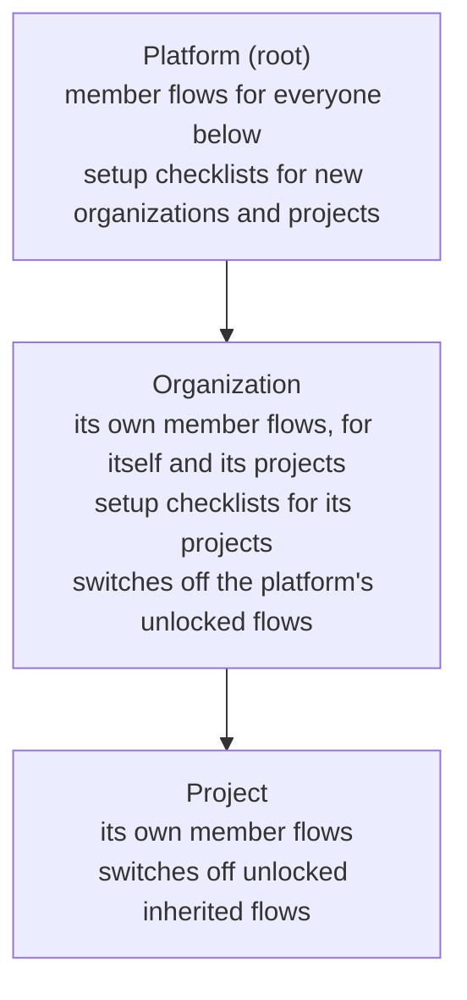

A new member's first day has a script: read the rules, fill in a profile, set up two-step verification, collect a
laptop. A new customer organization has one too: add a second owner, verify the email domain, require MFA, pass a
business verification. The platform wants the same basics everywhere, each organization adds its own, and a project
inside an organization adds a little more. Onboarding flows are those scripts, stored in Better IAM next to your
tenants, so the steps follow the tenant tree, completion shows up in reports, and a policy can hold access back until
the required steps are done.

There are two kinds of flow:

- **Member onboarding** (`audience: 'member'`) walks people who join a tenant through their first steps.
- **Tenant setup** (`audience: 'tenant'`) is a checklist for the administrators of new organizations or projects below
  the tenant that defines it.

Everything lives in the `onboarding` API group (`client.onboarding.*` over HTTP).

## Setup

Onboarding flows are always on. There is nothing to enable and no job to schedule.

<Callout type="info">
  The `onboarding` server option (`mode`, `invitationLifetimeMs`) is unrelated to onboarding flows: it controls how
  owner and member invitations work. See [Configuration](/docs/operations/deployment/configuration#tenancy-and-catalog).
</Callout>

<Steps>
<Step>

### Declare the attributes forms may fill

A form field can fill an identity attribute, such as the department a new member picks. The attribute must be declared.

```ts title="iam.ts"
import { betterIam } from 'better-iam';
import { sqliteAdapter } from 'better-iam/adapter-sqlite';

export const iam = betterIam({
  database: sqliteAdapter({ filename: './iam.db' }),
  secret: process.env.BETTER_IAM_SECRET!,
  baseURL: process.env.BETTER_IAM_BASE_URL!,
  permissions: {
    identityAttributes: { department: 'string' },
  },
});
```

</Step>
<Step>

### Migrate

Flows, settings, and progress are stored in the shared `iam_records` table, which the ordinary migration creates.

```bash
npx better-iam migrate --config better-iam.config.mjs
```

</Step>
<Step>

### Create the client

People work through their own checklist from the browser.

```ts title="lib/iam-client.ts"
import { createIamClient } from 'better-iam/client';
import type { iam } from './iam';

export const client = createIamClient<typeof iam>({ baseURL: 'https://app.acme.test' });
```

</Step>
</Steps>

## Levels

Flows are defined at any level of the tenant tree and inherited downward:



A flow's `appliesTo` decides whom it reaches: `tenant` (the defining tenant's own people), `descendants` (the people of
the tenants below it) or `subtree` (both). It defaults to `descendants` at the platform root and `tenant` elsewhere.
`tenantTypes` narrows the tenants below to some types, such as `['project']`. A person sees the flows of every level at
once, platform first.

Flows ask only people (or tenants) created after the flow took effect, so publishing a flow never interrupts everyone
at once. `includeExisting: true` asks existing ones too.

## Steps

A flow has 1 to 25 steps. Each has a stable `id`, because progress is kept per step:

| Kind           | Who      | Completes when                                                                                             |
| -------------- | -------- | ---------------------------------------------------------------------------------------------------------- |
| `form`         | both     | The answers are submitted (text, textarea, email, URL, number, yes/no, select, and date fields).          |
| `acknowledge`  | both     | The reader confirms the text.                                                                              |
| `task`         | both     | Marked done, or approved by an administrator (`verification: 'admin'`).                                   |
| `agreement`    | member   | The person accepts the named terms of use of their own tenant. Skipped where the tenant has none.          |
| `verify-email` | member   | The email address is verified.                                                                             |
| `mfa`          | member   | An authenticator app or a passkey is enrolled.                                                             |
| `passkey`      | member   | A passkey is registered.                                                                                   |
| `check`        | tenant   | The tenant's own state meets it: a verified domain, enough members or owners, an MFA policy, and more.     |

`check` steps name one of `verified-domain`, `members`, `owners`, `mfa-policy`, `agreement`, `slug`, `sso`,
`directory-sync`, or `member-onboarding`, with `minimum` for the counting checks. `optional: true` steps never hold a
flow back. Steps that complete on their own follow the live state: removing the last passkey reopens a `passkey` step.

Step states are `pending`, `complete`, `submitted` (an administrator-verified task waiting for review), `rejected` (sent
back, with the reviewer's `note`), and `unavailable` (an agreement the tenant has not published).

## Usage

### Define a flow

`onboarding.createFlow` (`iam:onboarding:manage`) defines a flow in the tenant you name. `updateFlow` changes any field
but the audience (changing the steps bumps `version`), and `deleteFlow` removes the flow with everyone's progress
through it, in every tenant it reached. `listFlows` and `getFlow` (`iam:onboarding:read`) read them back.

```ts
// The platform: every member of every organization and project reads the rules.
await iam.api.onboarding.createFlow(rootSession, {
  tenantId: rootTenantId,
  name: 'Platform essentials',
  audience: 'member',
  locked: true,
  steps: [
    { id: 'conduct', kind: 'acknowledge', title: 'Acceptable use', content: 'Use the service lawfully.' },
    { id: 'mfa', kind: 'mfa', title: 'Set up two-step verification' },
  ],
});

// The platform: every new organization completes a setup checklist the platform reviews.
await iam.api.onboarding.createFlow(rootSession, {
  tenantId: rootTenantId,
  name: 'Organization setup',
  audience: 'tenant',
  tenantTypes: ['organization'],
  steps: [
    { id: 'owners', kind: 'check', title: 'Add a second owner', check: 'owners', minimum: 2 },
    { id: 'domain', kind: 'check', title: 'Verify your email domain', check: 'verified-domain' },
    { id: 'kyc', kind: 'task', title: 'Business verification', verification: 'admin' },
  ],
});

// An organization: its engineers collect a laptop and then join a group.
await iam.api.onboarding.createFlow(acmeAdmin, {
  tenantId: acmeId,
  name: 'Engineering onboarding',
  audience: 'member',
  rule: { include: [{ StringEquals: { 'principal.department': 'Engineering' } }] },
  completionGroupIds: [engineersGroupId],
  steps: [{ id: 'laptop', kind: 'task', title: 'Collect your laptop', verification: 'admin' }],
});
```

**Route:** `POST /api/iam/onboarding/createFlow` (also `/onboarding/updateFlow`, `/onboarding/deleteFlow`,
`/onboarding/listFlows`, `/onboarding/getFlow`)

`rule` targets a member flow with the [automatic assignment](/docs/features/privileged-access/automatic-assignment) rule
language, and `completionGroupIds` adds people to groups when they finish, which needs the same rights as adding them
by hand.

### Fill attributes from answers

A form field with `attribute` fills a declared identity attribute, so the department a new member picks can drive
targeting rules, access packages, and policies. Onboarding fills only **empty** attributes, never overwriting a value
an administrator or directory sync set, and only for the **defining tenant's own people**: a tenant has no authority
over the identities of the tenants below it, so a flow that reaches only descendants cannot map fields at all. Mapping
fields needs `iam:identities:update` when the flow is saved.

```ts
await iam.api.onboarding.createFlow(acmeAdmin, {
  tenantId: acmeId,
  name: 'Acme profile',
  audience: 'member',
  steps: [
    {
      id: 'team',
      kind: 'form',
      title: 'Your team',
      fields: [
        {
          name: 'department',
          label: 'Department',
          type: 'select',
          options: ['Engineering', 'Sales'],
          required: true,
          attribute: 'department',
        },
      ],
    },
  ],
});
```

**Route:** `POST /api/iam/onboarding/createFlow`

### Customize what a tenant inherits

Each tenant customizes what it inherits with `onboarding.setSettings` (`iam:onboarding:manage`, replace semantics):

- **Switching flows off.** `disabledFlowIds` turns inherited member flows off for the tenant and everything below it.
  A flow defined with `locked: true` cannot be switched off (`INVALID_INPUT`). Setup checklists from above always
  apply.
- **The welcome screen.** `welcomeTitle`, `welcomeMessage`, `supportEmail`, and `supportUrl`: for each value, the
  nearest level that set it wins. The platform sets defaults, an organization overrides the message, and a project
  overrides only the title.

`onboarding.effective` (`iam:onboarding:read`) shows everything as the tenant sees it: the levels, every member flow
that reaches its people with where it comes from and whether it is switched off, the setup checklists it is asked to
complete, its own flows, and the settings with the level each value comes from.

```ts
await iam.api.onboarding.setSettings(acmeAdmin, {
  tenantId: acmeId,
  welcomeMessage: 'Welcome to Acme. These steps take about ten minutes.',
  supportEmail: 'it@acme.test',
  disabledFlowIds: [],
});
const view = await iam.api.onboarding.effective(acmeAdmin, { tenantId: acmeId });
```

**Route:** `POST /api/iam/onboarding/setSettings` (also `/onboarding/effective`)

### Work through member onboarding

People work through their own flows without any permission, from an ordinary session of their tenant. Impersonating
administrators can look but never complete steps (`IMPERSONATION_RESTRICTED`), and service accounts are never onboarded.

<Tabs items={['Server', 'Client']}>
<Tab value="Server">

```ts
const mine = await iam.api.onboarding.mine(session, { tenantId });
// { tenant, welcome, flows: [{ name, source, required, steps, done, total, complete }], pending, complete }

await iam.api.onboarding.submitStep(session, { tenantId, flowId, stepId: 'conduct', acknowledged: true });
```

</Tab>
<Tab value="Client">

```ts
import { client } from './lib/iam-client';

const mine = await client.onboarding.mine({ tenantId });
await client.onboarding.submitStep({ tenantId, flowId, stepId: 'conduct', acknowledged: true });
const { attributesFilled } = await client.onboarding.submitStep({
  tenantId,
  flowId,
  stepId: 'team',
  answers: { department: 'Engineering' },
});
```

</Tab>
</Tabs>

**Route:** `POST /api/iam/onboarding/mine` (also `/onboarding/submitStep`)

A flow is recorded as complete (`onboarding:complete`) the first time it is seen complete in its current version, and
its completion groups are applied then.

### Complete tenant setup

Tenant setup is completed by the tenant's administrators: `onboarding.setup` (`iam:onboarding:read`) lists the
checklists with the state of every step, and `onboarding.submitSetupStep` (`iam:onboarding:manage`) completes forms,
acknowledgements, and tasks. `check` steps complete by themselves when the tenant's state meets them.

```ts
const checklists = await iam.api.onboarding.setup(acmeAdmin, { tenantId: acmeId });
await iam.api.onboarding.submitSetupStep(acmeAdmin, {
  tenantId: acmeId,
  flowId: setupFlowId,
  stepId: 'kyc',
});
```

**Route:** `POST /api/iam/onboarding/setup` (also `/onboarding/submitSetupStep`)

### Follow, verify, and reset progress

The tenant that defines a flow follows progress with `onboarding.progress` (`iam:onboarding:read`): its own people with
their answers, and per-tenant counts for the tenants below (never names). Setup reports list every tenant being set up
with its answers. `onboarding.memberProgress` returns one person's flows and answers.

`onboarding.verifyStep` (`iam:onboarding:manage`) approves or sends back an administrator-verified task, and
`onboarding.resetProgress` (`iam:onboarding:manage`) starts a flow or one step over. People cannot verify their own
onboarding.

```ts
const report = await iam.api.onboarding.progress(acmeAdmin, { tenantId: acmeId, flowId });
await iam.api.onboarding.verifyStep(acmeAdmin, {
  tenantId: acmeId,
  flowId,
  subjectId: newHireId,
  stepId: 'laptop',
  approve: true,
});
await iam.api.onboarding.resetProgress(acmeAdmin, { tenantId: acmeId, flowId, subjectId: newHireId });
```

**Route:** `POST /api/iam/onboarding/progress` (also `/onboarding/memberProgress`, `/onboarding/verifyStep`,
`/onboarding/resetProgress`)

## Onboarding in policies

Decisions for a person in their own tenant can see `principal.onboarding` (the names of the member flows they have
completed) and `principal.pendingOnboarding` (how many required flows are still open, a number). A deny statement holds access back until
onboarding is done:

```json title="No documents until onboarding is done"
{
  "effect": "deny",
  "actions": ["documents:*"],
  "resources": ["*"],
  "conditions": { "NumericGreaterThan": { "principal.pendingOnboarding": 0 } }
}
```

`{ "ArrayContains": { "principal.onboarding": "Security basics" } }` grants something only to people who finished one
flow. The server reads these keys only for decisions whose documents name them, so policies that do not use them pay
nothing. Finishing onboarding never depends on them: accepting terms, verifying an email address, and enrolling MFA use
their own APIs, so nobody is locked out of the steps that would let them in.

## Options

There is no server option for onboarding flows. Each flow carries its settings:

| Option | Type | Default | Description |
| --- | --- | --- | --- |
| `name` | `string` | required | Unique per tenant (`CONFLICT`). |
| `audience` | `'member' \| 'tenant'` | required | Member onboarding or tenant setup. Fixed once created. |
| `appliesTo` | `'tenant' \| 'descendants' \| 'subtree'` | `'descendants'` at the root, `'tenant'` elsewhere | Whose people a member flow reaches. Tenant flows always reach descendants. |
| `tenantTypes` | `string[]` | all types | Only descendant tenants of these types. |
| `rule` | `{ include, exclude? }` | none | Member flows: only people the rule matches. |
| `required` | `boolean` | `true` | Counts toward `principal.pendingOnboarding` until complete. |
| `locked` | `boolean` | `false` | Tenants below cannot switch the flow off. |
| `includeExisting` | `boolean` | `false` | Also ask people or tenants that existed before the flow took effect. |
| `enabled` | `boolean` | `true` | Paused flows ask nobody. |
| `completionGroupIds` | `string[]` | none | Groups a person joins on completion (at most 10). |
| `steps` | `OnboardingStep[]` | required | 1 to 25 steps with stable IDs. |

Tenant settings (`onboarding.setSettings`): `welcomeTitle`, `welcomeMessage`, `supportEmail`, `supportUrl`, and
`disabledFlowIds`.

## Permissions

| Action | Methods |
| --- | --- |
| `iam:onboarding:manage` | `createFlow`, `updateFlow`, `deleteFlow`, `setSettings`, `submitSetupStep`, `verifyStep`, `resetProgress` |
| `iam:onboarding:read` | `listFlows`, `getFlow`, `effective`, `setup`, `progress`, `memberProgress` |
| `iam:identities:update` | Saving a flow whose form fields fill attributes |
| None | `mine` and `submitStep` (the person's own session) |

Audit events: `onboarding:step`, `onboarding:complete`, `onboarding:verify`, `onboarding:reject`, `onboarding:reset`,
`onboarding:groups` (completion groups applied), and `onboarding:groups-skipped` (completion groups the flow's owner
can no longer add people to). Flow and settings changes are recorded as `iam:onboarding:manage`
operations.

## Schema

Records live in the `iam_records` table under these tenant-scoped collections. Deleting a person removes their
progress (it holds their answers); purging a tenant removes its flows, settings, and progress.

| Collection | Holds | Key fields |
| --- | --- | --- |
| `onboardingFlows` | A flow the tenant defines | `name`, `description`, `audience`, `appliesTo`, `tenantTypes`, `rule`, `required`, `locked`, `includeExisting`, `enabled`, `effectiveFrom`, `steps`, `completionGroupIds`, `groupsOwnerId`, `version`, `authorId`, `createdAt`, `updatedAt` |
| `onboardingSettings` | The tenant's welcome screen and switched-off flows | `welcomeTitle`, `welcomeMessage`, `supportEmail`, `supportUrl`, `disabledFlowIds` |
| `onboardingProgress` | One person's or tenant's progress through one flow | `flowId`, `flowTenantId`, `subjectType` (`identity` or `tenant`), `subjectId`, `steps` (with `answers`), `startedAt`, `updatedAt`, `completedAt`, `completedVersion`, `groupsAppliedVersion`, `completionError` |

A tenant defines at most 50 flows.

## Errors

| Code | Status | When |
| --- | --- | --- |
| [`INVALID_INPUT`](/docs/reference/errors#invalid_input) | 400 | A malformed flow or step, switching off a locked flow, or answers that do not fit the form |
| [`NOT_FOUND`](/docs/reference/errors#not_found) | 404 | An unknown flow or step, or a flow that does not reach the caller |
| [`CONFLICT`](/docs/reference/errors#conflict) | 409 | A flow with the same name exists in the tenant |
| [`LIMIT_EXCEEDED`](/docs/reference/errors#limit_exceeded) | 409 | More than 50 flows in a tenant |
| [`ACCESS_DENIED`](/docs/reference/errors#access_denied) | 403 | Completing onboarding from anything but an ordinary session of the tenant, or missing rights for completion groups |
| [`IMPERSONATION_RESTRICTED`](/docs/reference/errors#impersonation_restricted) | 403 | Completing a step while impersonating |
| [`TEAM_MANAGED`](/docs/reference/errors#team_managed) | 409 | A completion group is a team's backing group |

## In the console

- **Administration → Onboarding** (root): platform flows, the platform welcome screen, and progress reports, including
  every organization's setup answers with **Approve** and **Send back** for verified tasks.
- **Organization → Onboarding**, in an organization or a project: the levels, the welcome screen and switched-off
  inherited flows, the flows inherited from above, the tenant's own flows, and a builder with templates.
- **Get started**: the signed-in person's checklist. A banner links to it while required steps are open.
- **Organization → Setup checklist**, and a **Finish setting up** card on the overview.

## Next steps

<Cards>
  <Card title="Onboarding API" href="/docs/reference/api/onboarding">
    Every method, permission, and error of the onboarding group.
  </Card>
  <Card title="Terms of use" href="/docs/features/governance/agreements">
    Versioned agreements that onboarding steps and policies can require.
  </Card>
  <Card title="Conditions" href="/docs/authorization/conditions">
    The operators and context keys policies can test, including principal.pendingOnboarding.
  </Card>
</Cards>
