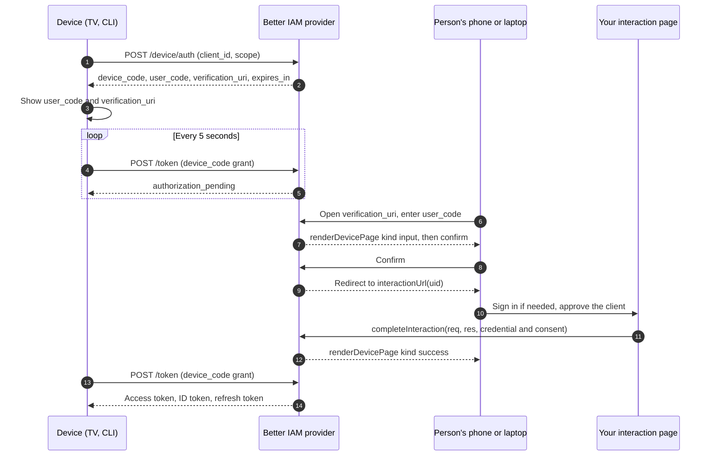

import { KeyRound, Server, LogIn } from '@/lib/icons';

The **device authorization grant** (RFC 8628) signs a person in on a device that has no browser or no usable
keyboard: a smart TV app, a command-line tool on a remote server, a kiosk, a set-top box. The device asks the
[OAuth/OIDC provider](/docs/federation/oauth-provider) for a short code, shows it with a URL, and waits. The person
opens that URL on their phone or laptop, signs in to Better IAM there, enters the code, and approves the device.
The device then receives the same access, ID, and refresh tokens a browser app would.

Use it when typing a password on the device is impractical or unsafe. When the device has a browser, use the
[authorization code flow](/docs/federation/oauth-provider#authorization-code-flow) instead: it is shorter and
needs no polling.

Device authorization is part of `createOAuthProvider` and is always enabled. A client may use it only when it is
registered with the `urn:ietf:params:oauth:grant-type:device_code` grant type.

## How it works



The person approves on their own device, with their own Better IAM session, so passwords, passkeys, single
sign-on, and MFA all work unchanged. The grant is bound to that IAM session like every other consent: signing out
or being deactivated ends the device's tokens too.

## Setup

<Steps>
<Step>

### Configure the device pages

`renderDevicePage` is a required option of `createOAuthProvider`. The provider generates the HTML forms of the
verification flow (with their CSRF fields) and calls `renderDevicePage` to wrap each one in your page. It is called
with one of three `kind` values:

| `kind` | When | Extra fields |
| --- | --- | --- |
| `input` | The person opened the verification URL and must type the code. | none |
| `confirm` | The code was found and the person must approve this device. | `userCode`, `clientName` |
| `success` | The device was approved. `form` is an empty string. | none |

```ts title="oauth.ts"
import { createOAuthProvider } from 'better-iam/oauth';
import { iam } from './iam';

const keys = JSON.parse(process.env.OIDC_KEYS!); // { jwks, cookieKeys, encryptionKey } from your secret store

const escape = (value: string) =>
  value.replace(/[&<>"']/g, (c) => ({ '&': '&amp;', '<': '&lt;', '>': '&gt;', '"': '&quot;', "'": '&#39;' })[c]!);

function page(title: string, body: string) {
  return `<!doctype html><html lang="en"><head><meta charset="utf-8"><title>${escape(title)}</title></head><body><main><h1>${escape(title)}</h1>${body}</main></body></html>`;
}

export const issuer = createOAuthProvider({
  ...iam.protocolHost,
  issuer: 'https://identity.example/oidc',
  jwks: keys.jwks,
  cookieKeys: keys.cookieKeys,
  encryptionKey: keys.encryptionKey,
  trustedOrigins: ['https://identity.example'],
  interactionUrl: (uid) => `https://identity.example/interactions/${uid}`,
  renderDevicePage: ({ kind, form, userCode, clientName }) =>
    page(
      'Connect a device',
      kind === 'success'
        ? '<p>Device connected. You can return to your device.</p>'
        : kind === 'input'
          ? `<p>Enter the code shown on your device.</p>${form}`
          : `<p>Allow ${escape(clientName ?? 'this application')} with code ${escape(userCode ?? '')}?</p>${form}`,
    ),
  renderLogoutPage: ({ form }) => page('Sign out', form),
});
iam.useProtocol(issuer);
```

Embed `form` unchanged: it carries the fields the provider checks. Escape `clientName` and `userCode`, because a
client name is set by whoever registered the client.

</Step>
<Step>

### Build the interaction page

After the person confirms the code, the provider sends the browser to `interactionUrl(uid)`, the same sign-in and
consent page the authorization code flow uses. If you already serve one, there is nothing more to build. Otherwise
follow [Build the interaction pages](/docs/federation/oauth-provider#build-the-interaction-pages): call
`issuer.interactionDetails(req, res)` on `GET` and `issuer.completeInteraction(req, res, { credential, consent })`
on `POST`.

</Step>
<Step>

### Serve the provider from a Node server

The provider needs Node's request and response objects. `iam.nodeHandler(req, res)` serves every route under the
issuer path, including the device routes:

```ts title="server.ts"
import { createServer } from 'node:http';
import { iam } from './iam';
import './oauth'; // registers the provider with iam.useProtocol

createServer((req, res) => void iam.nodeHandler(req, res)).listen(3000);
```

See [Protocol mounts](/docs/operations/deployment/protocol-mounts) for frameworks and reverse proxies.

</Step>
<Step>

### Register a device client

Register the device application with the device code grant. A TV or CLI cannot keep a secret, so register it as a
public client with no redirect URIs. Add `refresh_token` so the device stays signed in:

```ts title="scripts/register-tv.ts"
import { issuer } from '../oauth';

await issuer.registerClient(adminCredential, {
  tenantId: 'acme',
  clientId: 'reports-tv',
  name: 'Reports for TV',
  public: true,
  redirectUris: [],
  grantTypes: ['urn:ietf:params:oauth:grant-type:device_code', 'refresh_token'],
  scopes: ['openid', 'profile', 'offline_access', 'reports:read'],
});
```

`registerClient` requires `iam:oauth:clients:create`. `adminCredential` is the administrator's IAM credential, such
as `{ headers: request.headers }`. Leave `authorization_code` out of `grantTypes`: an authorization code client
must have a redirect URI, and a device client has none. A confidential client (with a secret or `private_key_jwt`)
may also use the device grant; it then authenticates at the device authorization endpoint and at the token endpoint.

</Step>
</Steps>

## Usage

The device side is plain HTTP. These examples use `fetch` and work in Node 22 and later. Read the endpoint URLs from
discovery rather than building them by hand.

### Discover the endpoints

```ts title="cli/discover.ts"
const issuerUrl = 'https://identity.example/oidc';

export async function discover() {
  const response = await fetch(`${issuerUrl}/.well-known/openid-configuration`);
  if (!response.ok) throw new Error(`Discovery failed: ${response.status}`);
  const metadata = (await response.json()) as {
    device_authorization_endpoint: string;
    token_endpoint: string;
  };
  return metadata;
}
```

### Start a device authorization

The device posts its `client_id` and the scopes it wants to the device authorization endpoint. Add `resource` to
get an access token for one of your [resource servers](/docs/federation/oauth-resource-servers).

```ts title="cli/start.ts"
import { discover } from './discover';

export async function startDeviceLogin() {
  const { device_authorization_endpoint } = await discover();
  const response = await fetch(device_authorization_endpoint, {
    method: 'POST',
    headers: { 'content-type': 'application/x-www-form-urlencoded' },
    body: new URLSearchParams({
      client_id: 'reports-tv',
      scope: 'openid profile offline_access reports:read',
    }),
  });
  if (!response.ok) throw new Error(`Device authorization failed: ${response.status}`);
  return (await response.json()) as {
    device_code: string;
    user_code: string;
    verification_uri: string;
    verification_uri_complete: string;
    expires_in: number;
  };
}
```

**Endpoint:** `POST {issuer}/device/auth`

| Response field | Meaning |
| --- | --- |
| `device_code` | The secret the device polls with. Never show it. |
| `user_code` | The short code the person types, such as `WDJB-MJHT`. Show it on screen. |
| `verification_uri` | Where the person goes: `{issuer}/device`. Show it on screen. |
| `verification_uri_complete` | The same URL with the code filled in. Render it as a QR code so phones skip typing. |
| `expires_in` | Seconds until the codes expire: 600 (10 minutes). |

The response has no `interval` field, so poll every 5 seconds, the RFC 8628 default.

### Show the code

Display `user_code` and `verification_uri`, for example "Go to identity.example/oidc/device and enter WDJB-MJHT".
The person can type the code with or without the dash and in any letter case; the provider normalizes it.

### Poll for tokens

While the person approves, the device polls the token endpoint with the device code grant:

```ts title="cli/poll.ts"
import { discover } from './discover';

const DEVICE_GRANT = 'urn:ietf:params:oauth:grant-type:device_code';

export async function pollForTokens(deviceCode: string, expiresIn: number) {
  const { token_endpoint } = await discover();
  const deadline = Date.now() + expiresIn * 1000;
  let interval = 5;
  while (Date.now() < deadline) {
    await new Promise((resolve) => setTimeout(resolve, interval * 1000));
    const response = await fetch(token_endpoint, {
      method: 'POST',
      headers: { 'content-type': 'application/x-www-form-urlencoded' },
      body: new URLSearchParams({ grant_type: DEVICE_GRANT, device_code: deviceCode, client_id: 'reports-tv' }),
    });
    const body = (await response.json()) as Record<string, string>;
    if (response.ok) return body; // access_token, id_token, refresh_token, expires_in, scope
    if (body.error === 'authorization_pending') continue;
    if (body.error === 'slow_down') {
      interval += 5; // RFC 8628: back off when asked
      continue;
    }
    throw new Error(`Device sign-in failed: ${body.error}`); // access_denied, expired_token, invalid_grant
  }
  throw new Error('Device sign-in expired');
}
```

**Endpoint:** `POST {issuer}/token` with `grant_type=urn:ietf:params:oauth:grant-type:device_code`

| `error` | Meaning | What the device does |
| --- | --- | --- |
| `authorization_pending` | The person has not approved yet. | Keep polling. |
| `access_denied` | The person cancelled on the confirm screen or declined consent. | Stop and say so. |
| `expired_token` | The device code is older than 10 minutes. | Start again. |
| `invalid_grant` | The code was already redeemed, or is unknown. | Start again. |

A device code is redeemed once. The token response is the standard one; `refresh_token` is present when the
client is registered for the `refresh_token` grant and the request included `offline_access`.

### Approve on another device

The person opens `verification_uri` (or `verification_uri_complete`). The provider then:

1. Shows your page with `kind: 'input'` (skipped when the URL carries the code).
2. Looks the code up and shows `kind: 'confirm'` with `userCode` and `clientName`, so the person can check that the
   code matches their screen. Cancelling marks the device code `access_denied`.
3. Sends the browser to your interaction page. The person signs in to the client's tenant if needed and approves
   the requested scopes; your page calls `completeInteraction`.
4. Shows `kind: 'success'`. The device's next poll receives the tokens.

A code that is unknown, expired, or already used does not reach the confirm step.

### Use and refresh the tokens

Device tokens are ordinary provider tokens: call your API with the access token, verify it there with
[`createAccessTokenVerifier`](/docs/federation/oauth-resource-servers#verify-tokens-in-your-api), and refresh with
`grant_type=refresh_token`. Refresh tokens rotate on every use. A client registered with `requireDpop` must send a
DPoP proof when it polls, and receives key-bound tokens ([DPoP](/docs/federation/oauth-resource-servers#dpop)).

## Endpoints

Paths are relative to the issuer URL. With an issuer of `https://identity.example/oidc`, the device authorization
endpoint is `https://identity.example/oidc/device/auth`.

| Endpoint | Path | Discovery field | Used by |
| --- | --- | --- | --- |
| Device authorization | `POST /device/auth` | `device_authorization_endpoint` | The device, to get the codes. |
| Verification page | `GET` and `POST /device` | `verification_uri` in the device response | The person's browser. |
| Token | `POST /token` | `token_endpoint` | The device, to poll and to refresh. |
| Discovery | `GET /.well-known/openid-configuration` | | The device, to find the others. |

## Options

Device authorization has no switch of its own. These provider and client settings shape it:

| Option | Type | Default | Description |
| --- | --- | --- | --- |
| `renderDevicePage` | `({ kind, form, userCode?, clientName? }) => string \| Promise<string>` | required | Wraps the provider's device forms in your page. `kind` is `input`, `confirm`, or `success`. |
| `interactionUrl` | `(uid: string) => string` | required | Your sign-in and consent page, shared with the authorization code flow. |
| `grantTypes` (client) | `OAuthGrantType[]` | `authorization_code, refresh_token` | Must include `urn:ietf:params:oauth:grant-type:device_code`. Add `refresh_token` for refresh tokens. |
| `public` (client) | `boolean` | `false` | `true` for devices that cannot keep a secret. |
| `scopes` (client) | `string[]` | `openid email profile offline_access` | The most the device may request. |
| `resources` (client) | `string[]` | none | APIs the device may request audience-restricted tokens for. |
| `requireDpop` (client) | `boolean` | `false` | Issue only DPoP-bound tokens to the device. |
| `refreshTokenTtl` (client) | `number` | 30 days | Refresh token lifetime in seconds, 300 to 30 days. |

Fixed lifetimes: device codes and interactions last 10 minutes, access tokens 15 minutes (or the shorter of the
resource server's and the client's `accessTokenTtl`), and the consent 30 days from the last approval.

## Schema

Device codes are provider artifacts in the `oauthArtifacts` collection, like authorization codes. Each is
encrypted with the provider's `encryptionKey`, bound to the client's tenant, and indexed by a SHA-256 hash of its
user code (`userCodeHash`), so neither code is stored in readable form. Consents land in `oauthGrantSessions`,
which binds each grant to the IAM session that approved it.

## Errors

The device endpoints answer with standard OAuth errors (the table under [Poll for tokens](#poll-for-tokens)).
Better IAM errors come from the server-side calls:

| Code | Status | Thrown by | When |
| --- | --- | --- | --- |
| [`INVALID_INPUT`](/docs/reference/errors#invalid_input) | 400 | `registerClient` | Unsupported grant types, a public client with `client_credentials` or token exchange, or `authorization_code` without a redirect URI. |
| [`CONFLICT`](/docs/reference/errors#conflict) | 409 | `registerClient` | The client ID already exists. |
| [`CSRF`](/docs/reference/errors#csrf) | 403 | `completeInteraction` | The approval was not a `POST` from one of `trustedOrigins`. |
| [`INVALID_SESSION`](/docs/reference/errors#invalid_session) | 403 | `completeInteraction` | The credential is not a person's session. |
| [`TENANT_MISMATCH`](/docs/reference/errors#tenant_mismatch) | 403 | `completeInteraction` | The person is signed in to a different tenant than the client's. |
| [`IMPERSONATION_RESTRICTED`](/docs/reference/errors#impersonation_restricted) | 403 | `completeInteraction` | An administrator impersonating the person tried to approve. |
| [`LOGIN_REQUIRED`](/docs/reference/errors#login_required) | 401 | `completeInteraction` | The request asked for a fresh sign-in (`prompt=login` or `max_age`) and the session's sign-in is older. |
| [`OAUTH_CLIENT`](/docs/reference/errors#oauth_client) | 404 | `interactionDetails`, `completeInteraction` | The client was revoked or its tenant is inactive. |

## Related

<Cards>
  <Card icon={<KeyRound />} title="OAuth/OIDC provider" href="/docs/federation/oauth-provider">
    Provider setup, clients, consent, token lifetimes, and back-channel logout.
  </Card>
  <Card icon={<Server />} title="Resource servers and tokens" href="/docs/federation/oauth-resource-servers">
    Verify device tokens in your API and bind them to keys with DPoP.
  </Card>
  <Card icon={<LogIn />} title="Sessions" href="/docs/authentication/sessions">
    The IAM sessions device grants are bound to.
  </Card>
</Cards>
