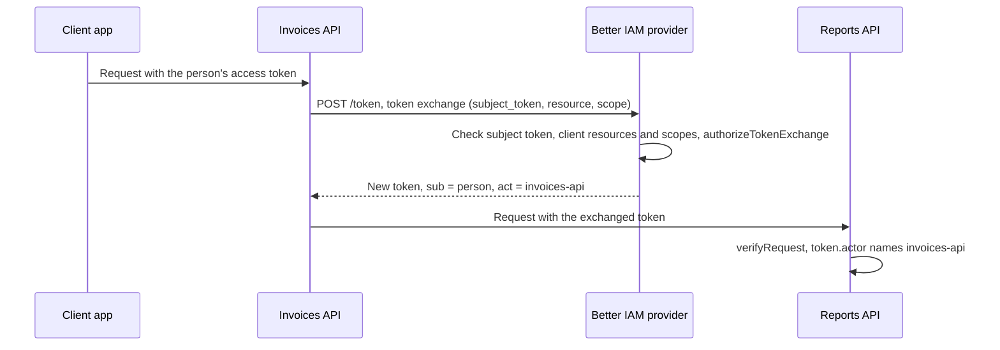

import { KeyRound, Server, Bot } from '@/lib/icons';

**Token exchange** (RFC 8693) lets an API that received a person's access token get a new token for a different
API, for the same person. The invoices API, handling Ada's request, needs Ada's reports. Forwarding Ada's token
does not work: it was issued for the invoices API only, and the reports API refuses it. Calling with the invoices
API's own service identity loses track of who the request is for. Token exchange gives the invoices API a token
for the reports API that still names Ada as the subject (`sub`) and names the invoices API as the actor (`act`).

Use it for service-to-service calls that act for a person, when each API accepts only tokens issued for it
([resource indicators](/docs/federation/oauth-resource-servers)). Token exchange is part of the
[OAuth/OIDC provider](/docs/federation/oauth-provider) and always available; a client may use it only when it is
registered for the `urn:ietf:params:oauth:grant-type:token-exchange` grant type.

<Callout type="info" title="Not the same as delegation tokens">
  This page covers OAuth token exchange at the provider's token endpoint, between your APIs. An AI agent acting
  for a person outside Better IAM uses a delegation token from `iam.api.delegations.issueToken` instead, a separate
  feature described in [Call services outside Better IAM as the person](/docs/features/a2a#call-services-outside-better-iam-as-the-person).
</Callout>

## How it works



## Setup

<Steps>
<Step>

### Declare both APIs as resource servers

Both the API that receives the person's token and the API it calls are
[resource servers](/docs/federation/oauth-resource-servers#declare-resource-servers) of the provider:

```ts title="oauth.ts"
import { createOAuthProvider } from 'better-iam/oauth';
import { iam } from './iam';

const keys = JSON.parse(process.env.OIDC_KEYS!); // { jwks, cookieKeys, encryptionKey }

export const issuer = createOAuthProvider({
  ...iam.protocolHost,
  issuer: 'https://identity.example/oidc',
  jwks: keys.jwks,
  cookieKeys: keys.cookieKeys,
  encryptionKey: keys.encryptionKey,
  trustedOrigins: ['https://identity.example'],
  interactionUrl: (uid) => `https://identity.example/interactions/${uid}`,
  renderDevicePage: ({ form }) => `<main>${form}</main>`,
  renderLogoutPage: ({ form }) => `<main>${form}</main>`,
  resourceServers: {
    'https://invoices.example': { scopes: ['invoices:read'] },
    'https://reports.example': { scopes: ['reports:read', 'reports:admin'] },
  },
  // Optional: your own rule, checked after the built-in ones.
  authorizeTokenExchange: ({ clientId, subjectClientId, scopes }) =>
    clientId === 'invoices-api' && subjectClientId === 'invoices-web' && !scopes.includes('reports:admin'),
});
iam.useProtocol(issuer);
```

</Step>
<Step>

### Register the calling API as a client

The API that exchanges tokens is a confidential client registered for the token exchange grant, with the
downstream API in `resources` and the scopes it may use there in `scopes`:

```ts title="scripts/register-invoices-api.ts"
import { issuer } from '../oauth';

const { clientSecret } = await issuer.registerClient(adminCredential, {
  tenantId: 'acme',
  clientId: 'invoices-api',
  name: 'Invoices API',
  redirectUris: [],
  grantTypes: ['urn:ietf:params:oauth:grant-type:token-exchange'],
  scopes: ['reports:read'],
  resources: ['https://reports.example'],
});
// Store clientSecret in the invoices API's secret store. It is shown once.
```

`adminCredential` is an administrator's IAM credential with `iam:oauth:clients:create`. Public clients cannot be
registered for token exchange (`INVALID_INPUT`), and the client must not have `requireDpop`: token exchange issues
bearer tokens only.

</Step>
<Step>

### Verify exchanged tokens in the downstream API

The reports API verifies the exchanged token like any other, and reads the acting API from `actor`:

```ts title="reports/auth.ts"
import { createAccessTokenVerifier } from 'better-iam/oauth';

export const verifier = createAccessTokenVerifier({
  issuer: 'https://identity.example/oidc',
  audience: 'https://reports.example',
});
```

</Step>
</Steps>

## Usage

### Exchange a token

The calling API posts the person's access token to the token endpoint, authenticated as itself:

```ts title="invoices/reports-client.ts"
const tokenEndpoint = 'https://identity.example/oidc/token';
const basic = Buffer.from(`invoices-api:${process.env.INVOICES_API_SECRET}`).toString('base64');

export async function exchangeForReports(subjectToken: string) {
  const response = await fetch(tokenEndpoint, {
    method: 'POST',
    headers: {
      authorization: `Basic ${basic}`,
      'content-type': 'application/x-www-form-urlencoded',
    },
    body: new URLSearchParams({
      grant_type: 'urn:ietf:params:oauth:grant-type:token-exchange',
      subject_token: subjectToken,
      subject_token_type: 'urn:ietf:params:oauth:token-type:access_token',
      resource: 'https://reports.example',
      scope: 'reports:read',
    }),
  });
  const body = (await response.json()) as Record<string, string | number>;
  if (!response.ok) throw new Error(`Token exchange failed: ${body.error}`);
  return body as {
    access_token: string;
    issued_token_type: 'urn:ietf:params:oauth:token-type:access_token';
    token_type: 'Bearer';
    expires_in: number;
    scope: string;
  };
}
```

**Endpoint:** `POST {issuer}/token` with `grant_type=urn:ietf:params:oauth:grant-type:token-exchange`

| Parameter | Required | Value |
| --- | --- | --- |
| `subject_token` | yes | The access token the calling API received. |
| `subject_token_type` | yes | Always `urn:ietf:params:oauth:token-type:access_token`. |
| `resource` or `audience` | yes | One resource indicator from the client's registered `resources`. |
| `scope` | no | Space-separated scopes. Omit to receive every scope the client and the target both allow. |
| `requested_token_type` | no | Only `urn:ietf:params:oauth:token-type:access_token` is accepted. |
| `actor_token` | refused | The authenticated client is always the actor. |

Each parameter may appear once. The client authenticates the way it was registered: `client_secret_basic`
(above), `client_secret_post`, or `private_key_jwt`.

### Call the downstream API

```ts title="invoices/routes/summary.ts"
import { exchangeForReports } from '../reports-client';

export async function GET(request: Request) {
  const subjectToken = request.headers.get('authorization')!.replace(/^Bearer /, '');
  const { access_token } = await exchangeForReports(subjectToken);
  const reports = await fetch('https://reports.example/reports', {
    headers: { authorization: `Bearer ${access_token}` },
  });
  return new Response(reports.body, { status: reports.status });
}
```

Verify the incoming token with the invoices API's own verifier before exchanging it. The exchange checks it again,
but your API should not act on a request it has not authenticated.

### Read the actor in the downstream API

```ts title="reports/routes/list.ts"
import { IamError } from 'better-iam';
import { verifier } from '../auth';

export async function GET(request: Request) {
  try {
    const token = await verifier.verifyRequest(
      {
        authorization: request.headers.get('authorization'),
        dpop: request.headers.get('dpop'),
        method: request.method,
        url: request.url,
      },
      { scopes: ['reports:read'] },
    );
    // token.subject: the person. token.clientId and token.actor.sub: 'invoices-api'.
    return Response.json({ person: token.subject, via: token.actor?.sub, tenant: token.tenantId });
  } catch (error) {
    if (!(error instanceof IamError)) throw error;
    return new Response(null, { status: error.status, headers: { 'www-authenticate': verifier.challenge(error) } });
  }
}
```

### What the issued token contains

| Claim | Value |
| --- | --- |
| `sub` | The account of the subject token: the person, or for a client-credentials subject token, its service account. |
| `client_id` | The exchanging client (`invoices-api`). |
| `act` | `{ sub: <exchanging client> }`. When the subject token was itself exchanged, its `act` is nested inside: `{ sub: 'billing-api', act: { sub: 'invoices-api' } }`. |
| `aud` | The target resource server's `audience`, or its resource indicator. |
| `scope` | The granted scopes. |
| `tenant_id` | The exchanging client's tenant. |
| `exp` | The earliest of: the target's `accessTokenTtl` (default 900 seconds), the client's `accessTokenTtl`, and the subject token's own expiry. |

The format is the target resource server's `accessTokenFormat` (JWT by default). Each exchange is appended to the
tenant's [audit chain](/docs/concepts/events/audit-chain) as `iam:oauth:TokenExchange`, with the subject account as
actor and the exchanging client as resource.

### Rules the provider enforces

- The subject token is a JWT access token signed by this issuer (`typ: at+jwt`) or an opaque access token the
  provider stores. ID tokens and refresh tokens are refused.
- It must not be DPoP-bound: the exchanging client cannot prove the original client's key.
- It must have been issued to a client that is not revoked and is in the exchanging client's tenant. For a
  person's JWT token, the person's consent to that client must still exist, so disconnecting the app stops its
  tokens from being exchanged.
- The account it names must be active, in the same tenant, and the tenant must be active.
- The target must be both a declared resource server and one of the exchanging client's `resources`.
- Granted scopes are the requested ones, each allowed by the client's `scopes` and the target's `scopes`. One
  refused scope fails the whole request.
- `authorizeTokenExchange`, when set, runs last and can refuse with `access_denied`.

### Add your own policy

Without `authorizeTokenExchange`, any client registered for the grant may exchange for its own resources and
scopes. Add it to restrict which apps' tokens an API may exchange, or which scopes it may delegate. It receives a
`TokenExchangeRequest` and returns `true` to allow:

| Field | Type | Meaning |
| --- | --- | --- |
| `tenantId` | `string` | The tenant of the client and the account. |
| `clientId` | `string` | The exchanging client, which becomes the actor. |
| `identityId` | `string` | The account the subject token represents. |
| `subjectClientId` | `string` | The client the subject token was issued to. |
| `subjectScopes` | `string[]` | The subject token's scopes. |
| `resource` | `string` | The target resource indicator. |
| `scopes` | `string[]` | The scopes about to be granted. |

## Endpoints

| Endpoint | Path (relative to the issuer) | Discovery field |
| --- | --- | --- |
| Token | `POST /token` | `token_endpoint` |
| Public keys, for verifying JWT tokens | `GET /jwks` | `jwks_uri` |
| Introspection, for opaque tokens | `POST /token/introspection` | `introspection_endpoint` |

The token exchange grant type is listed in the discovery document's `grant_types_supported`.

## Options

| Option | Type | Default | Description |
| --- | --- | --- | --- |
| `authorizeTokenExchange` (provider) | `(request: TokenExchangeRequest) => boolean \| Promise<boolean>` | none | Your rule after the built-in checks. Return `false` to answer `access_denied`. |
| `resourceServers` (provider) | `Record<string, OAuthResourceServer>` | `{}` | The APIs tokens can be exchanged for, with their scopes, audience, lifetime, and format. |
| `grantTypes` (client) | `OAuthGrantType[]` | `authorization_code, refresh_token` | Must include `urn:ietf:params:oauth:grant-type:token-exchange`. Confidential clients only. |
| `resources` (client) | `string[]` | none | The targets this client may exchange for. |
| `scopes` (client) | `string[]` | `openid email profile offline_access` | The most this client may receive at any target. |
| `accessTokenTtl` (client) | `number` | resource server lifetime | Shortens exchanged tokens further, 60 to 86,400 seconds. |
| `tokenEndpointAuthMethod` (client) | `'client_secret_basic' \| 'client_secret_post' \| 'private_key_jwt'` | `'client_secret_basic'` | How the exchanging client authenticates. |

## Errors

The token endpoint answers with standard OAuth error codes in a JSON body:

| `error` | When |
| --- | --- |
| `invalid_request` | The client is not registered for the grant, `subject_token` is missing, `subject_token_type` or `requested_token_type` is not an access token, `actor_token` was sent, a parameter is repeated, or the client requires DPoP. |
| `invalid_client` | The client failed authentication or is revoked. |
| `invalid_grant` | The subject token is invalid, expired, DPoP-bound, from a revoked or foreign client, its consent was revoked, or its account or tenant is inactive. |
| `invalid_target` | No `resource` or `audience`, or one the client may not call. |
| `invalid_scope` | A requested scope is not allowed for the client at that target, or nothing is left to grant. |
| `access_denied` | `authorizeTokenExchange` returned `false`. |

Registering the client can fail with [`INVALID_INPUT`](/docs/reference/errors#invalid_input) (a public client, an
unknown resource indicator, or an unsupported scope) or [`CONFLICT`](/docs/reference/errors#conflict) (the client
ID exists). In the downstream API, the verifier fails with
[`INVALID_TOKEN`](/docs/reference/errors#invalid_token) (401) or
[`INSUFFICIENT_SCOPE`](/docs/reference/errors#insufficient_scope) (403).

## Related

<Cards>
  <Card icon={<Server />} title="Resource servers and tokens" href="/docs/federation/oauth-resource-servers">
    Declare APIs, request resource tokens, verify them, and bind them with DPoP.
  </Card>
  <Card icon={<KeyRound />} title="OAuth/OIDC provider" href="/docs/federation/oauth-provider">
    Register and manage clients, consent, and token lifetimes.
  </Card>
  <Card icon={<Bot />} title="AI agents" href="/docs/features/ai-agents">
    Agent identities and delegation tokens for software that acts for a person.
  </Card>
</Cards>
