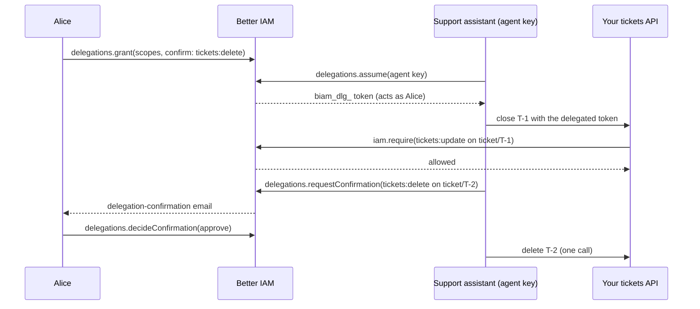

import { Bot, KeyRound, ScrollText, ShieldCheck } from '@/lib/icons';

In this guide you give an AI support assistant its own identity in Acme and let Alice, a support engineer, delegate
part of her access to it. The assistant never holds Alice's password or session: it opens short **delegated
sessions** that act as Alice, bounded by what Alice agreed to, by the agent's own ceiling, and by its API key.
Deleting a ticket is held back until Alice confirms that one call. You will build:

- a `ticket` resource type and a role that lets Alice read, update, and delete tickets;
- an agent identity with Alice as its **sponsor**, a **boundary** policy, and an API key;
- a **delegation** from Alice to the agent with scopes, an expiry, a session cap, and a `confirm` list;
- the agent's delegated session, checked by your API exactly like Alice's own requests;
- a confirmation round trip (agent asks, Alice approves, the agent retries once);
- the audit trail, the sponsor's kill switch, and revocation.



## Prerequisites

- The project from the [Quickstart](/docs/quickstart): `better-iam.config.mjs`, `iam.ts`, a migrated database, the
  organization Acme with its owner, and Alice, a member who accepted her invitation with a password. Export:

  ```bash
  export ACME_TENANT_ID=…          # the tenant.id of Acme
  export ACME_OWNER_EMAIL=owner@acme.test
  export ACME_OWNER_PASSWORD='another long password'
  export ALICE_EMAIL=alice@acme.test
  export ALICE_PASSWORD='alice password'
  ```

- Node.js 22.12 or newer and `tsx`.
- Optional: the MCP server from [Secure an MCP server](/docs/guides/secure-an-mcp-server), to see the same
  delegation work through MCP tools.

The agent APIs (`iam.api.agents`, `iam.api.delegations`) are part of `@better-iam/server` and need no extra option.
Every call below is also an HTTP route under `/api/iam`, shown as **Route:** in each step.

<Steps>
<Step>

### Declare the ticket resources

Decisions are about an action on a resource, so declare the ticket types and actions, and resolve each ticket's
owner from your own storage. Skip this step if you already did it in the MCP guide.

```js title="tickets.mjs"
// Stands in for your product's ticket table.
const tenantId = process.env.ACME_TENANT_ID;
export const tickets = new Map([
  ['T-1', { id: 'T-1', tenantId, title: 'Cannot export invoices', status: 'open' }],
  ['T-2', { id: 'T-2', tenantId, title: 'Duplicate of T-1', status: 'open' }],
]);
```

```js title="better-iam.config.mjs"
import { IamError } from 'better-iam';
import { sqliteAdapter } from 'better-iam/adapter-sqlite';
import { findDocument } from './documents.mjs'; // your document lookup from the Quickstart
import { tickets } from './tickets.mjs';

const ticketActions = ['tickets:read', 'tickets:update', 'tickets:delete'];

export default {
  database: sqliteAdapter({ filename: './iam.db' }),
  secret: process.env.BETTER_IAM_SECRET,
  baseURL: process.env.BETTER_IAM_BASE_URL,
  authentication: {
    // Prints delegation-request and delegation-confirmation emails. Development only.
    sendEmail: async (message) => {
      console.log(message.template, message.to, message.payload);
    },
  },
  permissions: {
    resourceTypes: {
      document: { actions: ['documents:read', 'documents:write'], attributes: { ownerId: 'string' } },
      ticket: { description: 'A support ticket', actions: ticketActions },
      'ticket-queue': { description: "An organization's ticket queue", actions: ticketActions },
    },
  },
  resolveResource: async ({ type, id }) => {
    if (type === 'ticket-queue') return { type, id, tenantId: id }; // a queue's ID is its organization's ID
    if (type === 'ticket') {
      const ticket = tickets.get(id);
      if (!ticket) throw new IamError('NOT_FOUND', 'Ticket not found', 404);
      return { type, id, tenantId: ticket.tenantId };
    }
    if (type === 'document') {
      const document = await findDocument(id);
      return { type, id, tenantId: document.tenantId, attributes: { ownerId: document.ownerId } };
    }
    throw new IamError('NOT_FOUND', 'Unknown resource type', 404);
  },
};
```

</Step>
<Step>

### Give Alice access to tickets

An agent acting for Alice can never do more than Alice can, so Alice needs the permissions first. The rest of this
guide is one script, `scripts/agent-demo.ts`, that plays the owner, Alice, and the agent in turn; in production each
part runs in a different place (an admin screen, Alice's browser, the agent's runtime).

```ts title="scripts/agent-demo.ts"
import { IamError } from 'better-iam';
import { iam } from '../iam';

const tenantId = process.env.ACME_TENANT_ID!;

async function signIn(email: string, password: string) {
  const result = await iam.api.auth.signIn({ tenantId, email, password });
  if ('mfaRequired' in result) throw new Error(`${email} must complete MFA (auth.verifyMfa)`);
  return result;
}

const ownerSignIn = await signIn(process.env.ACME_OWNER_EMAIL!, process.env.ACME_OWNER_PASSWORD!);
const owner = { token: ownerSignIn.token };
const aliceSignIn = await signIn(process.env.ALICE_EMAIL!, process.env.ALICE_PASSWORD!);
const alice = { token: aliceSignIn.token }; // a fresh sign-in: counts as a recent authentication
const aliceId = aliceSignIn.session.identityId;

const handler = await iam.api.roles.create(owner, {
  tenantId,
  name: 'Ticket handler',
  permissions: ['tickets:read', 'tickets:update', 'tickets:delete'],
});
await iam.api.bindings.create(owner, {
  tenantId,
  roleId: handler.id,
  subjectType: 'identity',
  subjectId: aliceId,
});
```

**Route:** `POST /api/iam/roles/create`, `POST /api/iam/bindings/create`

</Step>
<Step>

### Register the agent

An agent is an identity of kind `agent`. Like a service account it holds API keys and never signs in. Unlike one, it
has a **sponsor**, the person accountable for it: its credentials work only while the sponsor is an active member of
the organization. Its `boundary` is a ceiling on everything it does, whatever its roles say and whoever it acts for.
Creating agents needs `iam:agents:create`, and issuing a key with `credentials.create` needs
`iam:credentials:create`, as for service accounts. The organization owner holds both.

```ts title="scripts/agent-demo.ts (continued)"
const agent = await iam.api.agents.create(owner, {
  tenantId,
  name: 'Support assistant',
  purpose: 'Triages and closes support tickets for the person it works for',
  model: 'claude-sonnet-5',
  provider: 'anthropic',
  protocols: ['mcp'],
  sponsorId: aliceId, // defaults to the caller when the caller is a person of the organization
  boundary: {
    version: 1,
    statements: [{ effect: 'allow', actions: ['tickets:*'], resources: ['ticket/*', 'ticket-queue/*'] }],
  },
  maxDelegatedSessionSeconds: 900, // 60 to 43200; 3600 by default
});

// The agent's own key: a biam_key_… bearer token. Its scopes also bound every delegated session it opens.
const { token: agentKeyToken } = await iam.api.credentials.create(owner, {
  tenantId,
  identityId: agent.id,
  name: 'production',
  scopes: ['tickets:read', 'tickets:update', 'tickets:delete'],
});
const agentKey = { token: agentKeyToken };
console.log('agent standing:', agent.standing); // ok
```

**Route:** `POST /api/iam/agents/create`, `POST /api/iam/credentials/create`

| Field | Description |
| --- | --- |
| `sponsorId` | The accountable person: an active user of the same tenant. |
| `model`, `provider` | What the agent runs on. Policies see them as `principal.agentModel` and `principal.agentProvider` (the provider is stored in lowercase). |
| `purpose`, `url` | Shown to people deciding whether to delegate to the agent (`agents.catalog`). |
| `protocols` | Informational, such as `mcp` and `a2a`. |
| `boundary` | A ceiling over everything the agent does. Changes apply to live sessions at once. |
| `delegable` | `false` refuses delegations and stops existing ones from being used. Default `true`. |
| `maxDelegatedSessionSeconds` | The longest delegated session the agent may hold: 60 to 43200 seconds, 3600 by default. |
| `tokenAudiences` | Services outside Better IAM the agent may present delegation tokens to (`delegations.issueToken`). |

`agent.standing` is `ok`, `suspended`, `expired`, `deleted`, `sponsor-missing`, or `sponsor-inactive`. Anything but
`ok` means every credential of the agent is refused.

</Step>
<Step>

### Delegate access with a scope and an expiry

A **delegation** lets one agent act for one person. Alice grants it from her own session, which must be a recent
sign-in (`RECENT_AUTH_REQUIRED` otherwise). The delegated sessions it allows act as Alice and are limited by:

1. the delegation's scope: `scopes` (an action list, wildcards allowed) or a `policy` document;
2. the agent's `boundary`;
3. the agent key's `scopes` (or session policy) and the authority of whoever issued the key;
4. an optional scope-down `policy` the agent passes when it opens a session;

and by Alice's own permissions, because the session's identity is Alice. `confirm` lists actions Alice confirms one
call at a time.

<Tabs items={['Server', 'Client', 'Requested by the agent']}>
<Tab value="Server">

```ts title="scripts/agent-demo.ts (continued)"
const delegation = await iam.api.delegations.grant(alice, {
  tenantId,
  agentId: agent.id,
  scopes: ['tickets:read', 'tickets:update', 'tickets:delete'],
  confirm: ['tickets:delete'], // each delete needs Alice's approval
  expiresInSeconds: 7 * 86_400, // 5 minutes to 1 year; 30 days by default
  maxSessionSeconds: 900, // cap on each delegated session
});
console.log('delegation:', delegation.status); // active
```

</Tab>
<Tab value="Client">

From Alice's browser, signed in with her session cookie, through the typed client:

```ts title="app/delegate.ts"
import { createIamClient } from 'better-iam/client';
import type { iam } from '../iam';

const client = createIamClient<typeof iam>({ baseURL: 'http://localhost:3000' });

export async function delegateToAssistant(tenantId: string, agentId: string) {
  return client.delegations.grant({
    tenantId,
    agentId,
    scopes: ['tickets:read', 'tickets:update', 'tickets:delete'],
    confirm: ['tickets:delete'],
    expiresInSeconds: 7 * 86_400,
    maxSessionSeconds: 900,
  });
}
```

People pick an agent from `client.agents.catalog({ tenantId })`: the active, delegable agents of their
organization with their purpose, model, and sponsor.

</Tab>
<Tab value="Requested by the agent">

The agent can ask with its own key. Alice gets a `delegation-request` email when the deployment sends email, and the
request waits up to seven days. She approves (possibly narrowing it) or denies; approving needs a recent sign-in,
denying does not.

```ts title="scripts/agent-request.ts"
import { iam } from '../iam';

const tenantId = process.env.ACME_TENANT_ID!;
const agentKey = { token: process.env.AGENT_KEY! };

const request = await iam.api.delegations.request(agentKey, {
  tenantId,
  subjectEmail: process.env.ALICE_EMAIL!,
  scopes: ['tickets:read', 'tickets:update', 'tickets:delete'],
  confirm: ['tickets:delete'],
  reason: 'Triage your support queue while you are on call',
  expiresInSeconds: 7 * 86_400,
});
console.log(request.status); // pending: the agent polls delegations.get until it changes

// Alice, from her own recent session:
// await iam.api.delegations.approve(alice, { tenantId, delegationId: request.id, scopes: ['tickets:read', 'tickets:update'] });
// or: await iam.api.delegations.deny(alice, { tenantId, delegationId: request.id });
```

**Route:** `POST /api/iam/delegations/request`, `POST /api/iam/delegations/approve`,
`POST /api/iam/delegations/deny`

</Tab>
</Tabs>

**Route:** `POST /api/iam/delegations/grant`

| Field | Type | Default | Description |
| --- | --- | --- | --- |
| `agentId` | `string` | required | The agent that may act for the person. |
| `scopes` | `string[]` | none | Actions the agent may take for the person; an alternative to `policy`. |
| `policy` | `PolicyDocument` | none | A full policy document as the scope, for resource limits or conditions. |
| `confirm` | `string[]` | none | Action patterns the person confirms one call at a time (at most 50). |
| `expiresInSeconds` | `number` | 30 days | Lifetime of the delegation: 5 minutes to 1 year. |
| `maxSessionSeconds` | `number` | none | Cap on each delegated session, on top of the agent's `maxDelegatedSessionSeconds`. |
| `handoff` | `{ agents?, depth? }` | off | Lets the agent hand part of the delegation on to other agents (depth 1 to 3). |
| `spend` | `{ period, maxCostUsd?, maxTokens?, maxRequests? }` | none | Caps AI model use under the delegation per `minute`, `hour`, `day`, or `month`. |

One pending request or active delegation may link an agent and a person at a time (`DELEGATION_EXISTS` otherwise).

</Step>
<Step>

### Act as the person with a delegated session

The agent opens a short delegated session with its own key. The returned `biam_dlg_…` token is a bearer credential
whose identity is Alice, with the agent and the delegation recorded alongside. Every use re-checks the whole chain:
the delegation, Alice, the agent and its sponsor, and the agent's key.

```ts title="scripts/agent-demo.ts (continued)"
const assumed = await iam.api.delegations.assume(agentKey, {
  tenantId,
  delegationId: delegation.id,
  durationSeconds: 600, // at most the agent's and the delegation's caps; 900 or less by default
  sessionName: 'triage-run-1', // appears in decisions as principal.sessionName
});
const delegated = { token: assumed.token };
console.log(assumed.session.identityId === aliceId, assumed.session.agentId === agent.id); // true true

const check = (action: string, id: string) =>
  iam.authorize({ ...delegated, tenantId, action, resource: { type: 'ticket', id } });

console.log('close T-1:', (await check('tickets:update', 'T-1')).allowed); // true
console.log('delete T-2 before confirmation:', (await check('tickets:delete', 'T-2')).allowed); // false
```

**Route:** `POST /api/iam/delegations/assume`

Your API does not need to know that an agent is calling: it checks the delegated token exactly like Alice's own
session. The agent sends it as `Authorization: Bearer biam_dlg_…`:

```ts title="routes/tickets.ts"
import { iam } from '../iam';
import { tickets } from '../tickets.mjs';

export async function closeTicket(request: Request, ticketId: string): Promise<Response> {
  const ticket = tickets.get(ticketId);
  if (!ticket) return new Response('Not found', { status: 404 });
  // Throws ACCESS_DENIED (403) or UNAUTHENTICATED (401); the HTTP layer turns them into JSON errors.
  await iam.require({
    headers: request.headers,
    tenantId: ticket.tenantId,
    action: 'tickets:update',
    resource: { type: 'ticket', id: ticket.id },
  });
  const { identity, session } = await iam.authenticate({ headers: request.headers });
  // Better IAM audits refusals; record the allowed change, and which agent made it, in your own logs.
  console.log(`ticket ${ticket.id} closed for ${identity.id}`, session.agentId ? `by agent ${session.agentId}` : '');
  ticket.status = 'closed';
  return Response.json(ticket);
}
```

Through the MCP gate from [Secure an MCP server](/docs/guides/secure-an-mcp-server), the same token works as is:
the gate reports `caller.sessionKind: 'delegated'` with `agentId` and `delegationId`.

A delegated session never counts as a recent sign-in, never acts as an owner or root administrator, cannot manage
delegations (except handing work on when allowed) or mint further credentials, and lasts at most the delegation, the
key that opened it, and the session caps. At most 20 live sessions may exist per delegation.

</Step>
<Step>

### Ask the person to confirm a risky action

`tickets:delete` is in the delegation's `confirm` list, so the delegated session is refused it until Alice approves
that action on that exact ticket. The agent files the request with its delegated session; Alice answers from her own
session; the approval then opens one call, made within `validSeconds`.

```ts title="scripts/agent-demo.ts (continued)"
// The agent asks (it should read delegation.confirm first, with delegations.get):
const pending = await iam.api.delegations.requestConfirmation(delegated, {
  tenantId,
  action: 'tickets:delete',
  resource: { type: 'ticket', id: 'T-2' },
  reason: 'T-2 duplicates T-1, which I just closed',
  validSeconds: 120, // how long the approval stays usable: 30 to 3600; 300 by default
});

// Alice sees it in her inbox (or in the delegation-confirmation email) and approves:
const inbox = await iam.api.delegations.listConfirmations(alice, { tenantId, status: 'pending' });
await iam.api.delegations.decideConfirmation(alice, { tenantId, confirmationId: inbox[0]!.id, approve: true });

// The agent polls its request, then retries:
const decided = await iam.api.delegations.getConfirmation(delegated, { tenantId, confirmationId: pending.id });
console.log('confirmation:', decided.status); // approved
console.log('delete T-2 after approval:', (await check('tickets:delete', 'T-2')).allowed); // true
console.log('delete T-2 again:', (await check('tickets:delete', 'T-2')).allowed); // false: one approval, one call
```

**Route:** `POST /api/iam/delegations/requestConfirmation`, `POST /api/iam/delegations/listConfirmations`,
`POST /api/iam/delegations/decideConfirmation`, `POST /api/iam/delegations/getConfirmation`

A real agent polls until the person decides; requests wait up to 30 minutes, and asking again for the same action and
resource returns the pending request:

```ts title="agent/wait-for-confirmation.ts"
import { iam } from '../iam';

export async function waitForConfirmation(
  delegated: { token: string },
  tenantId: string,
  confirmationId: string,
): Promise<boolean> {
  for (;;) {
    const request = await iam.api.delegations.getConfirmation(delegated, { tenantId, confirmationId });
    if (request.status === 'approved' && !request.expired) return true;
    if (request.status !== 'pending' || request.expired) return false; // rejected, used, or lapsed
    await new Promise((resolve) => setTimeout(resolve, 5_000));
  }
}
```

Single checks (`iam.authorize`, `iam.require`) use the approval up; batch and listing checks (`authorizeMany`,
`listAccessible`) see it without using it. The MCP gate files the confirmation request for the agent automatically
and tells the model to retry.

To let people answer in your product, build an inbox with the React hooks from `better-iam/react` (inside an
`IamProvider`; see [React](/docs/integrations/react)):

```tsx title="app/confirmation-inbox.tsx"
import { useConfirmations } from 'better-iam/react';

export function ConfirmationInbox({ tenantId }: { tenantId: string }) {
  const { pending, approve, reject } = useConfirmations({ tenantId });
  return (
    <ul>
      {pending.map((item) => (
        <li key={item.id}>
          {item.agent.name} wants to {item.action} on {item.resource.type}/{item.resource.id}: {item.reason}
          <button onClick={() => approve(item.id)}>Approve</button>
          <button onClick={() => reject(item.id)}>Reject</button>
        </li>
      ))}
    </ul>
  );
}
```

`useDelegations({ tenantId })` gives the same page the agents acting or asking to act for the person, with `grant`,
`approve`, `deny`, and `revoke`.

</Step>
<Step>

### Audit, stop, and revoke

Every audit event of a delegated session names Alice as the actor and carries `agentId` and `delegationId` in its
`sessionContext`, covered by the tenant's hash chain. `delegations.activity` shows Alice what happened under her
delegation, newest first: its lifecycle and every audited action of the agent's sessions. `agents.activity` shows the
sponsor (or an administrator with `iam:agents:read`) everything the agent did, for anyone.

```ts title="scripts/agent-demo.ts (continued)"
const trail = await iam.api.delegations.activity(alice, { tenantId, delegationId: delegation.id, limit: 20 });
for (const event of trail) console.log(event.action, event.outcome, event.resourceId);
// newest first: tickets:delete deny T-2 (the second delete), delegation:confirm, delegation:confirmation-request,
// tickets:delete deny T-2, delegation:assume, delegation:grant

// The sponsor's kill switch: no permission needed, effective at once.
await iam.api.agents.suspend(alice, { tenantId, agentId: agent.id, reason: 'Demo finished' });
try {
  await check('tickets:read', 'T-1');
} catch (error) {
  if (error instanceof IamError) console.log('after suspend:', error.code); // UNAUTHENTICATED
}

// Bring it back (a sponsor may resume only an agent they suspended), then end the delegation for good.
await iam.api.agents.resume(alice, { tenantId, agentId: agent.id });
await iam.api.delegations.revoke(alice, { tenantId, delegationId: delegation.id, reason: 'No longer on call' });
```

**Route:** `POST /api/iam/delegations/activity`, `POST /api/iam/agents/activity`, `POST /api/iam/agents/suspend`,
`POST /api/iam/agents/resume`, `POST /api/iam/delegations/revoke`

| Lever | Who | Effect |
| --- | --- | --- |
| `agents.suspend` | The sponsor (no permission), or `iam:agents:update` | The agent's keys are refused and its live delegated sessions end at once. Keys are kept for `agents.resume`. |
| `agents.suspendAll` | `iam:agents:update`, no recent sign-in | Emergency stop for every agent of the tenant, or those of one `sponsorId`, `provider`, or `model`. |
| `delegations.revoke` | The person, the sponsor, the agent, or `iam:delegations:revoke` | Ends the delegation and its sessions at once, and the hand-offs below it. |
| `credentials.revoke` | `iam:credentials:revoke` and a recent sign-in | Ends one key, the sessions it opened, and the hand-offs made with it. |
| `agents.delete` | `iam:agents:delete` and a recent sign-in | Ends keys and sessions, revokes every delegation to the agent, and keeps a tombstone for the audit trail. |

Audit actions to watch: `agent:create`, `agent:suspend`, `agent:resume`, `agent:sponsor-change`,
`delegation:grant`, `delegation:request`, `delegation:approve`, `delegation:deny`, `delegation:assume`,
`delegation:revoke`, `delegation:confirmation-request`, `delegation:confirm`, and `delegation:reject`.
[Access analysis](/docs/reference/api/analysis) flags agents without an active sponsor, delegations that allow every
action, unused delegations, and agents refused 20 or more times in a day (`agent-denials`), a sign of a looping or
prompt-injected agent.

</Step>
</Steps>

## Verify it works

Run the script:

```bash
npx tsx scripts/agent-demo.ts
```

```text
agent standing: ok
delegation: active
true true
close T-1: true
delete T-2 before confirmation: false
confirmation: approved
delete T-2 after approval: true
delete T-2 again: false
tickets:delete deny T-2
delegation:confirm allow …
delegation:confirmation-request allow …
tickets:delete deny T-2
delegation:assume allow …
delegation:grant allow …
after suspend: UNAUTHENTICATED
```

Then check from another angle:

- `iam.api.sts.getCallerIdentity({ token: assumed.token })` (before the revocation) reports `agentId` and
  `delegationId` for the delegated session.
- `iam.api.delegations.listMine(alice, { tenantId })` lists the delegation with `status: 'revoked'` and `revokedBy`.
- `iam.api.audit.list(owner, { tenantId, action: 'delegation:assume' })` shows each session the agent opened.

## Troubleshooting

<Accordions>
<Accordion title="delegations.grant or approve fails with RECENT_AUTH_REQUIRED">

Granting and approving need the person's own session with a recent sign-in (within the last five minutes by
default). Ask the
person to sign in again or step up, then retry. Denying needs no recent sign-in. See
[`RECENT_AUTH_REQUIRED`](/docs/reference/errors#recent_auth_required).

</Accordion>
<Accordion title="delegations.grant fails with ACCESS_DENIED">

Delegations are decided by a person in their own session of the organization: not an administrator acting for
them, not an impersonation session (`IMPERSONATION_RESTRICTED`), and not an API key. Call it with the person's
session token or cookie.

</Accordion>
<Accordion title="DELEGATION_EXISTS">

One pending request or active delegation may link an agent and a person at a time. Find it with
`delegations.listMine` and revoke or decide it first. See
[`DELEGATION_EXISTS`](/docs/reference/errors#delegation_exists).

</Accordion>
<Accordion title="delegations.assume fails">

- `ACCESS_DENIED`: the call did not use the agent's own API key (a person's session or a service-account key cannot
  open delegated sessions).
- `DELEGATION_PENDING`: the person has not approved the request yet.
- `DELEGATION_INACTIVE`: the delegation was revoked or expired, the person is no longer active, or a delegation above
  a hand-off ended. See [`DELEGATION_INACTIVE`](/docs/reference/errors#delegation_inactive).
- `DELEGATION_NOT_ALLOWED`: the agent's `delegable` is `false`.
- `LIMIT_EXCEEDED`: the delegation already has 20 live sessions.
- `INVALID_INPUT`: `durationSeconds` is above the agent's `maxDelegatedSessionSeconds` or the delegation's
  `maxSessionSeconds`.

</Accordion>
<Accordion title="The delegated session is refused an action the delegation allows">

Every ceiling applies at once. Check that the person holds the action through their own roles, that the agent's
`boundary` allows it on that resource, that the agent key's `scopes` include it, and that it is not in the
delegation's `confirm` list. A held-back action is refused with `ACCESS_DENIED` and audited as a denial until the
person approves that action on that resource (`delegations.requestConfirmation`).

</Accordion>
<Accordion title="requestConfirmation fails with INVALID_INPUT">

Only actions that match the delegation's `confirm` list can be requested. Read the list with
`delegations.get(delegated, { tenantId, delegationId })` before asking.

</Accordion>
<Accordion title="Every request with the delegated token fails with UNAUTHENTICATED">

A link in the chain broke: the delegation was revoked or expired, the session reached its end, the agent was
suspended or deleted, its sponsor left or was deactivated, or the agent key was revoked. `agents.get` reports the
agent's `standing`; open a new session with `delegations.assume` once the cause is fixed.

</Accordion>
</Accordions>

## Next steps

<Cards>
  <Card icon={<Bot />} title="AI agents" href="/docs/features/ai-agents">
    Hand-offs between agents, spend caps, agent policies, and the full feature reference.
  </Card>
  <Card icon={<ShieldCheck />} title="Secure an MCP server" href="/docs/guides/secure-an-mcp-server">
    Per-tool permissions, with confirmations filed automatically for delegated agents.
  </Card>
  <Card icon={<KeyRound />} title="Delegations API" href="/docs/reference/api/delegations">
    Every delegations method with its permission, input, and errors.
  </Card>
  <Card icon={<ScrollText />} title="Agent-to-agent (A2A)" href="/docs/features/a2a">
    Attested agent cards, the agent directory, and delegation tokens for other services.
  </Card>
</Cards>
