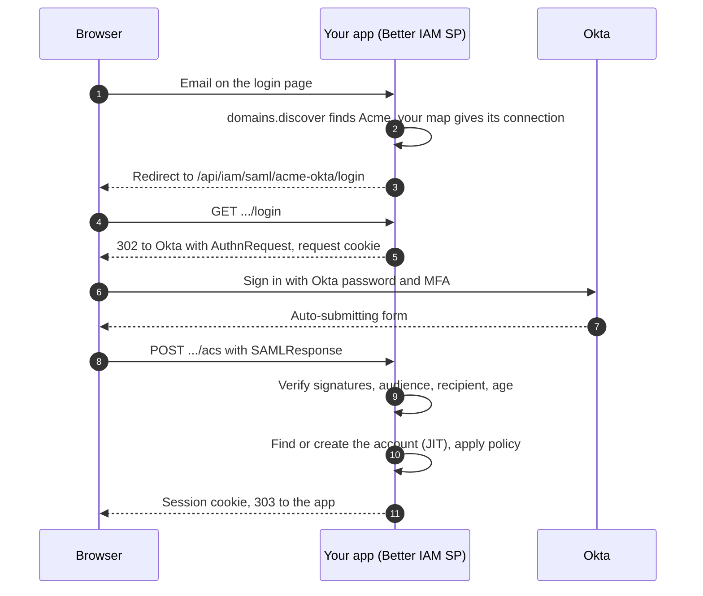

import { ArrowDownToLine, Building, Globe, RefreshCw, ShieldCheck, SlidersHorizontal } from '@/lib/icons';

This guide connects one customer organization, Acme, to its Okta tenant with <Term id="saml">SAML 2.0</Term>, so
Acme's people sign in to your product with their Okta account and Okta's password and MFA rules. The connection is
**tenant-managed**: Acme's administrator creates it at runtime by uploading Okta's metadata, with no deployment
change per customer. You will build:

- a SAML service provider mounted in a Next.js app, with one key pair shared by every organization's connection;
- a verified `acme.com` domain, so sign-in can route Acme's people by email address;
- an SSO settings page where Acme's administrator registers the app in Okta and uploads its metadata;
- just-in-time (JIT) accounts on first sign-in, with default access granted by a birthright rule;
- a one-time link for members who already have a password account;
- an enforced policy that allows only federated sign-in for Acme.

The Okta steps below name the fields of Okta's SAML app integration settings; Okta's console labels can change
between versions, so match them by meaning. Other SAML identity providers (Entra ID, Google Workspace, ADFS) ask for
the same values; see [SAML](/docs/federation/saml#register-the-app-at-the-idp).

## Prerequisites

- The app from [Build a multi-tenant B2B SaaS](/docs/guides/b2b-saas), or any Next.js app using `@better-iam/next`
  with an organization (`acme`) and its owner.
- A public HTTPS origin for the app, such as `https://app.example.com`. The SAML service provider refuses a
  non-HTTPS `baseUrl`, and its request cookie is `Secure` with `SameSite=None`. For local testing, run the app
  behind an HTTPS tunnel and set `BETTER_IAM_BASE_URL` to the tunnel's origin.
- Admin access to an Okta organization (a free developer org works), and DNS access for the domain you verify.
- `openssl`, to create the service-provider key pair.

<Steps>
<Step>

### Create the service-provider key pair

Better IAM signs its SAML requests and metadata with one key pair, shared by every tenant-managed connection.
Create it once per deployment and store both files like any other secret:

```bash
openssl req -x509 -newkey rsa:2048 -nodes -days 730 \
  -keyout saml-sp-key.pem -out saml-sp-cert.pem -subj "/CN=app.example.com"
```

The certificate is published in your SP metadata. Okta does not need it for this setup, because Better IAM does not
ask for encrypted assertions unless a connection sets `requireEncryptedAssertions`.

</Step>
<Step>

### Mount the SAML service

```npm
npm i @better-iam/saml
```

Create the service with the host callbacks from `iam.protocolHost` and mount it. `basePath` puts the SAML routes
under the IAM route that Next.js already serves, `app/api/iam/[...path]`.

```ts title="lib/iam.ts"
import { readFileSync } from 'node:fs';
import { betterIam } from '@better-iam/server';
import { createSamlService } from '@better-iam/saml';
import config from '../better-iam.config.mjs';

export const iam = betterIam(config);

export const saml = createSamlService({
  ...iam.protocolHost,
  basePath: '/api/iam/saml',
  serviceProvider: {
    baseUrl: process.env.BETTER_IAM_BASE_URL!, // https://app.example.com
    privateKey: readFileSync(process.env.SAML_SP_KEY_FILE!, 'utf8'),
    publicCertificate: readFileSync(process.env.SAML_SP_CERT_FILE!, 'utf8'),
  },
});
iam.useProtocol(saml);
```

Add the package to `serverExternalPackages` in `next.config.mjs` next to `@better-iam/server`, so it loads as a
plain Node module.

Each connection now has three fixed URLs under the base URL:

| URL | Use |
| --- | --- |
| `https://app.example.com/api/iam/saml/{id}/metadata` | Signed SP metadata. It is also the SP entity ID (the audience). |
| `https://app.example.com/api/iam/saml/{id}/acs` | The assertion consumer service (ACS), HTTP-POST binding. |
| `https://app.example.com/api/iam/saml/{id}/login` | Where SP-initiated sign-in starts. |

</Step>
<Step>

### Send people into the app after the assertion

When the browser posts Okta's response to the ACS, the IAM handler sets the session cookie and answers `200` with
the sign-in result as JSON. It does not redirect. Wrap `POST` in the IAM route so a successful SAML sign-in
continues to your app instead of showing that JSON:

```ts title="app/api/iam/[...path]/route.ts"
import { iamNext } from '@/lib/iam-next';

export const runtime = 'nodejs';

const handlers = iamNext.handlers();
export const GET = handlers.GET;
export const OPTIONS = handlers.OPTIONS;

const acsPath = /^\/api\/iam\/saml\/[^/]+\/acs$/;

export async function POST(request: Request): Promise<Response> {
  const response = await handlers.POST(request);
  const cookies = response.headers.getSetCookie();
  const signedIn = cookies.some((cookie) => cookie.includes('better-iam.session='));
  if (!acsPath.test(new URL(request.url).pathname) || !response.ok || !signedIn) return response;
  const headers = new Headers({ location: '/', 'cache-control': 'no-store' });
  for (const cookie of cookies) headers.append('set-cookie', cookie);
  return new Response(null, { status: 303, headers });
}
```

The session cookie is `__Host-better-iam.session` over HTTPS. A failed assertion answers `401` with
`{ "error": "SAML_INVALID" }` and no further detail. When the organization requires your product's own MFA
(`requireMfa` in its policy, or `requireMfaForOwners` for an owner, which the B2B guide's `tenantDefaults` sets for
every new organization), the ACS answers with an MFA challenge instead of a session and sets no cookie; this
wrapper then passes the JSON through. Okta already enforces MFA for Okta sign-ins, so the usual choice for an
SSO-only organization is to leave both off.

</Step>
<Step>

### Verify the email domain

A verified domain proves that `@acme.com` addresses belong to Acme. It lets your sign-in page find Acme from an
email address alone, and stops any other organization from claiming `acme.com`. Acme's administrator claims it,
and whoever runs Acme's DNS publishes the record:

<Tabs items={['Server', 'Client']}>
<Tab value="Server">

```ts title="app/[org]/settings/sso/domain-actions.ts"
'use server';
import { iam } from '@/lib/iam';
import { iamNext } from '@/lib/iam-next';

export async function claimDomain(domain: string) {
  const session = await iamNext.requireSession();
  const claimed = await iam.api.domains.add(await iamNext.credential(), {
    tenantId: session.session.tenantId,
    domain,
  });
  return { domainId: claimed.id, record: claimed.dnsRecord }; // { type: 'TXT', name, value }
}

export async function verifyDomain(domainId: string) {
  const session = await iamNext.requireSession();
  const result = await iam.api.domains.verify(await iamNext.credential(), {
    tenantId: session.session.tenantId,
    domainId,
  });
  return result.verified;
}
```

</Tab>
<Tab value="Client">

```ts title="app/[org]/settings/sso/domain.ts"
import { createIamClient } from '@better-iam/client';
import type { iam } from '@/lib/iam';

const client = createIamClient<typeof iam>({
  baseURL: typeof window === 'undefined' ? 'http://localhost' : window.location.origin,
});

// Call from a client component, as an administrator of the organization.
export async function claimAndVerify(tenantId: string, domain: string) {
  const claimed = await client.domains.add({ tenantId, domain });
  // Show claimed.dnsRecord to the administrator, wait until it is published, then:
  return client.domains.verify({ tenantId, domainId: claimed.id });
}
```

</Tab>
</Tabs>

The record is a TXT record named `_better-iam-challenge.acme.com` with the value
`better-iam-verification=<token>`. `domains.verify` looks it up and returns `verified: true` once DNS has it.
A domain verified by one organization cannot be claimed by another (`DOMAIN_TAKEN`), and shared mailbox providers
such as `gmail.com` are refused (`DOMAIN_NOT_ALLOWED`).

**Route:** `POST /api/iam/domains/add`, then `POST /api/iam/domains/verify`

</Step>
<Step>

### Register the app in Okta

Pick the connection ID first, because it is part of every URL Okta needs. Connection IDs are 2 to 63 lowercase
letters, digits, and hyphens; this guide uses `acme-okta`. Give Acme's Okta administrator these values, then have
them create a **SAML 2.0** app integration:

| Okta field | Value |
| --- | --- |
| **Single sign-on URL** | `https://app.example.com/api/iam/saml/acme-okta/acs` (also used as Recipient and Destination) |
| **Audience URI (SP Entity ID)** | `https://app.example.com/api/iam/saml/acme-okta/metadata` |
| **Name ID format** | `EmailAddress`: Better IAM's sign-in requests ask for `urn:oasis:names:tc:SAML:1.1:nameid-format:emailAddress` |
| **Response** and **Assertion Signature** (advanced settings) | Both signed |
| **Attribute statement** `email` | The person's email, for example `user.email` |
| **Attribute statement** `displayName` | The person's display name |
| **Attribute statement** `department` (optional) | Any attribute you map in the next step |

Then they assign the app to the people or groups who should sign in, and download the app's **IdP metadata** XML
from its **Sign On** tab.

- Better IAM requires both the SAML response and the assertion to be signed.
- The email is read from an attribute named `email`, `mail`, or `urn:oid:0.9.2342.19200300.100.1.3`. The name comes
  from `displayName`.
- The account is keyed by connection, IdP issuer, and `NameID`. A `NameID` that changes, such as an email address
  that is later renamed, makes the next sign-in look like a new person, so keep each person's Okta username stable.

</Step>
<Step>

### Create the connection

Acme's administrator uploads the metadata file on your SSO settings page. `saml.createConnection` reads Okta's
sign-on URL, entity ID, and signing certificates from it, and returns the URLs to register. It requires
`iam:saml:connections:create` on `saml/{id}` in the organization, and a recent sign-in because it adds trust.

```ts title="app/[org]/settings/sso/actions.ts"
'use server';
import { revalidatePath } from 'next/cache';
import { saml } from '@/lib/iam';
import { iamNext } from '@/lib/iam-next';

export async function connectOkta(form: FormData) {
  const session = await iamNext.requireSession({ stepUp: { maxAgeMs: 5 * 60_000 } });
  const metadata = form.get('metadata');
  if (!(metadata instanceof File)) throw new Error('Upload the IdP metadata file');
  await saml.createConnection(await iamNext.credential(), {
    tenantId: session.session.tenantId,
    id: 'acme-okta',
    name: 'Acme Okta',
    metadataXml: await metadata.text(),
    trustedEmailDomains: ['acme.com'],
    attributeMapping: { department: 'department' },
  });
  revalidatePath('/[org]/settings/sso', 'page');
}
```

```tsx title="app/[org]/settings/sso/page.tsx"
import { saml } from '@/lib/iam';
import { iamNext } from '@/lib/iam-next';
import { connectOkta } from './actions';

export default iamNext.page(
  async (_props: { params: Promise<{ org: string }> }, { session }) => {
    const connections = await saml.listConnections(await iamNext.credential(), {
      tenantId: session.session.tenantId,
    });
    return (
      <main>
        <h1>Single sign-on</h1>
        {connections.map((connection) => (
          <dl key={connection.id}>
            <dt>Single sign-on URL</dt>
            <dd>{connection.acsUrl}</dd>
            <dt>Audience URI</dt>
            <dd>{connection.entityId}</dd>
            <dt>Signing certificates</dt>
            <dd>
              {connection.certificates
                .map((certificate) => `${certificate.subject}${certificate.expired ? ' (expired)' : ''}`)
                .join(', ')}
            </dd>
          </dl>
        ))}
        <form action={connectOkta}>
          <input type="file" name="metadata" accept=".xml" required />
          <button type="submit">Connect Okta</button>
        </form>
      </main>
    );
  },
  { authorize: { action: 'iam:saml:connections:read', resource: () => ({ type: 'saml', id: '*' }) } },
);
```

Connection options used here:

| Option | Type | Default | Description |
| --- | --- | --- | --- |
| `tenantId` | `string` | required | The organization whose people sign in through the connection. |
| `id` | `string` | generated | The ID in the connection URLs: 2 to 63 lowercase letters, digits, and hyphens. |
| `name` | `string` | required | A label for administrators, up to 200 characters. |
| `metadataXml` | `string` | none | Okta's metadata; fills in `entryPoint`, `idpIssuer`, and `idpCertificates`. |
| `trustedEmailDomains` | `string[]` | `[]` | Exact domains whose emails this IdP may vouch for, so a first sign-in can create the account. |
| `attributeMapping` | `Record<string, string>` | `{}` | Identity attribute name to SAML attribute name, copied on every sign-in. |
| `allowIdpInitiated` | `boolean` | `false` | Also accept sign-ins started from the Okta dashboard tile. |
| `enabled` | `boolean` | `true` | `false` stops new sign-ins through the connection at once. |

`trustedEmailDomains` is not checked against verified domains. List only domains the organization verified in the
previous step, because an email in a trusted domain counts as verified and can create an account.
`attributeMapping` writes declared identity attributes, so declare them in the options
(`permissions: { identityAttributes: { department: 'string' } }`); an undeclared or invalid value fails the sign-in.

The full option list, certificate rollover, and encrypted assertions are in
[Tenant-managed connections](/docs/federation/saml#tenant-managed-connections).

</Step>
<Step>

### Start sign-in from your login page

`domains.discover` maps an email address to its organization. It does not return SAML connections, so keep the
connection ID for each organization in your own data (or derive it, as here) and send the browser to the
connection's login URL:

```ts title="app/login/sso-action.ts"
'use server';
import { redirect } from 'next/navigation';
import { iam } from '@/lib/iam';

// Organizations with SSO, by tenant ID. Store this with your organization records.
const ssoConnections: Record<string, string> = {
  /* [acmeTenantId]: 'acme-okta' */
};

export async function continueWithSso(form: FormData) {
  const email = String(form.get('email'));
  const found = await iam.api.domains.discover({ email }).catch(() => null);
  const connectionId = found ? ssoConnections[found.tenantId] : undefined;
  if (!found || !connectionId) redirect('/login'); // no SSO for this domain: use the regular sign-in form
  redirect(`/api/iam/saml/${connectionId}/login`);
}
```

`domains.discover` is public and also returns `allowedMethods` and `requireMfa`, so the page can hide the password
field for an organization that allows only `federated`. `GET /api/iam/saml/{id}/login` saves the request ID and a
`RelayState`, bound to a cookie, and redirects to Okta. Both are single use and expire after 10 minutes.

**Route:** `POST /api/iam/domains/discover`

</Step>
<Step>

### Give new accounts their default access

On the first sign-in of someone without an account, Better IAM creates the identity with a verified email when the
email's domain is in `trustedEmailDomains`. That is just-in-time provisioning. The new identity has **no role
bindings**: it can sign in, but every authorization check is denied until it is given a role.

To give every Acme account a default role automatically, use a birthright rule: an
<Term id="access-package">access package</Term> with `autoAssign`.

```ts title="app/[org]/settings/sso/access-actions.ts"
'use server';
import { iamNext } from '@/lib/iam-next';

// Run once by the owner: everyone with a verified acme.com address gets the Member role.
export async function createDefaultAccess(memberRoleId: string) {
  const session = await iamNext.requireSession();
  return iamNext.client().packages.create({
    tenantId: session.session.tenantId,
    name: 'Everyone at Acme',
    roleIds: [memberRoleId],
    autoAssign: {
      include: [
        {
          StringEquals: { 'principal.kind': 'user' },
          StringEqualsIgnoreCase: { 'identity.emailDomain': 'acme.com' },
          Bool: { 'identity.emailVerified': true },
        },
      ],
    },
  });
}
```

`packages.create` requires `iam:packages:create`. The caller becomes the rule's owner, so they also need what
assigning the package by hand needs: `iam:packages:assign`, `iam:bindings:create` on the role, and a grant
authority. The organization's owner has all of them.

Rules re-evaluate right after `identities.create`, `update`, and `setStatus`, but federated sign-ins reach them only
through the scheduled reconciliation job. Run it every 15 minutes, after `purge`:

```bash
npx better-iam reconcile --config better-iam.config.mjs --fail-on-attention
```

Until the job runs, a person who just signed in for the first time has no access. An administrator can apply the
rule at once with `packages.reconcile`. See [Automatic assignment](/docs/features/privileged-access/automatic-assignment).

**Route:** `POST /api/iam/packages/create`

</Step>
<Step>

### Link existing accounts

Better IAM never joins a SAML login to an existing account by email. A person who already has an account in Acme
(the owner, members who accepted an invitation, or people a [SCIM](/docs/guides/scim-provisioning) directory
provisioned) is refused on their first SAML sign-in: the underlying error is `ACCOUNT_LINK_REQUIRED`, which the ACS
reports as `401 SAML_INVALID` like every other failure. They link once, while signed in to that account by another
method, within five minutes of signing in:

```tsx title="app/[org]/settings/sso/link-button.tsx"
'use client';

export function LinkOktaButton({ connectionId }: { connectionId: string }) {
  async function link() {
    const response = await fetch(`/api/iam/saml/${connectionId}/login`, {
      method: 'POST',
      credentials: 'include',
      headers: { 'content-type': 'application/json', 'x-better-iam': '1' },
      body: '{}',
    });
    if (!response.ok) throw new Error((await response.json()).error);
    const { url } = (await response.json()) as { url: string };
    window.location.assign(url); // Okta, then back to the ACS, which links the account
  }
  return <button onClick={link}>Link my Okta account</button>;
}
```

The POST needs a trusted `Origin` (by default, the origin of the connection's URLs), `X-Better-IAM: 1`, a JSON
body, and a user session in the connection's tenant authenticated within five minutes. Root administrators cannot
link. After linking, the person signs in with Okta and keeps their roles. See
[First sign-in and account linking](/docs/federation/saml#first-sign-in-and-account-linking).

</Step>
<Step>

### Require SSO for the organization

Once Okta sign-in works for the administrators, require it. Password and email-link sign-in are then refused for
everyone in Acme before any credential is checked, so someone Okta removed cannot keep using an old password.

```ts title="app/[org]/settings/sso/require-actions.ts"
'use server';
import { iamNext } from '@/lib/iam-next';

export async function requireSso() {
  const session = await iamNext.requireSession({ stepUp: { maxAgeMs: 5 * 60_000 } });
  const tenantId = session.session.tenantId;
  const current = (await iamNext.client().tenants.get({ tenantId })).authPolicy ?? {};
  await iamNext.client().tenants.setAuthPolicy({
    tenantId,
    authPolicy: { ...current, allowedMethods: ['federated'] },
  });
}
```

Make sure every member who had a password account has linked first: after this step, an unlinked account has no
way to sign in. Other methods fail with `METHOD_NOT_ALLOWED`.

**Route:** `POST /api/iam/tenants/setAuthPolicy`

</Step>
</Steps>



## Verify it works

1. In Okta, assign the app to a test user whose email is in `acme.com` and who has no account in Acme.
2. On your login page, enter that email. The browser goes to Okta, then back to your app (the `303` from the route
   wrapper), signed in to Acme.
3. Call `iam.api.identities.list(credential, { tenantId, query: 'test-user@acme.com' })` as an administrator: the new
   identity has `emailVerified: true`. Its `attributes.department` holds the mapped value.
4. Run `npx better-iam reconcile` and reload a project page: the person now holds the _Member_ role.
5. Sign in with the owner's password, click **Link my Okta account**, and sign in at Okta as the owner's Okta user.
   From then on the owner signs in through Okta. While the policy still has `requireMfaForOwners`, the owner's
   Okta sign-in answers with an MFA challenge instead of a session (see Troubleshooting).
6. Turn on **Require SSO** and try a password sign-in for Acme: it fails with `METHOD_NOT_ALLOWED`.

## Troubleshooting

<Accordions>
<Accordion title="The ACS answers 401 with SAML_INVALID">
  Every validation failure looks the same on purpose. Check, in order: the response and the assertion are both
  signed; **Single sign-on URL** and **Audience URI** match `connection.acsUrl` and `connection.entityId` exactly;
  the server clock is correct (assertions are accepted for five minutes with 30 seconds of skew); and the sign-in
  started at `/login` in the same browser, because the request cookie binds the response to it. A sign-in started
  from the Okta dashboard fails unless the connection sets `allowIdpInitiated: true`. See
  [SAML_INVALID](/docs/reference/errors#saml_invalid).
</Accordion>
<Accordion title="A new person's first sign-in fails (VERIFIED_EMAIL_REQUIRED)">
  The ACS reports this as `401 SAML_INVALID`, like every failure; the underlying error is `VERIFIED_EMAIL_REQUIRED`
  when signatures, URLs, and clock all check out. The email's domain is not in the connection's
  `trustedEmailDomains`, or Okta sends no `email` (or `mail`) attribute. Add the attribute statement in Okta, or
  update the connection with `saml.updateConnection`. See
  [VERIFIED_EMAIL_REQUIRED](/docs/reference/errors#verified_email_required).
</Accordion>
<Accordion title="An existing member's first sign-in fails (ACCOUNT_LINK_REQUIRED)">
  The ACS reports this as `401 SAML_INVALID` too. An account with that email already exists in the organization.
  The person links it once, as in the linking step. See
  [ACCOUNT_LINK_REQUIRED](/docs/reference/errors#account_link_required).
</Accordion>
<Accordion title="createConnection is refused with RECENT_AUTH_REQUIRED">
  Creating a connection, or widening one's trust (a new issuer, a new certificate, IdP-initiated sign-in, more trusted
  domains), needs a sign-in from the last five minutes. Step up and retry. See
  [RECENT_AUTH_REQUIRED](/docs/reference/errors#recent_auth_required).
</Accordion>
<Accordion title="The browser shows JSON after signing in at Okta">
  The `POST` wrapper in `app/api/iam/[...path]/route.ts` is missing, or the organization requires your product's MFA
  (`requireMfa`, or `requireMfaForOwners` for an owner) and the ACS returned an MFA challenge instead of a session.
  Add the wrapper, or turn those policy settings off for the organization and rely on Okta's MFA.
</Accordion>
<Accordion title="Signed in through Okta, but every page answers 403">
  The account was created just in time and has no role yet. Run `better-iam reconcile`, or call `packages.reconcile`,
  so the birthright rule assigns the default package.
</Accordion>
<Accordion title="Sign-in breaks when Okta rotates its signing certificate">
  Add the new certificate before Okta switches: call `saml.updateConnection` with `idpCertificates` listing the old and
  the new certificate, or upload refreshed metadata that lists both. Connection summaries show each certificate's
  `notAfter` and `expired`. See [Certificate rollover](/docs/federation/saml#certificate-rollover).
</Accordion>
</Accordions>

## Next steps

<Cards>
  <Card icon={<ArrowDownToLine />} title="SCIM provisioning" href="/docs/guides/scim-provisioning">
    Let Okta create, update, and deactivate Acme's accounts before anyone signs in.
  </Card>
  <Card icon={<ShieldCheck />} title="SAML reference" href="/docs/federation/saml">
    Every connection option, response validation rule, and route.
  </Card>
  <Card icon={<Building />} title="Enterprise onboarding" href="/docs/federation/enterprise-onboarding">
    SSO, SCIM, outbound provisioning, and offboarding for one customer.
  </Card>
  <Card icon={<SlidersHorizontal />} title="Tenant authentication policy" href="/docs/authentication/tenant-policy">
    Allowed methods, MFA, IP ranges, and session limits.
  </Card>
  <Card icon={<RefreshCw />} title="Automatic assignment" href="/docs/features/privileged-access/automatic-assignment">
    Birthright rules, reconciliation, and the safety brake.
  </Card>
  <Card icon={<Globe />} title="OAuth and OIDC sign-in" href="/docs/federation/oauth-sign-in">
    Connect an identity provider over OpenID Connect instead.
  </Card>
</Cards>
