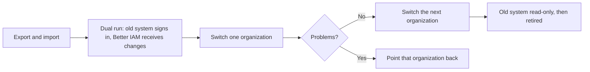

import { ArrowLeftRight, Building, Database, KeyRound, LogIn, ShieldCheck, Users } from '@/lib/icons';

Moving to Better IAM from a hosted identity provider or an authentication library is mostly a data move: the
people, the organizations they belong to, the roles they hold, and the SSO and directory connections their
companies use. This page is the general plan that every provider-specific guide follows. It covers what carries
over and what cannot, the bulk import APIs, how imported people sign in without their old password, how to run
both systems side by side while you switch, and how to roll back.

The short version:

- People, organizations, roles, groups, and role assignments move through the API, 100 people per transaction.
- Password hashes, authenticator secrets, passkeys, sessions, and links to social or enterprise accounts do not
  move. Imported people sign in once with a magic link, a reset link, or their identity provider.
- SSO and SCIM connections are recreated, and each customer's IT team points its identity provider at the new
  connection.
- You switch over one organization at a time while the old system keeps running, so rolling back means pointing
  that organization back.

## Pick a guide

<Cards>
  <Card icon={<ShieldCheck />} title="From Auth0" href="/docs/guides/migration/from-auth0">
    Database, social, and enterprise connections, Organizations, roles and permissions, and metadata.
  </Card>
  <Card icon={<Users />} title="From Clerk" href="/docs/guides/migration/from-clerk">
    Users, organizations and memberships, organization roles and permissions, metadata, and SSO.
  </Card>
  <Card icon={<Building />} title="From WorkOS" href="/docs/guides/migration/from-workos">
    Organizations, SSO connections, Directory Sync, domains, and AuthKit users.
  </Card>
  <Card icon={<KeyRound />} title="From Better Auth" href="/docs/guides/migration/from-better-auth">
    Users, sessions, and organizations from Better Auth.
  </Card>
  <Card icon={<LogIn />} title="From Auth.js" href="/docs/guides/migration/from-authjs">
    Users and accounts from Auth.js (NextAuth).
  </Card>
  <Card icon={<Database />} title="From Keycloak" href="/docs/guides/migration/from-keycloak">
    Realms, users, groups, and roles from Keycloak.
  </Card>
</Cards>

## What carries over

| Data | Carries over | How |
| --- | --- | --- |
| People (email, display name) | Yes | [`identities.createMany`](/docs/reference/api/identities#createmany), up to 100 per transaction. |
| Old user IDs | Yes | As an identity attribute such as `legacyId`, declared in `permissions.identityAttributes`. |
| Custom profile data (metadata) | Partly | Flat `string`, `number`, and `boolean` attributes declared in `permissions.identityAttributes` (strings up to 2,048 characters). Nested objects and arrays stay in your own database. |
| Usernames | As data only | Sign-in is by email address. Keep a username as an attribute if you display it. |
| Phone numbers | No | A phone number is set only when the person verifies it (`auth.startPhoneVerification`). Every identity needs an email address, so phone-only accounts cannot be imported. |
| Organizations | Yes | `tenants.create`, one <Term id="tenant">tenant</Term> per organization. Each new tenant waits for its owner to accept an emailed invitation. |
| Roles and permissions | Yes | `roles.create`, or a [configuration document](/docs/features/privileged-access/config-as-code) applied with `config.apply`. Permission names become actions in your [catalog](/docs/authorization/catalog). |
| Role assignments | Yes | `roleIds` on each `createMany` entry, or `bindings.create`. |
| Groups and memberships | Yes | `groups.create` and `groups.addMembers`, or `groups` in a configuration document. |
| Managers | Yes | `identities.update` with `managerId`, after both people exist. |
| Password hashes | No | No API accepts a hash. See [Passwords](#passwords-factors-and-sessions). |
| Authenticator apps, SMS factors, recovery codes | No | People enroll again. A tenant that requires MFA asks them on their next sign-in. |
| Passkeys | No | People register a new passkey after they sign in. |
| Sessions and refresh tokens | No | Everyone signs in once after the switch. |
| Links to social and enterprise accounts | No | No API creates them. They are created at a person's first federated sign-in, or when a signed-in person links a provider. |
| SAML and OIDC connections | Recreated | A new connection per customer; their IT team registers the new service-provider values. |
| SCIM directories | Recreated | A new SCIM connection per customer; their IT team replaces the URL and token in their identity provider. |
| Verified domains | Recreated | `domains.add`, then a new DNS TXT record and `domains.verify`. |
| Machine-to-machine clients | Recreated | A <Term id="service-account">service account</Term> with an API key (`serviceAccounts.create`, `credentials.create`). |
| Audit logs | No | Better IAM starts its own tamper-evident chain. Export and archive the old provider's logs separately. |

## Map the concepts

Hosted providers use similar words for different things. The provider guides have a full table for each provider;
these are the mappings that change how you plan.

| Hosted-provider concept | Better IAM | What changes |
| --- | --- | --- |
| User | <Term id="identity">Identity</Term> | An identity belongs to exactly one tenant. |
| Organization | Tenant (type `organization` in the default hierarchy) | Each tenant has its own directory, roles, sign-in policy, and SSO connections. |
| Organization membership | An identity in that tenant | A person in three organizations has three identities with the same email address. Opt-in [account linking](/docs/concepts/tenants-and-identities#account-linking) lets them switch between those accounts without merging them. |
| Role | <Term id="role">Role</Term>, defined per tenant | Create the same roles in every tenant, for example by applying one configuration document to each. |
| Permission | <Term id="action">Action</Term> declared in `permissions.resourceTypes` | Roles that name an undeclared action are refused with `INVALID_ACTION`. |
| Role assignment | <Term id="binding">Binding</Term> | Issued under a <Term id="authority">grant authority</Term>; a root administrator receives one automatically. |
| SSO connection | SAML connection (`better-iam/saml`) or OAuth/OIDC connection (`better-iam/oauth`) | SAML connections can be created at runtime per tenant; OAuth connections are fixed in the deployment configuration, and each one serves a single tenant. |
| Directory sync | SCIM connection (`better-iam/scim`) | SCIM 2.0 push only. Directories the old provider read by polling an API have no equivalent. |
| User metadata | Identity attributes | Typed, flat, and declared up front; policies read them as `principal.<name>`. |
| Hosted login page | Your own sign-in screens | Better IAM has no hosted pages. Build them with the [typed client](/docs/concepts/client) or a framework integration. |
| Post-login hooks and event webhooks | [Webhooks](/docs/concepts/events/webhooks) and [plugins](/docs/concepts/extensions) | Webhooks carry audit events after the fact; they cannot change a sign-in in flight. |

## Passwords, factors, and sessions

### Password hashes

Better IAM hashes passwords with Argon2id and sets them only from plaintext. No API accepts a precomputed hash, and
there is no hook that checks a legacy hash at first sign-in. Exporting bcrypt, scrypt, PBKDF2, or any other hashes
from the old provider therefore gains nothing: they cannot be loaded. See
[Hashing](/docs/authentication/email-and-password#importing-passwords-from-another-provider).

People you import without a password are active, have no password, and have an unverified email address. Choose
how each group of people signs in:

| People who today | Do this |
| --- | --- |
| Sign in with a password or a magic link | Turn on magic links (`authentication.passwordlessEmail: true`). Their first magic-link sign-in also verifies the address. Or send each person a reset link with [`identities.requestPasswordReset`](/docs/reference/api/identities#requestpasswordreset). |
| Sign in with Google, GitHub, Microsoft, or another social provider | Either do not import them, and let their first sign-in through the [provider](/docs/federation/oauth-sign-in) create the account, or import them and have them [link the provider](/docs/federation/oauth-sign-in#link-an-existing-account) after a magic-link sign-in. |
| Sign in with their company's SAML or OIDC identity provider | Do not import them. Their first SSO sign-in creates the account when the connection trusts their email domain, or the company's SCIM directory creates them. |

<Callout type="warn" title="Two traps">
  The public "forgot password" flow (`auth.requestPasswordReset`) sends nothing to an unverified address, so
  imported people cannot reset a password on their own until a magic link or an `auth.requestEmailVerification`
  link has verified it (an administrator's reset link sets a password but leaves the address unverified). And an imported account blocks federated sign-in for the same address: accounts are never merged by
  email, so the first sign-in through a provider fails with `ACCOUNT_LINK_REQUIRED` until the person signs in
  another way and links the provider.
</Callout>

`identities.requestPasswordReset` needs `iam:identities:update` and recent authentication: a session signed in
within `recentAuthenticationMs` (five minutes by default), or an API key created within that window. It queues the
`password-reset` email whether or not the address is verified.

### Capture passwords at first sign-in

If the old provider can still verify a password from your server, you can keep people's passwords without ever
seeing a hash: when someone signs in during the dual run and has no Better IAM account yet, check the password with
the old provider, then create the identity with that password. This is code you write in your application, not a
Better IAM feature, and it only works for people who have **not** been imported yet, because no API sets a password
on an existing identity.

```ts title="app/api/migrate-password/route.ts"
import { IamError } from 'better-iam';
import { iam } from '@/lib/iam';
import { verifyWithOldProvider } from '@/lib/old-provider'; // your code: returns { name } or null

const migration = { token: process.env.BETTER_IAM_MIGRATION_TOKEN! }; // API key with iam:identities:create and :read
const tenantId = process.env.APP_TENANT_ID!;

export async function POST(request: Request) {
  const { email, password } = (await request.json()) as { email: string; password: string };
  const normalized = email.trim().toLowerCase();
  const matches = await iam.api.identities.list(migration, { tenantId, query: normalized, limit: 20 });
  if (!matches.some((identity) => identity.email === normalized)) {
    const legacy = await verifyWithOldProvider(normalized, password);
    if (legacy) {
      try {
        await iam.api.identities.create(migration, { tenantId, email: normalized, name: legacy.name, password });
      } catch (error) {
        // Too short for the password policy, found in a breach list, or created concurrently:
        // leave the person for the bulk import, where they sign in with a magic link instead.
        if (!(error instanceof IamError)) throw error;
      }
    }
  }
  return new Response(null, { status: 204 }); // same answer either way
}
```

Your sign-in form posts to this route first, then signs in with Better IAM as usual (`auth.signIn`). Keep these
points in mind:

- Passwords must satisfy the Better IAM password policy (at least 12 characters, plus any tenant rules), so shorter
  legacy passwords are refused with `WEAK_PASSWORD` and those people use the fallback.
- The new identity's email is unverified. With `authentication.requireEmailVerification` on, sign-in fails with
  `EMAIL_UNVERIFIED` until the person follows the link from `auth.requestEmailVerification`.
- Rate-limit the route like any sign-in endpoint, and keep the old provider running until the route is removed.

### Bridge sign-in through the old provider

If the old provider can act as an OpenID Connect provider for other applications (Auth0 can, for example), add it
as an upstream `kind: 'oidc'` connection during the dual run. People sign in at the old provider with the password
and factors they already have; on their first sign-in Better IAM creates their account with a verified email and links it
to the old provider's subject. The ID token must say `email_verified: true`; otherwise that first sign-in fails with
`VERIFIED_EMAIL_REQUIRED`.

```ts title="sso.ts"
import { createOAuthLogin } from 'better-iam/oauth';
import { iam } from './iam';

export const login = createOAuthLogin({
  ...iam.protocolHost,
  connections: [
    {
      id: 'legacy',
      tenantId: process.env.APP_TENANT_ID!,
      kind: 'oidc',
      issuer: process.env.LEGACY_ISSUER!, // the old provider's issuer URL, as in its discovery document
      clientId: process.env.LEGACY_CLIENT_ID!,
      clientSecret: process.env.LEGACY_CLIENT_SECRET!,
      redirectUri: 'https://app.example.com/oauth/legacy/callback',
    },
  ],
});
iam.useProtocol(login);
```

The same rule applies as for any federated sign-in: do not bulk-import the people who will arrive this way, or
their first sign-in fails with `ACCOUNT_LINK_REQUIRED`. When you retire the old provider, remove the connection;
the accounts it created stay, have no password, and sign in with a magic link or a reset link from then on.

### Factors, passkeys, and sessions

TOTP secrets, SMS factors, recovery codes, and passkeys stay with the system that issued them; passkeys are also
bound to the old provider's relying-party domain. People enroll again: if a tenant's policy sets `requireMfa`,
people without a factor enroll at their next sign-in ([MFA](/docs/authentication/mfa)). Sessions and refresh
tokens do not carry over either, so everyone signs in once after the switch.

## Bulk import APIs

| Method | Route | Batch | Use it for |
| --- | --- | --- | --- |
| `tenants.create` | `POST /tenants/create` | 1 | One organization, with an owner invitation. Needs `sendEmail` and recent authentication. |
| `config.apply` | `POST /config/apply` | One document | Roles, policies, groups with members (by email), and group-to-role bindings, matched by name, in one transaction. `config.plan` previews it. |
| `identities.createMany` | `POST /identities/createMany` | 1 to 100 | People, with attributes, direct roles, groups, an optional password, and an optional deactivation date. All or nothing per batch. |
| `groups.addMembers` | `POST /groups/addMembers` | Up to 100 | Adding existing people to one group. |
| `bindings.create` | `POST /bindings/create` | 1 | A role for a person or group, for example for people who arrived through SSO. |
| `identities.update` | `POST /identities/update` | 1 | Managers (`managerId`) and attribute corrections after the import. |
| `domains.add`, `domains.verify` | `POST /domains/add`, `POST /domains/verify` | 1 | Re-verifying each organization's email domains. |
| `identities.list` | `POST /identities/list` | Up to 1,000 per page | Finding people already imported, so a re-run skips them. |

Routes are relative to the handler's `basePath` (`/api/iam` by default). From a terminal,
`better-iam api identities.createMany --data @batch.json --tenant TENANT_ID` calls the same method with the same
permission checks; see [the CLI](/docs/reference/cli).

## Plan the migration

The provider guides fill in these steps with each provider's export format. The code here assumes an instance
module `iam.ts` that exports `iam`, and a credential for a root administrator or for the organization's owner.

<Steps>
<Step>

### Inventory and export

List what the old system holds and decide where each part goes: people by sign-in method (password, social, SSO),
organizations and their owners, roles and the permissions they contain, groups, SSO connections, and directory
connections. Export people as files you keep (JSON Lines works well) and record counts, so you can compare them
after the import.

Freeze changes you cannot replay: once the export is taken, new sign-ups, role changes, and deletions in the old
system must either wait or be applied again later. The import below skips people who already exist, so re-running
it picks up new sign-ups.

</Step>
<Step>

### Configure the deployment

Declare the attribute that keeps each person's old ID, the actions the old permissions become, and the delivery
callback that invitations, magic links, and reset links need:

```ts title="iam.ts"
import { betterIam } from 'better-iam';
import { postgresAdapter } from 'better-iam/adapter-postgres';
import { sendEmail } from './mail';

export const iam = betterIam({
  database: postgresAdapter({ connectionString: process.env.DATABASE_URL! }),
  secret: process.env.BETTER_IAM_SECRET!,
  baseURL: process.env.BETTER_IAM_BASE_URL!,
  authentication: {
    sendEmail, // owner invitations, magic links, reset links
    passwordlessEmail: true, // imported people sign in with a magic link the first time
  },
  permissions: {
    identityAttributes: { legacyId: 'string' },
    resourceTypes: {
      invoice: { actions: ['invoices:read', 'invoices:create'] },
    },
  },
});
```

Run `better-iam migrate` against the new database, then `better-iam bootstrap` once to create the root
administrator, as in the [Quickstart](/docs/quickstart#migrate-and-bootstrap). Before the first import, take a
snapshot you can return to with `better-iam store-export --config better-iam.config.mjs --output before-import.jsonl`
([Snapshots](/docs/databases/operations#snapshots-and-moving-between-databases)).

</Step>
<Step>

### Recreate organizations

Create one tenant per organization. Each starts `pending` and becomes `active` only when its owner accepts the
emailed invitation with `tenants.acceptInvitation`, which creates the owner's account with a verified email. People
cannot be added to a pending tenant (`TENANT_INACTIVE`), so send these invitations early and import each
organization once it is active.

```ts title="scripts/create-tenants.ts"
import { writeFile } from 'node:fs/promises';
import { iam } from '../iam';

const credential = { token: process.env.BETTER_IAM_TOKEN! }; // a root administrator's session
const rootTenantId = process.env.ROOT_TENANT_ID!;
const organizations: Array<{ legacyId: string; name: string; ownerEmail: string }> = JSON.parse(
  process.env.ORGANIZATIONS_JSON ?? '[]',
);

const tenantIds: Record<string, string> = {};
for (const organization of organizations) {
  const { tenant } = await iam.api.tenants.create(credential, {
    parentId: rootTenantId,
    type: 'organization',
    name: organization.name,
    ownerEmail: organization.ownerEmail,
  });
  tenantIds[organization.legacyId] = tenant.id;
}
await writeFile('tenant-map.json', JSON.stringify(tenantIds, null, 2));
```

`tenants.create` needs recent authentication, so run it soon after signing in. A product without organizations
creates one tenant for all of its people.

</Step>
<Step>

### Recreate roles and groups

Roles belong to a tenant. Write them once as a configuration document and apply it to every tenant, so each
organization gets the same roles under the same names:

```ts title="scripts/apply-roles.ts"
import { iam } from '../iam';

const credential = { token: process.env.BETTER_IAM_TOKEN! };

export const rolesDocument = {
  version: 1,
  roles: [
    { name: 'Admin', permissions: ['invoices:read', 'invoices:create'] },
    { name: 'Member', permissions: ['invoices:read'] },
  ],
};

export async function applyRoles(tenantId: string) {
  const plan = await iam.api.config.plan(credential, { tenantId, config: rolesDocument });
  console.log(tenantId, plan);
  await iam.api.config.apply(credential, { tenantId, config: rolesDocument });
}
```

Groups whose members are already imported can go in the same document (`groups` with `members` as emails, and
`bindings` from group to role).

</Step>
<Step>

### Import people

Import 100 people per call, skip anyone who already exists, and keep the mapping from old ID to new ID for your own
tables. Each batch is one transaction: if one entry fails, nobody in that batch is created, so a stopped script
resumes at the failed batch.

```ts title="scripts/import-people.ts"
import { readFile, writeFile } from 'node:fs/promises';
import { iam } from '../iam';

type Person = { legacyId: string; email: string; name: string; roles: string[] };

const credential = { token: process.env.BETTER_IAM_TOKEN! };

async function existingEmails(tenantId: string): Promise<Set<string>> {
  const emails = new Set<string>();
  for (let offset = 0; ; offset += 1000) {
    const page = await iam.api.identities.list(credential, { tenantId, kind: 'user', limit: 1000, offset });
    for (const identity of page) if (identity.email) emails.add(identity.email);
    if (page.length < 1000) return emails;
  }
}

export async function importPeople(tenantId: string, people: Person[]): Promise<Record<string, string>> {
  const roleIds = new Map(
    (await iam.api.roles.list(credential, { tenantId })).map((role) => [role.name, role.id]),
  );
  const seen = await existingEmails(tenantId);
  const pending = people.filter((person) => {
    const email = person.email.trim().toLowerCase();
    if (seen.has(email)) return false; // already imported, or the tenant's owner
    seen.add(email); // also drops duplicates inside the export
    return true;
  });

  const idMap: Record<string, string> = {};
  for (let start = 0; start < pending.length; start += 100) {
    const batch = pending.slice(start, start + 100);
    const { identities } = await iam.api.identities.createMany(credential, {
      tenantId,
      identities: batch.map((person) => ({
        email: person.email,
        name: person.name || person.email,
        attributes: { legacyId: person.legacyId },
        roleIds: person.roles.flatMap((name) => roleIds.get(name) ?? []),
      })),
    });
    // Results come back in the order sent: identities[i] replaces batch[i].
    batch.forEach((person, i) => (idMap[person.legacyId] = identities[i]!.id));
  }
  return idMap;
}

const tenantId = process.env.TENANT_ID!;
const people = JSON.parse(await readFile(process.argv[2] ?? 'people.json', 'utf8')) as Person[];
const idMap = await importPeople(tenantId, people);
await writeFile(`id-map-${tenantId}.json`, JSON.stringify(idMap, null, 2));
```

Handing out roles needs `iam:bindings:create` on each role and an active grant authority in the tenant; a root
administrator or the tenant's owner has both. Tenant plan limits apply (`LIMIT_EXCEEDED`).

</Step>
<Step>

### Recreate SSO and directory connections

For each organization that signs in through its company identity provider:

1. **Verify the domain.** `domains.add` returns a DNS TXT record for the customer to publish, then
   `domains.verify` checks it. A verified domain lets [`domains.discover`](/docs/reference/api/domains#discover)
   route people to the right organization from their email address.
2. **Create the connection.** For SAML, `saml.createConnection` with the IdP's metadata file and
   `trustedEmailDomains`, which lets the first sign-in create the account. For OIDC, a `kind: 'oidc'` or
   `kind: 'microsoft'` connection in `createOAuthLogin`. See [SAML](/docs/federation/saml#tenant-managed-connections)
   and [OAuth and OIDC sign-in](/docs/federation/oauth-sign-in).
3. **Have the customer register it.** Their IT team adds your new values (the SAML `entityId` and `acsUrl`, or the
   OIDC `redirectUri`) to their identity provider, ideally as a second application next to the old one, so both
   work during the dual run.
4. **Re-point SCIM.** `scim.createConnection` returns a connection path and a token shown once. The customer
   replaces the old provider's SCIM base URL and token in their identity provider's provisioning settings, and the
   directory then creates its people in Better IAM. Map directory groups to roles with `scim.setRoleMappings`. See
   [SCIM inbound](/docs/federation/scim).

Do not bulk-import people that an identity provider or directory manages. An imported account blocks the first SSO
sign-in for that address (`ACCOUNT_LINK_REQUIRED`), and a SCIM create for an address that already exists in the
tenant fails with a `409 uniqueness` error. When a company uses both SCIM and SSO, the directory creates the
accounts and each person links the SSO connection once while signed in another way; see
[Link existing accounts](/docs/guides/enterprise-sso-okta#link-existing-accounts). Restrict the organization to
`allowedMethods: ['federated']` with `tenants.setAuthPolicy` only after that.

</Step>
<Step>

### Check parity

Compare counts and sample people before switching anyone:

- `tenants.usage` returns the tenant's identity, group, and role counts; compare them with the export.
- `policies.effectiveActions` lists what one person may do on a resource; spot-check people from each role
  ([What can a person do](/docs/authorization/reviews#what-can-a-person-do)).
- `better-iam explain ACTION RESOURCE --tenant TENANT_ID --identity EMAIL` explains one decision from a terminal.

</Step>
</Steps>

## Cut over with a dual run

Switch organizations one at a time while the old system keeps serving everyone else. Your application decides per
organization which system signs people in, for example with a flag on your own organization record.



| Phase | The old system | Better IAM | Your application |
| --- | --- | --- | --- |
| Import | Signs everyone in | Holds imported people, roles, and groups | Unchanged |
| Dual run | Signs everyone in | Re-run the import to pick up new sign-ups; apply deactivations with `identities.setStatus` | Optionally captures passwords at sign-in ([Capture passwords](#capture-passwords-at-first-sign-in)) |
| Switch an organization | Still running, no longer used by that organization | Signs that organization in; its SSO and SCIM connections are live | Routes that organization's sign-in to Better IAM; existing old sessions end when they expire or at sign-out |
| Retire | Read-only, kept until the rollback window ends | Signs everyone in | The old provider's SDK is removed |

During the dual run, make Better IAM the one place you change roles for organizations that have switched, and the
old system the one place for those that have not. Changing both invites drift.

## Roll back

Rolling back is cheap as long as the old system still holds everyone and nobody depends on changes made only in
Better IAM:

- **Point the organization back.** Flip your per-organization flag. Its people sign in to the old system again,
  where their passwords, factors, and links still exist.
- **Know what does not flow back.** Accounts created in Better IAM after the switch, role changes made there, and
  passwords set there do not exist in the old system. No API returns a password hash, so people who joined or
  changed their password after the switch reset it in the old system.
- **Keep the old tenant intact.** Do not delete the old provider's data or connections until the rollback window
  ends. SSO keeps working there as long as the customer's identity provider still has the old application.
- **Start the import again.** To discard an import, restore the snapshot you took before it into an empty database
  with `better-iam store-import`, or delete the tenants you created with `tenants.setStatus` (`status: 'deleted'`).
  Deleted tenants are purged after the retention window by `better-iam purge`.

## Errors

| Code | When |
| --- | --- |
| [`IDENTITY_EXISTS`](/docs/reference/errors#identity_exists) | A batch contains an address that already exists in the tenant. Skip people already imported and deduplicate the export. |
| [`TENANT_INACTIVE`](/docs/reference/errors#tenant_inactive) | The tenant is still `pending`: its owner has not accepted the invitation. |
| [`INVALID_INPUT`](/docs/reference/errors#invalid_input) | An empty batch or more than 100 entries, an invalid email, or an attribute that is undeclared or of the wrong type. |
| [`INVALID_ACTION`](/docs/reference/errors#invalid_action) | A role names a permission that is not declared in `permissions.resourceTypes`. |
| [`GRANT_AUTHORITY_REQUIRED`](/docs/reference/errors#grant_authority_required) | The caller assigns roles but holds no active grant authority in the tenant. |
| [`ACCESS_DENIED`](/docs/reference/errors#access_denied) | The caller may not create people, grant one of the roles, or fill one of the groups. |
| [`LIMIT_EXCEEDED`](/docs/reference/errors#limit_exceeded) | The tenant's plan limit on identities, roles, or groups is reached. |
| [`DELIVERY_REQUIRED`](/docs/reference/errors#delivery_required) | `tenants.create` or `identities.invite` without `authentication.sendEmail`. |
| [`RECENT_AUTH_REQUIRED`](/docs/reference/errors#recent_auth_required) | `tenants.create`, `identities.requestPasswordReset`, or `saml.createConnection` from a session older than `recentAuthenticationMs`. |
| [`WEAK_PASSWORD`](/docs/reference/errors#weak_password) | A password passed to `identities.create` or `createMany` breaks the password policy. |
| [`ACCOUNT_LINK_REQUIRED`](/docs/reference/errors#account_link_required) | A first federated sign-in used an address that already belongs to an imported account. |

## Next steps

<Cards>
  <Card icon={<Users />} title="Tenants and identities" href="/docs/concepts/tenants-and-identities">
    Tenant trees, owners, invitations, and account linking.
  </Card>
  <Card icon={<KeyRound />} title="Magic links and codes" href="/docs/authentication/passwordless">
    The sign-in method most imported people use first.
  </Card>
  <Card icon={<ShieldCheck />} title="Enterprise onboarding" href="/docs/federation/enterprise-onboarding">
    Domain, SSO, SCIM, and offboarding for one customer organization.
  </Card>
  <Card icon={<ArrowLeftRight />} title="Configuration as code" href="/docs/features/privileged-access/config-as-code">
    Roles, groups, and bindings as one document applied to each tenant.
  </Card>
</Cards>
