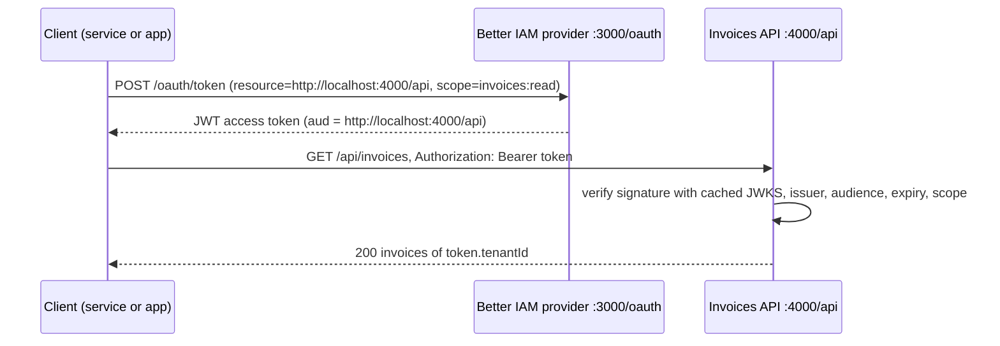

import { Bot, KeyRound, Server, ShieldCheck } from '@/lib/icons';

In this guide you turn the Better IAM instance from the [Quickstart](/docs/quickstart) into an OAuth 2.0
authorization server and protect a second service, an invoices API that runs in its own process, with the access
tokens it issues. The API never calls Better IAM per request: it verifies signed JWT access tokens locally and checks
their scopes. You will build:

- an OAuth provider mounted at `http://localhost:3000/oauth`, with persistent keys and a consent page;
- a resource server declaration for the invoices API (`http://localhost:4000/api`) with two scopes, `invoices:read`
  and `invoices:write`;
- a machine-to-machine client that acts as a <Term id="service-account">service account</Term> and gets tokens with
  the client credentials grant;
- the invoices API in [Hono](https://hono.dev) (or Express), with one middleware that verifies tokens and requires a
  scope per route;
- a browser client that gets tokens for a signed-in person with the authorization code flow.



## Prerequisites

- The project from the [Quickstart](/docs/quickstart): `better-iam.config.mjs`, `iam.ts`, a migrated database, and
  the organization Acme with an owner who signs in with a password. Export these variables in the shell you run the
  scripts from:

  ```bash
  export ACME_TENANT_ID=…          # the tenant.id of Acme
  export ACME_OWNER_EMAIL=owner@acme.test
  export ACME_OWNER_PASSWORD='another long password'
  ```

- Node.js 22.12 or newer, and `tsx` (or any TypeScript runner) for the scripts.
- `curl` to test the API.

Better IAM packages the provider as `@better-iam/oauth`, also exposed by the umbrella package as `better-iam/oauth`.
Every import in this guide uses the umbrella.

<Steps>
<Step>

### Generate the provider keys

The provider needs three kinds of key material, and all of them must survive restarts and be identical on every
replica:

| Key | Used for |
| --- | --- |
| `jwks` | Private signing keys for ID tokens and JWT access tokens. The API verifies tokens with their public half. |
| `cookieKeys` | Sign the provider's own interaction and session cookies. At least 32 characters each. |
| `encryptionKey` | Base64-encoded 32-byte key that encrypts client secrets and protocol records at rest. |

Generate them once and keep the file out of version control:

```js title="identity/scripts/generate-oauth-keys.mjs"
import { generateKeyPairSync, randomBytes, randomUUID } from 'node:crypto';
import { writeFile } from 'node:fs/promises';
import { resolve } from 'node:path';

const output = process.argv[2];
if (!output) throw new Error('Usage: node generate-oauth-keys.mjs ./oauth-keys.json');
const pair = generateKeyPairSync('rsa', { modulusLength: 2048 });
const jwk = { ...pair.privateKey.export({ format: 'jwk' }), use: 'sig', alg: 'RS256', kid: randomUUID() };
await writeFile(
  resolve(output),
  JSON.stringify(
    {
      jwks: { keys: [jwk] },
      cookieKeys: [randomBytes(32).toString('base64url')],
      encryptionKey: randomBytes(32).toString('base64'),
    },
    null,
    2,
  ),
  { flag: 'wx', mode: 0o600 },
);
console.log(`Wrote ${resolve(output)}. Set OAUTH_KEY_FILE to this path.`);
```

```bash
node scripts/generate-oauth-keys.mjs ./oauth-keys.json
export OAUTH_KEY_FILE="$PWD/oauth-keys.json"
```

<Callout type="warn" title="Never regenerate keys at startup">
  New signing keys invalidate every token already issued, new cookie keys end pending sign-ins, and a new encryption
  key makes stored protocol records unreadable. In production, load this material from your
  [secret store](/docs/operations/deployment/secrets).
</Callout>

</Step>
<Step>

### Create the provider and declare the API

`createOAuthProvider` builds the authorization server. `iam.protocolHost` supplies its database access, credential
checks, permission checks, and session validation. `resourceServers` declares each API that accepts its tokens, keyed
by a **resource indicator** (RFC 8707): an absolute URI without query or fragment that names the API. Tokens requested
for it carry it as their audience (`aud`) and contain only the scopes listed for it.

```ts title="identity/oauth.ts"
import { readFileSync } from 'node:fs';
import { createOAuthProvider } from 'better-iam/oauth';
import { iam } from './iam';

const keys = JSON.parse(readFileSync(process.env.OAUTH_KEY_FILE!, 'utf8'));
export const origin = 'http://localhost:3000';
export const invoicesApi = 'http://localhost:4000/api';

export const issuer = createOAuthProvider({
  ...iam.protocolHost,
  issuer: `${origin}/oauth`,
  jwks: keys.jwks,
  cookieKeys: keys.cookieKeys,
  encryptionKey: keys.encryptionKey,
  trustedOrigins: [origin],
  allowInsecureLocalhost: true, // development only: allows http:// on localhost. Use HTTPS and remove it in production.
  resourceServers: {
    [invoicesApi]: { scopes: ['invoices:read', 'invoices:write'], accessTokenTtl: 600 },
  },
  interactionUrl: (uid) => `${origin}/interactions/${encodeURIComponent(uid)}`,
  renderDevicePage: ({ form }) => `<!doctype html><title>Device sign-in</title>${form}`,
  renderLogoutPage: ({ form }) => `<!doctype html><title>Sign out</title>${form}`,
});
```

| Option | Value here | Why |
| --- | --- | --- |
| `issuer` | `http://localhost:3000/oauth` | Written into every token as `iss`. It never changes after launch, and endpoint URLs keep its path: the token endpoint is `http://localhost:3000/oauth/token`, the public keys `http://localhost:3000/oauth/jwks`. |
| `trustedOrigins` | `['http://localhost:3000']` | Origins allowed to submit the consent form (`completeInteraction`), as a CSRF defense. |
| `resourceServers` | the invoices API | Its `scopes` are what tokens for it may carry; `accessTokenTtl` is the token lifetime in seconds (default 900). `accessTokenFormat` defaults to `jwt`, which the API can verify offline. |
| `interactionUrl` | `/interactions/{uid}` | Where the provider sends the browser when a person must sign in or consent. You build that page in a later step. |
| `allowInsecureLocalhost` | `true` | Permits `http://` URLs on loopback hosts. Local development only. |

`renderDevicePage` and `renderLogoutPage` are required even if you never use the device flow or RP-initiated logout;
they wrap the provider's CSRF-protected forms in your own HTML. See
[OAuth/OIDC provider](/docs/federation/oauth-provider#set-up-the-provider) for every option.

</Step>
<Step>

### Mount the provider

`iam.useProtocol(issuer)` registers the provider, and `iam.nodeHandler` then serves everything under the issuer path
(`/oauth/...`) plus the metadata document at `/.well-known/oauth-authorization-server/oauth`. The provider is a Node
mount, so serve it with `nodeHandler` (not the fetch `handler`). The interaction route is yours:

```ts title="identity/server.ts"
import { createServer } from 'node:http';
import { iam } from './iam';
import { issuer, origin } from './oauth';
import { interaction } from './interactions';

iam.useProtocol(issuer);

createServer(async (req, res) => {
  const { pathname } = new URL(req.url ?? '/', origin);
  try {
    if (pathname.startsWith('/interactions/')) return await interaction(req, res);
    await iam.nodeHandler(req, res); // /api/iam, /oauth/*, /.well-known/oauth-authorization-server/oauth
  } catch (error) {
    if (!res.headersSent) res.writeHead(400, { 'content-type': 'text/plain' });
    res.end(error instanceof Error ? error.message : 'Request failed');
  }
}).listen(3000);

// Back-channel logout: end OAuth grants whose IAM session ended (sign-out, deactivation, expiry).
setInterval(() => void issuer.logoutEndedSessions().catch(() => undefined), 60_000).unref();
```

The interaction page has two halves. On `GET`, `issuer.interactionDetails(req, res)` says which client asks for which
scopes and resources, and you render a consent screen. On `POST`, `issuer.completeInteraction(req, res, { credential,
consent })` records the answer and redirects the browser back to the client. The `credential` must be the person's
real IAM session (their cookie), never an ID from the form.

```ts title="identity/interactions.ts"
import type { IncomingMessage, ServerResponse } from 'node:http';
import { iam } from './iam';
import { issuer } from './oauth';

function headersOf(req: IncomingMessage): Headers {
  const headers = new Headers();
  for (const [name, value] of Object.entries(req.headers))
    if (value !== undefined) headers.set(name, Array.isArray(value) ? value.join(', ') : value);
  return headers;
}

async function readForm(req: IncomingMessage): Promise<URLSearchParams> {
  let body = '';
  for await (const chunk of req) body += chunk;
  return new URLSearchParams(body);
}

const escape = (value: string) =>
  value.replace(/[&<>"']/g, (c) => `&#${c.charCodeAt(0)};`);

export async function interaction(req: IncomingMessage, res: ServerResponse): Promise<void> {
  const credential = { headers: headersOf(req) }; // the person's IAM session cookie
  const signedIn = await iam.authenticate(credential).then(
    () => true,
    () => false,
  );
  if (!signedIn) {
    // Send the person to your existing sign-in page, then back here.
    res.writeHead(303, { location: `/sign-in?next=${encodeURIComponent(req.url ?? '/')}` });
    res.end();
    return;
  }
  if (req.method === 'GET') {
    const details = await issuer.interactionDetails(req, res);
    res.writeHead(200, { 'content-type': 'text/html; charset=utf-8', 'cache-control': 'no-store' });
    res.end(`<!doctype html>
<h1>${escape(details.client.name)} wants access</h1>
<p>Scopes: ${details.scopes.map(escape).join(', ')}</p>
<p>APIs: ${details.resources.map(escape).join(', ')}</p>
<form method="post">
  <button name="consent" value="yes">Allow</button>
  <button name="consent" value="no">Deny</button>
</form>`);
    return;
  }
  const form = await readForm(req);
  await issuer.completeInteraction(req, res, { credential, consent: form.get('consent') === 'yes' });
}
```

`/sign-in` stands for the sign-in page your product already has (see
[Email and password](/docs/authentication/email-and-password)). The person must be signed in to the client's
<Term id="tenant">tenant</Term>; otherwise `completeInteraction` fails with `TENANT_MISMATCH`.

Start the identity service and check the discovery document:

```bash
npx tsx server.ts
curl -s http://localhost:3000/.well-known/oauth-authorization-server/oauth | head -c 300
```

</Step>
<Step>

### Register a machine-to-machine client

A nightly billing job has no person behind it, so it uses the **client credentials** grant. Such a client must act as
an active service account in the same tenant, and its tokens name that service account as `identity_id`, so the API
knows which non-human identity is calling. Registering a client needs `iam:oauth:clients:create`, which the
organization owner has.

```ts title="identity/scripts/register-billing-client.ts"
import { iam } from '../iam';
import { invoicesApi, issuer } from '../oauth';

const tenantId = process.env.ACME_TENANT_ID!;
const signIn = await iam.api.auth.signIn({
  tenantId,
  email: process.env.ACME_OWNER_EMAIL!,
  password: process.env.ACME_OWNER_PASSWORD!,
});
if ('mfaRequired' in signIn) throw new Error('This owner needs MFA: complete it as the quickstart root did');
const owner = { token: signIn.token };

const billing = await iam.api.serviceAccounts.create(owner, {
  tenantId,
  name: 'Billing sync',
  description: 'Reads invoices every night',
});

const { clientId, clientSecret } = await issuer.registerClient(owner, {
  tenantId,
  clientId: 'billing-sync',
  name: 'Billing sync',
  redirectUris: [],
  grantTypes: ['client_credentials'],
  serviceAccountId: billing.id,
  scopes: ['invoices:read'], // the most this client may ever ask for
  resources: [invoicesApi], // the APIs it may get tokens for
});

console.log({ clientId, clientSecret }); // the secret is shown once: store it in the job's secret store
```

```bash
npx tsx scripts/register-billing-client.ts
export BILLING_CLIENT_SECRET=…   # clientSecret from the output
```

Two lists decide what this client can ever get: `scopes` (its maximum scopes) and `resources` (the APIs it may get
tokens for). A token request for any other API fails with `invalid_target`, and scopes the API does not define are
dropped from its tokens. `iam.api.serviceAccounts.create` is also available as `POST /api/iam/serviceAccounts/create`.

</Step>
<Step>

### Verify tokens in the API

The invoices API is a separate service. It needs only the issuer URL and its own resource indicator.
`createAccessTokenVerifier` fetches the provider's public keys from `{issuer}/jwks`, caches them, refetches on an
unknown key ID (so key rollover needs no change here), and checks the signature, `typ: at+jwt`, issuer, audience,
expiry, and the scopes you require.

```npm
npm i better-iam hono @hono/node-server
```

```ts title="invoices-api/src/auth.ts"
import { createAccessTokenVerifier } from 'better-iam/oauth';

export const verifier = createAccessTokenVerifier({
  issuer: 'http://localhost:3000/oauth', // exactly as in the provider's discovery document
  audience: 'http://localhost:4000/api', // this API's resource indicator
  // tenantId: process.env.ACME_TENANT_ID, // set it when this API serves one organization only
});
```

Each route names the scopes it needs. A missing or invalid token fails with `INVALID_TOKEN` (401) and a token without
a required scope with `INSUFFICIENT_SCOPE` (403); `verifier.challenge(error)` builds the `WWW-Authenticate` header
that tells the client which.

<Tabs items={['Hono', 'Express']}>
<Tab value="Hono">

```ts title="invoices-api/src/server.ts"
import { serve } from '@hono/node-server';
import { Hono } from 'hono';
import { createMiddleware } from 'hono/factory';
import { IamError } from 'better-iam/core';
import type { VerifiedAccessToken } from 'better-iam/oauth';
import { verifier } from './auth';

type Env = { Variables: { token: VerifiedAccessToken } };

const requireScopes = (...scopes: string[]) =>
  createMiddleware<Env>(async (c, next) => {
    try {
      const token = await verifier.verifyRequest(
        {
          authorization: c.req.header('authorization'),
          dpop: c.req.header('dpop'),
          method: c.req.method,
          url: c.req.url,
        },
        { scopes },
      );
      c.set('token', token);
    } catch (error) {
      if (!(error instanceof IamError)) throw error;
      return c.json(
        { error: error.code, message: error.message },
        error.status as 401 | 403,
        { 'www-authenticate': verifier.challenge(error, 'invoices', { scopes }) },
      );
    }
    await next();
  });

const invoices = [
  { id: 'inv_1', tenantId: process.env.ACME_TENANT_ID, amountCents: 12_000 },
];

const app = new Hono<Env>();

app.get('/api/invoices', requireScopes('invoices:read'), (c) => {
  const token = c.get('token');
  // Scope every query to the token's tenant. The token says who calls and with which scopes;
  // what that caller may see in your data is still your product's decision.
  return c.json(invoices.filter((invoice) => invoice.tenantId === token.tenantId));
});

app.post('/api/invoices', requireScopes('invoices:write'), async (c) => {
  const token = c.get('token');
  const body = await c.req.json<{ amountCents: number }>();
  const invoice = { id: `inv_${Date.now()}`, tenantId: token.tenantId, amountCents: body.amountCents };
  invoices.push(invoice);
  return c.json(invoice, 201);
});

serve({ fetch: app.fetch, port: 4000 });
```

</Tab>
<Tab value="Express">

```ts title="invoices-api/src/server.ts"
import express, { type NextFunction, type Request, type Response } from 'express';
import { IamError } from 'better-iam/core';
import type { VerifiedAccessToken } from 'better-iam/oauth';
import { verifier } from './auth';

const requireScopes =
  (...scopes: string[]) =>
  async (req: Request, res: Response, next: NextFunction) => {
    try {
      res.locals.token = await verifier.verifyRequest(
        {
          authorization: req.headers.authorization,
          dpop: req.get('dpop'),
          method: req.method,
          url: `${req.protocol}://${req.get('host')}${req.originalUrl}`, // absolute URL, for DPoP proofs
        },
        { scopes },
      );
      next();
    } catch (error) {
      if (!(error instanceof IamError)) return next(error);
      res
        .status(error.status)
        .set('www-authenticate', verifier.challenge(error, 'invoices', { scopes }))
        .json({ error: error.code, message: error.message });
    }
  };

const invoices = [
  { id: 'inv_1', tenantId: process.env.ACME_TENANT_ID, amountCents: 12_000 },
];

const app = express();
app.use(express.json());

app.get('/api/invoices', requireScopes('invoices:read'), (_req, res) => {
  const token = res.locals.token as VerifiedAccessToken;
  res.json(invoices.filter((invoice) => invoice.tenantId === token.tenantId));
});

app.post('/api/invoices', requireScopes('invoices:write'), (req, res) => {
  const token = res.locals.token as VerifiedAccessToken;
  const invoice = { id: `inv_${Date.now()}`, tenantId: token.tenantId, amountCents: Number(req.body.amountCents) };
  invoices.push(invoice);
  res.status(201).json(invoice);
});

app.listen(4000);
```

</Tab>
</Tabs>

A verified token has these fields:

| Field | Meaning |
| --- | --- |
| `subject` | The person (`sub`), or the client for client-credentials tokens. |
| `clientId` | The application the token was issued to. |
| `tenantId` | The tenant of the client and account. Scope your data access to it. |
| `identityId` | The service account behind a client-credentials client. |
| `scopes` | The scopes granted for this API. |
| `audience`, `expiresAt`, `issuedAt`, `tokenId` | `aud`, `exp`, `iat`, and `jti`. |
| `boundKey` | For a DPoP-bound token, the thumbprint of the key it is bound to. |
| `actor` | For an exchanged token, the client acting for `subject` (RFC 8693 `act`). |
| `claims` | Every claim of the token. |

Use `verifyRequest` for HTTP requests: it checks DPoP proofs when a token is key-bound. `verifier.verify(token, {
scopes })` checks a bare token string and refuses DPoP-bound tokens. Opaque tokens (`accessTokenFormat: 'opaque'`)
cannot be verified offline.

<Callout type="info" title="Prefer one call per request?">
  `createResourceGuard` from `better-iam/oauth` wraps the same verifier for fetch-style frameworks such as Hono:
  `const { response, token } = await guard.check(c.req.raw, { scopes })` returns either a ready `401`/`403`
  response or the verified token, and also serves the API's protected resource metadata (RFC 9728). See
  [Protect the MCP server](/docs/federation/mcp-authorization#protect-the-mcp-server).
</Callout>

Start the API in a second terminal:

```bash
cd invoices-api && npx tsx src/server.ts
```

</Step>
<Step>

### Get a token and call the API

The billing job asks the token endpoint for a token restricted to the invoices API with the `resource` parameter,
authenticating with its client ID and secret (`client_secret_basic`, the default):

```bash
TOKEN=$(curl -s -u "billing-sync:$BILLING_CLIENT_SECRET" \
  -d grant_type=client_credentials \
  -d resource=http://localhost:4000/api \
  -d scope=invoices:read \
  http://localhost:3000/oauth/token | node -e "process.stdin.on('data', d => console.log(JSON.parse(d).access_token))")

curl -s http://localhost:4000/api/invoices -H "authorization: Bearer $TOKEN"
```

In code, the job does the same with `fetch`:

```ts title="billing-job/token.ts"
export async function invoicesToken(): Promise<string> {
  const response = await fetch('http://localhost:3000/oauth/token', {
    method: 'POST',
    headers: {
      authorization: `Basic ${btoa(`billing-sync:${process.env.BILLING_CLIENT_SECRET}`)}`,
      'content-type': 'application/x-www-form-urlencoded',
    },
    body: new URLSearchParams({
      grant_type: 'client_credentials',
      resource: 'http://localhost:4000/api',
      scope: 'invoices:read',
    }),
  });
  if (!response.ok) throw new Error(`Token request failed: ${response.status}`);
  const { access_token } = (await response.json()) as { access_token: string; expires_in: number };
  return access_token; // valid for 600 seconds (the resource server's accessTokenTtl); cache it until then
}
```

</Step>
<Step>

### Let people call the API from an app

When a person uses a web or mobile app, the app gets tokens through the **authorization code flow with PKCE**:
the person signs in to Better IAM, approves the app on your interaction page, and the app receives a token for the
API. Register a public client (no secret; PKCE is required for every client) that may request the invoices API:

```ts title="identity/scripts/register-web-client.ts"
import { iam } from '../iam';
import { invoicesApi, issuer } from '../oauth';

const tenantId = process.env.ACME_TENANT_ID!;
const signIn = await iam.api.auth.signIn({
  tenantId,
  email: process.env.ACME_OWNER_EMAIL!,
  password: process.env.ACME_OWNER_PASSWORD!,
});
if ('mfaRequired' in signIn) throw new Error('This owner needs MFA');

await issuer.registerClient(
  { token: signIn.token },
  {
    tenantId,
    clientId: 'invoices-web',
    name: 'Invoices',
    public: true,
    redirectUris: ['http://localhost:5173/callback'],
    scopes: ['openid', 'offline_access', 'invoices:read', 'invoices:write'],
    resources: [invoicesApi],
  },
);
```

The app sends the person to the authorization endpoint with `resource` and a PKCE challenge, then exchanges the code
with the same `resource`:

```http
GET /oauth/auth?client_id=invoices-web&response_type=code
  &scope=openid%20offline_access%20invoices:read
  &resource=http://localhost:4000/api
  &redirect_uri=http://localhost:5173/callback
  &code_challenge=...&code_challenge_method=S256&state=...&prompt=consent
```

```http
POST /oauth/token
Content-Type: application/x-www-form-urlencoded

grant_type=authorization_code&client_id=invoices-web&code=...&code_verifier=...
&redirect_uri=http://localhost:5173/callback&resource=http://localhost:4000/api
```

Use an OAuth client library such as `oauth4webapi` for the PKCE and state handling. The resulting access token has
`sub` set to the person and `tenant_id` to their organization, and it works with the same API middleware. Without
`resource`, an OpenID request receives a UserInfo access token, which the API rejects because its audience is not
the API.

Consent is bound to the person's IAM <Term id="session">session</Term>: signing out, deactivation, or tenant
suspension ends the app's refresh tokens. People list and disconnect their apps with `issuer.listGrants` and
`issuer.revokeGrant` ([Consent and connected apps](/docs/federation/oauth-provider#consent-and-connected-apps)).

</Step>
<Step>

### Harden for production

| Setting | What to do |
| --- | --- |
| HTTPS | Use an `https://` issuer and resource indicators, and remove `allowInsecureLocalhost`. Behind a TLS-terminating proxy, set `trustProxy: true`. |
| Key material | Load `jwks`, `cookieKeys`, and `encryptionKey` from your secret store; rotate signing keys by publishing the new key alongside the old ones. |
| Sender-constrained tokens | Register high-value clients with `requireDpop: true`, so a leaked token is useless without the client's private key. The API middleware above already checks DPoP proofs. See [DPoP](/docs/federation/oauth-resource-servers#dpop). |
| One organization per API | Pass `tenantId` to `createAccessTokenVerifier` when an API serves a single organization and does not filter by `token.tenantId` itself. |
| API-to-API calls | Use [token exchange](/docs/federation/oauth-resource-servers#token-exchange) instead of forwarding a person's token to another API. |
| Secret leaks | `issuer.rotateClientSecret(credential, { tenantId, clientId, revokeTokens: true })` issues a new secret and revokes tokens obtained with the old one. |
| Back-channel logout | Keep `issuer.logoutEndedSessions()` running on an interval and after sign-out events. See [Protocol jobs](/docs/operations/jobs#protocol-jobs). |

</Step>
</Steps>

## Verify it works

With both services running and `TOKEN` set as in the previous step:

```bash
# 1. No token: 401 with a WWW-Authenticate challenge
curl -si http://localhost:4000/api/invoices | grep -i -E '^HTTP|www-authenticate'
# HTTP/1.1 401 Unauthorized
# www-authenticate: DPoP realm="invoices", error="invalid_token", algs="…", Bearer realm="invoices", error="invalid_token"

# 2. Read with the invoices:read token: 200 and Acme's invoices
curl -s http://localhost:4000/api/invoices -H "authorization: Bearer $TOKEN"
# [{"id":"inv_1","tenantId":"…","amountCents":12000}]

# 3. Write with the same token: 403, the scope is missing
curl -si -X POST http://localhost:4000/api/invoices -H "authorization: Bearer $TOKEN" \
  -H 'content-type: application/json' -d '{"amountCents":500}' | grep -i -E '^HTTP|www-authenticate'
# HTTP/1.1 403 Forbidden
# www-authenticate: … error="insufficient_scope", scope="invoices:write" …
```

To confirm the audience check, register a second resource server in `resourceServers`, get a token for it, and
send it to the invoices API: it is refused with `INVALID_TOKEN`, because its `aud` is the other API.

The provider audits client administration in the tenant's [audit chain](/docs/concepts/events/audit-chain):
`iam.api.audit.list(owner, { tenantId, action: 'iam:oauth:RegisterClient' })` returns the registration of
`billing-sync`.

## Troubleshooting

<Accordions>
<Accordion title="The token request answers invalid_target">

The client asked for a `resource` that is not in its registered `resources`, or that is not declared in the
provider's `resourceServers`. The string must match exactly, including scheme, port, and path
(`http://localhost:4000/api`). Add it with `issuer.updateClient(credential, { tenantId, clientId, resources })`.

</Accordion>
<Accordion title="The token request answers invalid_client">

The client ID or secret is wrong, or the client was revoked. A secret is shown only once, at registration or
rotation; if it was lost, call `issuer.rotateClientSecret(credential, { tenantId, clientId })` to issue a new one.

</Accordion>
<Accordion title="Every request to the API fails with INVALID_TOKEN">

Check, in this order:

- `issuer` in `createAccessTokenVerifier` is exactly the provider's `issuer` (compare with the `issuer` field of
  `/.well-known/oauth-authorization-server/oauth`).
- `audience` is the resource indicator the token was requested for. A token requested without `resource` is a
  UserInfo token and is always refused.
- The API can reach `{issuer}/jwks`. If it cannot, pass the public keys as `jwks`.
- The token has not expired, and the clocks differ by less than `clockTolerance` (30 seconds by default).
- The token is not DPoP-bound. A bound token needs the `DPoP` scheme and a `DPoP` proof header; see
  [`INVALID_TOKEN`](/docs/reference/errors#invalid_token).

</Accordion>
<Accordion title="A route answers INSUFFICIENT_SCOPE although the client has the scope">

The token carries only the scopes that the client requested, that the client is registered for, and that the
resource server defines. Request the scope explicitly (`scope=invoices:write`), and check that the client's `scopes`
include it. See [`INSUFFICIENT_SCOPE`](/docs/reference/errors#insufficient_scope).

</Accordion>
<Accordion title="registerClient fails with INVALID_INPUT">

Common causes: a `client_credentials` client without `serviceAccountId`, or a service account that is not active or
not in the client's tenant; an authorization code client without `redirectUris`; an `http://` redirect URI on a
non-loopback host; a scope the provider does not support; or a `resources` entry missing from `resourceServers`.

</Accordion>
<Accordion title="The consent page fails with TENANT_MISMATCH or CSRF">

`TENANT_MISMATCH`: the person's session belongs to another tenant than the client's. Sign them in to the client's
organization first. `CSRF`: the consent form was posted from an origin that is not in `trustedOrigins`.

</Accordion>
</Accordions>

## Next steps

<Cards>
  <Card icon={<Server />} title="Resource servers and tokens" href="/docs/federation/oauth-resource-servers">
    Every resource server and verifier option, DPoP, and token exchange.
  </Card>
  <Card icon={<KeyRound />} title="OAuth/OIDC provider" href="/docs/federation/oauth-provider">
    Client types, consent, connected apps, token lifetimes, and back-channel logout.
  </Card>
  <Card icon={<Bot />} title="Secure an MCP server" href="/docs/guides/secure-an-mcp-server">
    Put per-tool permissions and OAuth in front of a Model Context Protocol server.
  </Card>
  <Card icon={<ShieldCheck />} title="AI agents that act for users" href="/docs/guides/ai-agents-on-behalf-of-users">
    Give an AI agent its own identity and delegated, confirmable access.
  </Card>
</Cards>
