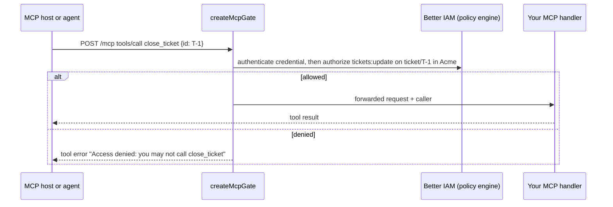

import { Bot, KeyRound, Server, ShieldCheck } from '@/lib/icons';

In this guide you build a small support-ticket server that speaks the
[Model Context Protocol](https://modelcontextprotocol.io) (MCP) over Streamable HTTP, and put `createMcpGate` from
`@better-iam/mcp` in front of it. The gate decides every `tools/call` with the Better IAM policy engine, removes
tools the caller may not use from `tools/list`, and lets OAuth-capable MCP hosts (desktop assistants, IDEs) discover
your authorization server and sign the person in. You will build:

- a `ticket` resource type and per-tool permission rules (`tickets:read`, `tickets:update`, `tickets:delete`);
- an MCP endpoint at `http://localhost:4100/mcp` behind the gate, served with Hono;
- callers with different access: an organization owner, a read-only service-account key, and OAuth access tokens
  issued to MCP hosts that registered themselves (RFC 7591);
- human confirmation for risky tools when an AI agent calls them on a person's behalf.



## Prerequisites

- The project from the [Quickstart](/docs/quickstart) (`better-iam.config.mjs`, `iam.ts`, a migrated database, and
  the organization Acme with an owner who signs in with a password), with these variables exported:

  ```bash
  export ACME_TENANT_ID=…          # the tenant.id of Acme
  export ACME_OWNER_EMAIL=owner@acme.test
  export ACME_OWNER_PASSWORD='another long password'
  ```

- For the OAuth part (step 6): the provider from [Protect an API with OAuth](/docs/guides/protect-an-api), mounted at
  `http://localhost:3000/oauth`, with its interaction page.
- Node.js 22.12 or newer, `tsx`, and `curl`.

```npm
npm i better-iam hono @hono/node-server
```

`@better-iam/mcp` is also exposed by the umbrella package as `better-iam/mcp`, which this guide uses. The gate works
with any MCP server that accepts a Web `Request` and returns a `Response`; it does not depend on an MCP SDK.

<Steps>
<Step>

### Declare what the tools act on

The gate asks the policy engine whether the caller may perform an **action** on a **resource**, so declare the
resource types and actions your tools use. `ticket` is one support ticket; `ticket-queue` is an organization's whole
queue, which search and tool listings are decided on. Both are application-owned: your `resolveResource` loads their
owner from your own storage.

```js title="tickets.mjs"
// Stands in for your product's ticket table.
const tenantId = process.env.ACME_TENANT_ID;
export const tickets = new Map([
  ['T-1', { id: 'T-1', tenantId, title: 'Cannot export invoices', status: 'open' }],
  ['T-2', { id: 'T-2', tenantId, title: 'Typo on the pricing page', status: 'open' }],
]);
```

```js title="better-iam.config.mjs"
import { IamError } from 'better-iam';
import { sqliteAdapter } from 'better-iam/adapter-sqlite';
import { findDocument } from './documents.mjs'; // your document lookup from the Quickstart
import { tickets } from './tickets.mjs';

const ticketActions = ['tickets:read', 'tickets:update', 'tickets:delete'];

export default {
  database: sqliteAdapter({ filename: './iam.db' }),
  secret: process.env.BETTER_IAM_SECRET,
  baseURL: process.env.BETTER_IAM_BASE_URL,
  authentication: {
    sendEmail: async (message) => {
      console.log(message.template, message.to, message.payload); // development only
    },
  },
  permissions: {
    resourceTypes: {
      document: { actions: ['documents:read', 'documents:write'], attributes: { ownerId: 'string' } },
      ticket: { description: 'A support ticket', actions: ticketActions },
      'ticket-queue': { description: "An organization's ticket queue", actions: ticketActions },
    },
  },
  resolveResource: async ({ type, id }) => {
    if (type === 'ticket-queue') {
      // A queue's ID is the ID of the organization that owns it.
      return { type, id, tenantId: id };
    }
    if (type === 'ticket') {
      const ticket = tickets.get(id);
      if (!ticket) throw new IamError('NOT_FOUND', 'Ticket not found', 404);
      return { type, id, tenantId: ticket.tenantId };
    }
    if (type === 'document') {
      const document = await findDocument(id);
      return { type, id, tenantId: document.tenantId, attributes: { ownerId: document.ownerId } };
    }
    throw new IamError('NOT_FOUND', 'Unknown resource type', 404);
  },
};
```

The resolver must return the `type` and `id` it was asked about and the tenant from your storage; a record of another
tenant fails the check with `RESOURCE_MISMATCH`. See
[Application-owned and managed resources](/docs/concepts/resources-and-catalog#application-owned-and-managed-resources).

</Step>
<Step>

### Create roles and a test caller

Roles say who may use which tools. Create a read-only role, give it to a service account, and issue that service
account an API key to test with. The owner already holds every permission in Acme.

```ts title="scripts/setup-mcp.ts"
import { iam } from '../iam';

const tenantId = process.env.ACME_TENANT_ID!;
const signIn = await iam.api.auth.signIn({
  tenantId,
  email: process.env.ACME_OWNER_EMAIL!,
  password: process.env.ACME_OWNER_PASSWORD!,
});
if ('mfaRequired' in signIn) throw new Error('This owner needs MFA');
const owner = { token: signIn.token };

const reader = await iam.api.roles.create(owner, {
  tenantId,
  name: 'Ticket reader',
  permissions: ['tickets:read'],
});
await iam.api.roles.create(owner, {
  tenantId,
  name: 'Support',
  permissions: ['tickets:read', 'tickets:update'],
});

const digest = await iam.api.serviceAccounts.create(owner, { tenantId, name: 'Ticket digest' });
await iam.api.bindings.create(owner, {
  tenantId,
  roleId: reader.id,
  subjectType: 'identity',
  subjectId: digest.id,
});
const { token: readerKey } = await iam.api.credentials.create(owner, {
  tenantId,
  identityId: digest.id,
  name: 'mcp-test',
});

console.log({ ownerToken: signIn.token, readerKey }); // test credentials for the next steps
```

```bash
npx tsx scripts/setup-mcp.ts
export OWNER_TOKEN=…   # ownerToken from the output
export READER_KEY=…    # readerKey from the output (a biam_key_… token)
```

Bind the `Support` role to the people who handle tickets with `iam.api.bindings.create` (or an invitation's
`roleIds`).

</Step>
<Step>

### Write the MCP handler

The handler is an ordinary Streamable HTTP MCP endpoint: it receives JSON-RPC messages over `POST` and answers with
JSON. It lists every tool; the gate filters the list per caller. Its second argument says who called.

```ts title="mcp/handler.ts"
import type { McpCaller } from 'better-iam/mcp';
import { tickets } from '../tickets.mjs';

export const tools = [
  {
    name: 'search_tickets',
    description: 'List open support tickets of the organization',
    inputSchema: { type: 'object', properties: { query: { type: 'string' } } },
  },
  {
    name: 'close_ticket',
    description: 'Close a support ticket',
    inputSchema: { type: 'object', properties: { id: { type: 'string' } }, required: ['id'] },
  },
  {
    name: 'delete_ticket',
    description: 'Permanently delete a support ticket',
    inputSchema: { type: 'object', properties: { id: { type: 'string' } }, required: ['id'] },
  },
  {
    name: 'ping',
    description: 'Check that the server is reachable',
    inputSchema: { type: 'object', properties: {} },
  },
];

type JsonRpcRequest = {
  jsonrpc: '2.0';
  id?: string | number | null;
  method: string;
  params?: Record<string, unknown>;
};

const result = (id: JsonRpcRequest['id'], value: unknown) =>
  Response.json({ jsonrpc: '2.0', id, result: value });
const text = (id: JsonRpcRequest['id'], value: string, isError = false) =>
  result(id, { content: [{ type: 'text', text: value }], isError });

export async function handleMcp(request: Request, caller: McpCaller): Promise<Response> {
  if (request.method !== 'POST') return new Response(null, { status: 405, headers: { allow: 'POST' } });
  const message = (await request.json()) as JsonRpcRequest;
  if (message.id === undefined) return new Response(null, { status: 202 }); // notifications

  const who = caller.kind === 'iam' ? caller.identityId : (caller.subject ?? caller.clientId);
  switch (message.method) {
    case 'initialize':
      return result(message.id, {
        // This demo accepts the client's protocol version; a production server negotiates it.
        protocolVersion: String(message.params?.protocolVersion ?? '2025-06-18'),
        capabilities: { tools: {} },
        serverInfo: { name: 'acme-tickets', version: '1.0.0' },
      });
    case 'ping':
      return result(message.id, {});
    case 'tools/list':
      return result(message.id, { tools });
    case 'tools/call': {
      const name = String(message.params?.name);
      const args = (message.params?.arguments ?? {}) as Record<string, unknown>;
      if (name === 'ping') return text(message.id, 'pong');
      if (name === 'search_tickets')
        return text(message.id, JSON.stringify([...tickets.values()].filter((t) => t.status === 'open')));
      const ticket = tickets.get(String(args.id));
      if (!ticket) return text(message.id, `No ticket ${String(args.id)}`, true);
      if (name === 'close_ticket') {
        ticket.status = 'closed';
        return text(message.id, `Closed ${ticket.id} for ${who}`);
      }
      if (name === 'delete_ticket') {
        tickets.delete(ticket.id);
        return text(message.id, `Deleted ${ticket.id} for ${who}`);
      }
      return text(message.id, `Unknown tool: ${name}`, true);
    }
    default:
      return Response.json({ jsonrpc: '2.0', id: message.id, error: { code: -32601, message: 'Method not found' } });
  }
}
```

</Step>
<Step>

### Put the gate in front

`createMcpGate` takes the Better IAM instance, the organization the server belongs to, and one rule per tool. It
returns `gate(request, next)`, which either answers the request itself (a challenge, a refused call) or passes it to
`next` with the authenticated caller.

```ts title="mcp/rules.ts"
import type { McpToolRule } from 'better-iam/mcp';

const tenantId = process.env.ACME_TENANT_ID!;
const queue = { type: 'ticket-queue', id: tenantId };
const ticketFrom = (args: Record<string, unknown>) => ({ type: 'ticket', id: String(args.id) });

export const toolRules: Record<string, McpToolRule> = {
  search_tickets: { action: 'tickets:read', resource: queue, scopes: ['tickets:read'] },
  close_ticket: { action: 'tickets:update', resource: ticketFrom, listAs: queue, scopes: ['tickets:write'] },
  delete_ticket: { action: 'tickets:delete', resource: ticketFrom, listAs: queue, scopes: ['tickets:write'] },
  ping: { public: true },
};
```

```ts title="mcp/server.ts"
import { serve } from '@hono/node-server';
import { Hono } from 'hono';
import { createMcpGate } from 'better-iam/mcp';
import { iam } from '../iam';
import { handleMcp } from './handler';
import { toolRules } from './rules';

const gate = createMcpGate({
  iam,
  tenantId: process.env.ACME_TENANT_ID!, // decisions are made in the organization that runs this server
  tools: toolRules,
  unlisted: 'deny', // a tool without a rule is hidden and refused (the default)
});

const app = new Hono();
app.all('/mcp', (c) => gate(c.req.raw, handleMcp));
serve({ fetch: app.fetch, port: 4100 });
```

Each tool rule has these fields:

| Field | Type | Description |
| --- | --- | --- |
| `action` | `string` | The Better IAM action a call needs, for callers with a Better IAM credential. |
| `resource` | `{ type, id }` or `(args) => { type, id }` | The resource the call acts on: fixed, or derived from the call's arguments. Defaults to `{ type: 'mcp-tool', id: toolName }`. |
| `listAs` | `{ type, id }` | For a derived `resource`: the resource that decides whether the tool appears in `tools/list`. Without it, such a tool is always listed. |
| `scopes` | `string[]` | Scopes an OAuth access token needs for the tool. Without `scopes`, OAuth callers are refused the tool. |
| `public` | `boolean` | Any authenticated caller may use the tool. |

The gate options:

| Option | Type | Default | Description |
| --- | --- | --- | --- |
| `iam` | `betterIam()` instance | required | Authenticates credentials (`authenticate`) and decides (`authorize`, `authorizeMany`). |
| `tenantId` | `string` or `(caller) => string \| undefined` | required | The organization decisions are made in. A function picks it per caller (`{ identityId, sessionTenantId }`); `undefined` refuses the caller. |
| `tools` | `Record<string, McpToolRule>` | required | The rules above, by tool name. |
| `unlisted` | `'deny' \| 'allow'` | `'deny'` | Tools without a rule: hidden and refused, or open to any authenticated caller. |
| `toolResourceType` | `string` | `'mcp-tool'` | The resource type of the default per-tool resource. |
| `oauth` | access-token verifier | none | Also accept OAuth access tokens, decided by each tool's `scopes`. |
| `metadata` | `{ resource, authorizationServers, scopes?, resourceName?, documentation? }` | none | Serve protected resource metadata (RFC 9728) and name it in `401` challenges. |
| `confirmations` | `boolean` | `true` when `iam.api.delegations` exists | Ask the person to confirm held-back actions for delegated agents. |
| `confirmationReason` | `(tool, args) => string` | which tool the agent wants to run | The reason shown to the person in a confirmation request. |
| `maxBodyBytes` | `number` | 4 MiB | Largest accepted JSON-RPC body; larger requests answer `413`. |

<Callout type="warn" title="Decide in the server's organization">
  `tenantId` is required because deciding in each caller's own tenant would let any organization grant itself access
  by writing policies in its own tenant. Fix it to the organization that runs the server, or choose it per caller
  from data you trust.
</Callout>

Start the server (it shares the database with your identity service):

```bash
npx tsx mcp/server.ts
```

</Step>
<Step>

### Test tool filtering and refusals

MCP clients send JSON-RPC over `POST` with `Accept: application/json, text/event-stream`. The gate accepts a Better
IAM credential as `Authorization: Bearer …` or `x-api-key`: a person's session token, a service-account or agent API
key, or a delegated agent session.

```bash
mcp() { curl -s http://localhost:4100/mcp -H "authorization: Bearer $1" \
  -H 'content-type: application/json' -H 'accept: application/json, text/event-stream' -d "$2"; echo; }

# The read-only service account sees only what it may use:
mcp "$READER_KEY" '{"jsonrpc":"2.0","id":1,"method":"tools/list"}'
# {"jsonrpc":"2.0","id":1,"result":{"tools":[{"name":"search_tickets",…},{"name":"ping",…}]}}

# Calling a hidden tool anyway is refused as a tool error the model can read:
mcp "$READER_KEY" '{"jsonrpc":"2.0","id":2,"method":"tools/call","params":{"name":"close_ticket","arguments":{"id":"T-1"}}}'
# {"jsonrpc":"2.0","id":2,"result":{"content":[{"type":"text","text":"Access denied: you may not call close_ticket"}],"isError":true}}

# The owner may use every tool:
mcp "$OWNER_TOKEN" '{"jsonrpc":"2.0","id":3,"method":"tools/call","params":{"name":"close_ticket","arguments":{"id":"T-1"}}}'
# {"jsonrpc":"2.0","id":3,"result":{"content":[{"type":"text","text":"Closed T-1 for …"}],"isError":false}}
```

How the gate treats each kind of request:

| Request | Gate answer |
| --- | --- |
| No credential | `401` with `WWW-Authenticate: Bearer` (plus `resource_metadata="…"` once `metadata` is set). |
| Invalid or expired credential | `401` with `error="invalid_token"`. |
| `tools/list` | Forwarded; tools the caller may not use are removed from the answer, in JSON and in event streams. Checks run 50 at a time with `authorizeMany`. |
| `tools/call` the caller may make | Forwarded to `next(request, caller)`. |
| `tools/call` the caller may not make | A JSON-RPC result with `isError: true` and the text `Access denied: you may not call {name}`, or `Unknown tool: {name}`. The server never sees it. |
| `tools/call` whose `params.name` is not a string | JSON-RPC error `-32602`, HTTP `400`. |
| A batch (JSON array) containing `tools/call` or `tools/list` | JSON-RPC error `-32600`, HTTP `400`. |
| Body that is not JSON | JSON-RPC error `-32700`, HTTP `400`. |
| `GET`, `DELETE`, and other methods | Authenticated, then forwarded unchanged (the Streamable HTTP event stream and session end). |

Denied Better IAM decisions are audited by the server like any other denied decision, so a model probing tools it
may not use shows up in the tenant's audit trail.

</Step>
<Step>

### Accept OAuth tokens from MCP hosts

Desktop assistants and IDEs connect to MCP servers they have never seen, so they configure themselves: the gate's
`401` names the server's protected resource metadata, the metadata names your authorization server, the host
registers itself there (dynamic client registration, RFC 7591), and the person signs in and approves it. The host
then calls the MCP server with a JWT access token whose audience is the MCP server.

First, declare the MCP server as a resource server on the provider and turn on registration. This is the provider
file from [Protect an API with OAuth](/docs/guides/protect-an-api) with two additions:

```ts title="oauth.ts"
import { readFileSync } from 'node:fs';
import { createOAuthProvider } from 'better-iam/oauth';
import { iam } from './iam';

const keys = JSON.parse(readFileSync(process.env.OAUTH_KEY_FILE!, 'utf8'));
export const origin = 'http://localhost:3000';
export const invoicesApi = 'http://localhost:4000/api';
export const ticketsMcp = 'http://localhost:4100/mcp';

export const issuer = createOAuthProvider({
  ...iam.protocolHost,
  issuer: `${origin}/oauth`,
  jwks: keys.jwks,
  cookieKeys: keys.cookieKeys,
  encryptionKey: keys.encryptionKey,
  trustedOrigins: [origin],
  allowInsecureLocalhost: true, // development only
  resourceServers: {
    [invoicesApi]: { scopes: ['invoices:read', 'invoices:write'], accessTokenTtl: 600 },
    [ticketsMcp]: { scopes: ['tickets:read', 'tickets:write'] }, // added
  },
  // Added: MCP hosts register themselves without a token. Every registration joins Acme, may ask for
  // at most these scopes, and may only get tokens for the MCP server.
  registration: {
    anonymous: () => ({
      tenantId: process.env.ACME_TENANT_ID!,
      scopes: ['openid', 'offline_access', 'tickets:read', 'tickets:write'],
      resources: [ticketsMcp],
      maxClients: 100,
    }),
  },
  interactionUrl: (uid) => `${origin}/interactions/${encodeURIComponent(uid)}`,
  renderDevicePage: ({ form }) => `<!doctype html><title>Device sign-in</title>${form}`,
  renderLogoutPage: ({ form }) => `<!doctype html><title>Sign out</title>${form}`,
});
```

A multi-tenant deployment maps each registration to the organization it belongs to, for example from the request's
`headers.host`, and returns `undefined` to decline. Registrations are public clients with PKCE unless the policy sets
`allowConfidential`, and anonymous registrations are capped per tenant by `maxClients`. For invited instead of open
registration, an administrator creates a registration token with `issuer.createRegistrationToken`; see
[Turn on dynamic registration](/docs/federation/mcp-authorization#turn-on-dynamic-registration).

Then give the gate a verifier for those tokens and the metadata to publish:

```ts title="mcp/server.ts"
import { serve } from '@hono/node-server';
import { Hono } from 'hono';
import { createMcpGate } from 'better-iam/mcp';
import { createAccessTokenVerifier } from 'better-iam/oauth';
import { iam } from '../iam';
import { handleMcp } from './handler';
import { toolRules } from './rules';

const resource = 'http://localhost:4100/mcp';
const authorizationServer = 'http://localhost:3000/oauth';

const gate = createMcpGate({
  iam,
  tenantId: process.env.ACME_TENANT_ID!,
  tools: toolRules,
  oauth: createAccessTokenVerifier({ issuer: authorizationServer, audience: resource }),
  metadata: {
    resource,
    authorizationServers: [authorizationServer],
    scopes: ['tickets:read', 'tickets:write'],
    resourceName: 'Acme tickets',
  },
});

const app = new Hono();
app.all('/mcp', (c) => gate(c.req.raw, handleMcp));
// The gate serves the metadata document itself; route its well-known path to the gate too.
app.all('/.well-known/oauth-protected-resource/mcp', (c) => gate(c.req.raw, handleMcp));
serve({ fetch: app.fetch, port: 4100 });
```

Restart the identity service and the MCP server. The metadata is now public:

```bash
curl -s http://localhost:4100/.well-known/oauth-protected-resource/mcp
# {"resource":"http://localhost:4100/mcp","authorization_servers":["http://localhost:3000/oauth"],
#  "scopes_supported":["tickets:read","tickets:write"],"bearer_methods_supported":["header"],"resource_name":"Acme tickets"}
```

The gate tries a bearer value as a Better IAM credential first and, when that fails, as an OAuth access token.
OAuth callers are decided only by each tool's `scopes`: the person's Better IAM roles are not evaluated for them, and
a token issued to another tenant than `tenantId` is refused. Grant `tickets:write` only to hosts that may change
tickets for anyone who consents, and apply your own checks in the handler with `caller.subject` when that is not
enough.

| Caller | `caller.kind` | Fields `next` receives | Decided by |
| --- | --- | --- | --- |
| Session, service-account or agent key, delegated session | `iam` | `credential`, `tenantId`, `identityId`, `identityKind`, `sessionKind`, `agentId?`, `delegationId?` | The policy engine: `action` on `resource` in `tenantId`. |
| OAuth access token | `oauth` | `clientId`, `subject?`, `tenantId?`, `scopes` | The tool's `scopes`. |

</Step>
<Step>

### Ask a person to confirm risky calls

When an AI agent acts for a person through a delegated session (see
[AI agents that act for users](/docs/guides/ai-agents-on-behalf-of-users)), the person can hold actions back for
confirmation call by call with the delegation's `confirm` list, for example `confirm: ['tickets:delete']`. The gate
handles this for you: when such an agent calls `delete_ticket`, the decision is denied, the gate files a confirmation
request with the person (`delegations.requestConfirmation`), and the agent gets a tool error telling it to retry:

```json
{
  "jsonrpc": "2.0",
  "id": 7,
  "result": {
    "content": [
      {
        "type": "text",
        "text": "The person you act for must confirm this call first. A confirmation request was sent to them (it expires at 2026-11-07T10:30:00.000Z). Call delete_ticket again once they approve it."
      }
    ],
    "isError": true,
    "_meta": {
      "better-iam/confirmationId": "…",
      "better-iam/confirmationExpiresAt": 1794047400000
    }
  }
}
```

The person receives a `delegation-confirmation` email when the deployment sends email, and approves with
`delegations.decideConfirmation`. The agent's next call to the same tool on the same ticket passes, once. Word the
request with `confirmationReason`, or turn the behavior off with `confirmations: false`:

```ts title="mcp/server.ts (gate options)"
confirmationReason: (tool, args) => `Your assistant wants to run ${tool} on ticket ${String(args.id)}.`,
```

</Step>
<Step>

### Use the decisions inside an MCP SDK server

If your server is built with an MCP SDK and you want the checks inside its handlers instead of in front of the
transport, `createMcpAuthorizer` takes the same options (without `metadata` and `maxBodyBytes`) and exposes the
gate's decisions:

```ts title="mcp/authorizer.ts"
import { createMcpAuthorizer, type McpCaller } from 'better-iam/mcp';
import { iam } from '../iam';
import { toolRules } from './rules';

export const authorizer = createMcpAuthorizer({
  iam,
  tenantId: process.env.ACME_TENANT_ID!,
  tools: toolRules,
});

// In your HTTP layer: undefined means no valid credential, so answer 401.
export const callerOf = (request: Request): Promise<McpCaller | undefined> => authorizer.authenticate(request);

// In your tools/call handler:
export async function assertCanCall(caller: McpCaller, name: string, args: Record<string, unknown>) {
  const decision = await authorizer.canCall(caller, name, args);
  // decision.reason: ALLOWED, PUBLIC, ACCESS_DENIED, UNKNOWN_TOOL, NO_RULE_FOR_CALLER,
  // INSUFFICIENT_SCOPE, or CONFIRMATION_REQUESTED (with decision.confirmation.id and expiresAt)
  if (!decision.allowed) throw new Error(`Refused: ${decision.reason}`);
}

// In your tools/list handler:
export const listFor = <T extends { name: string }>(caller: McpCaller, tools: T[]) =>
  authorizer.visibleTools(caller, tools);
```

</Step>
</Steps>

## Verify it works

1. Without a credential, the gate challenges and names the metadata:

   ```bash
   curl -si -X POST http://localhost:4100/mcp -d '{}' | grep -i -E '^HTTP|www-authenticate'
   # HTTP/1.1 401 Unauthorized
   # www-authenticate: Bearer resource_metadata="http://localhost:4100/.well-known/oauth-protected-resource/mcp"
   ```

2. With `READER_KEY`, `tools/list` contains only `search_tickets` and `ping`, and `close_ticket` is refused with
   `isError: true`. With `OWNER_TOKEN`, all four tools are listed and `close_ticket` succeeds.
3. Connect an MCP client that speaks Streamable HTTP, for example the MCP Inspector
   (`npx @modelcontextprotocol/inspector`; its option names vary between versions), at the URL
   `http://localhost:4100/mcp`. Either send `READER_KEY` as a bearer token, or let an OAuth-capable client run the
   flow: it reads the metadata, registers at `http://localhost:3000/oauth/reg`, sends you to the interaction page to
   sign in to Acme and approve it, and then lists the tools its scopes allow. The client must request its token with
   `resource=http://localhost:4100/mcp`; a token without it is not for the MCP server and is refused.
4. The registered host appears in `issuer.listClients(owner, { tenantId })` with `registeredVia: 'anonymous'`, and the
   registration is audited as `iam:oauth:RegisterClient`.

## Troubleshooting

<Accordions>
<Accordion title="Tool calls fail with a server error, even for the owner">

Resolution errors are thrown by `iam.authorize`, and the gate passes them on to your HTTP framework (Hono answers
`500`), so look at the server's error output. `RESOURCE_RESOLVER_REQUIRED` means the config has no
`resolveResource`; `RESOURCE_MISMATCH` means the resolver returned another `type`, `id`, or tenant than it was asked
about (for example, a ticket of another organization); `NOT_FOUND` from your resolver means the ticket ID in the
arguments does not exist. If calls are refused instead, check that the gate's `tenantId` is Acme's tenant ID.

</Accordion>
<Accordion title="roles.create fails with INVALID_ACTION">

An action in `permissions` is not in the catalog. Declare it in a resource type's `actions` in
`permissions.resourceTypes` and restart, so the instance loads the new catalog.

</Accordion>
<Accordion title="A tool appears in tools/list but its calls are refused">

A tool whose `resource` is a function and that has no `listAs` is always listed, because there are no arguments to
decide on yet. Add `listAs` (here, the ticket queue) so the listing reflects whether the caller holds the action at
all.

</Accordion>
<Accordion title="OAuth tokens are answered with 401 invalid_token">

The verifier's `issuer` must match the provider's `issuer` exactly, and its `audience` must be the resource
indicator the host requested (`http://localhost:4100/mcp`, the same string in `resourceServers`, the registration
policy's `resources`, and the gate's `metadata.resource`). A token for another tenant than the gate's `tenantId` is
refused too.

</Accordion>
<Accordion title="OAuth callers get Access denied for a tool">

OAuth callers are decided only by `scopes`. A tool without `scopes` is refused to them (`NO_RULE_FOR_CALLER`), and
a token without every listed scope is refused (`INSUFFICIENT_SCOPE`). Check the scopes the host requested and the
person approved.

</Accordion>
<Accordion title="The MCP host cannot register">

The registration endpoint answers `401 invalid_token` when the `anonymous` hook returns `undefined`, a registration
token is missing, expired, or used up, or the tenant is suspended. It answers `access_denied` when the tenant already
has `maxClients` anonymously registered clients. A registration asking for scopes outside the policy, grants other
than `authorization_code` and `refresh_token`, or a redirect URI that is not HTTPS, loopback HTTP, or a
reverse-domain custom scheme is refused.

</Accordion>
<Accordion title="Batched requests are rejected">

The gate refuses JSON-RPC batches that contain `tools/call` or `tools/list` (`-32600`), because batches were dropped
from MCP in the 2025-06-18 revision and could otherwise carry tool traffic past the per-call checks. Send one
message per request.

</Accordion>
</Accordions>

## Next steps

<Cards>
  <Card icon={<ShieldCheck />} title="AI agents that act for users" href="/docs/guides/ai-agents-on-behalf-of-users">
    Register an agent with a sponsor, delegate access, and confirm risky actions.
  </Card>
  <Card icon={<Bot />} title="Dynamic registration and MCP" href="/docs/federation/mcp-authorization">
    Registration policies, registration tokens, and the resource guard.
  </Card>
  <Card icon={<Server />} title="Resource servers and tokens" href="/docs/federation/oauth-resource-servers">
    Audience-restricted JWT access tokens, DPoP, and token exchange.
  </Card>
  <Card icon={<KeyRound />} title="AI agents" href="/docs/features/ai-agents">
    Sponsors, boundaries, delegations, hand-offs, and the kill switch.
  </Card>
</Cards>
