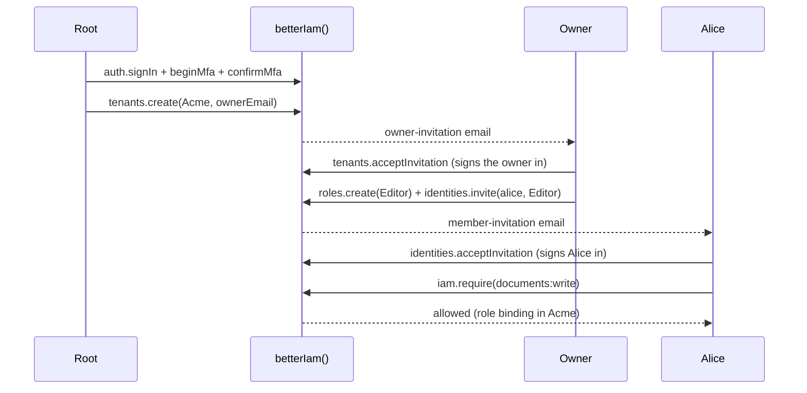

This walkthrough builds a working identity layer on SQLite in a few minutes: a configured instance, a migrated
database, a root administrator signed in with MFA, an organization with an owner, a custom role, and an enforced
authorization check. Every step uses the same APIs you will use in production. [Basic usage](#basic-usage), after
the walkthrough, lists the everyday calls (sign up, sign in, read the session, sign out, grant a role, check
access) with server and browser code side by side.

You will:

- create a configuration module and a `betterIam()` instance on SQLite;
- migrate the database and bootstrap the platform root administrator;
- sign the root in with a password and an authenticator app;
- create an organization, define an _Editor_ role, and invite a member with it;
- enforce `documents:write` in your own route with `iam.require`.

Already followed [Installation](/docs/installation) in an existing app? Skip to
[Migrate and bootstrap](#migrate-and-bootstrap).

<Callout title="Requirements">
  Node.js 22.12 or newer. Better IAM is ESM-only (set `"type": "module"` in your `package.json`) and ships
  TypeScript declarations. The SQLite adapter uses the
  native `better-sqlite3` driver and password hashing uses `argon2`, so your package manager must be allowed to run
  their install scripts. You also need an authenticator app (any TOTP app) for the root administrator's second
  factor.
</Callout>

<Steps>
<Step>

### Install

```npm
npm i better-iam
```

The umbrella package installs every `@better-iam/*` package except the Nuxt module, and exposes them as subpaths
such as `better-iam/adapter-sqlite`, `better-iam/client`, and `better-iam/next`. Protocol packages (OAuth, SAML,
SCIM) load only when you import their subpaths. See [Installation](/docs/installation) to install
individual packages instead.

</Step>
<Step>

### Create a secret

Better IAM derives its signing and encryption keys from one deployment secret of at least 32 characters. Keep it
stable across restarts and processes, and store it like a database password.

```bash
node -e "console.log(require('node:crypto').randomBytes(32).toString('base64url'))"
```

```ini title=".env"
BETTER_IAM_SECRET=paste-the-generated-value-here
BETTER_IAM_BASE_URL=http://localhost:3000
```

Better IAM does not load `.env` files itself. Make these variables available to every process that loads the
configuration (your server, your scripts, and the CLI), for example with `export` in your shell or your
framework's `.env` support. Rotating the secret later is supported with `previousSecrets`; see
[Secrets](/docs/operations/deployment/secrets).

</Step>
<Step>

### Configure the instance

Put the options in a module whose default export is the configuration. Your application and the
`better-iam` CLI both load it, so migrations and jobs always see the same settings.

```js title="better-iam.config.mjs"
import { sqliteAdapter } from 'better-iam/adapter-sqlite';

export default {
  database: sqliteAdapter({ filename: './iam.db' }),
  secret: process.env.BETTER_IAM_SECRET,
  baseURL: process.env.BETTER_IAM_BASE_URL,
  authentication: {
    // Development only: print each invitation, link, and code, including its token. In production,
    // send the message with your mail provider, deduplicate retries by message.id, and never log payloads.
    sendEmail: async (message) => {
      console.log(message.template, message.to, message.payload);
    },
  },
  permissions: {
    resourceTypes: {
      document: {
        actions: ['documents:read', 'documents:write'],
        attributes: { ownerId: 'string' },
      },
    },
  },
  // Authorization calls this to learn which tenant owns one of your documents. Replace findDocument
  // with a lookup in your own database; never trust a tenant ID taken from the request.
  resolveResource: async ({ type, id }) => {
    const document = await findDocument(id);
    return { type, id, tenantId: document.tenantId, attributes: { ownerId: document.ownerId } };
  },
};
```

- `database` chooses the storage adapter, here a SQLite file.
- `secret` and `baseURL` come from the environment you set in the previous step.
- `authentication.sendEmail` delivers invitations, verification links, and codes. Creating an organization fails
  with `DELIVERY_REQUIRED` without it.
- `permissions.resourceTypes` declares the kinds of things your product protects and the actions that apply to
  them, so policies and roles that use these names are validated when they are saved.
- `resolveResource` loads the owner and attributes of your own records at decision time. `document` is an
  application-owned type (your database holds documents, not Better IAM), so checks on it fail with
  `RESOURCE_RESOLVER_REQUIRED` without a resolver. See
  [resources and catalog](/docs/concepts/resources-and-catalog#application-owned-and-managed-resources).

Then create the instance your code imports:

```ts title="iam.ts"
import { betterIam } from 'better-iam';
import config from './better-iam.config.mjs';

export const iam = betterIam(config);
```

</Step>
<Step>

### Migrate and bootstrap

`migrate` creates the schema. `bootstrap` creates the platform root tenant and its first administrator exactly
once. It reads the administrator's credentials from the environment, because secrets are never accepted as
command-line arguments.

```bash
npx better-iam migrate --config better-iam.config.mjs

export BETTER_IAM_ROOT_EMAIL=root@example.com
export BETTER_IAM_ROOT_NAME="Platform administrator"
export BETTER_IAM_ROOT_PASSWORD='a long root password' # at least 12 characters
npx better-iam bootstrap --config better-iam.config.mjs
```

`bootstrap` prints what it created as JSON:

```json
{
  "tenant": { "id": "3f2c9a4e-…", "name": "Platform", "type": "root", "status": "active", … },
  "identity": { "id": "usr_…", "email": "root@example.com", "rootAdmin": true, … },
  "mfaEnrollmentRequired": true
}
```

Copy `tenant.id`: it is the root tenant's ID, which the next steps call `rootTenantId`. Every sign-in names a
tenant, because the same email address can belong to separate identities in different tenants.

</Step>
<Step>

### Serve the HTTP API

The instance exposes a Web-standard `handler` and a Node `nodeHandler`. Mount either one; the typed browser client
and every framework integration talk to it under `/api/iam`.

```ts title="server.ts"
import { createServer } from 'node:http';
import { iam } from './iam';

createServer(iam.nodeHandler).listen(3000);
```

Emails are queued in the database with the change that caused them, and reach `sendEmail` only when
`iam.auth.dispatchOutbox()` runs. A deployment runs it on a schedule (see
[scheduled jobs](/docs/operations/jobs)); the setup script below calls it directly.

Using a framework? Skip this step and use the framework's mount from
[Installation](/docs/installation#mount-the-handler) instead: Next.js, Nuxt, SvelteKit, React Router, Express,
Hono, Fastify, or NestJS.

</Step>
<Step>

### Sign in as the root administrator

Root authority always requires an MFA-verified session, so the root administrator can do nothing until it enrolls
an authenticator. Its first sign-in therefore returns a **challenge** with `enrollmentRequired: true` instead of a
session. The rest of this walkthrough is one setup script that calls `iam.api` directly, the way your backend and
admin tooling do; it starts by completing that enrollment.

```ts title="setup.ts"
import { createInterface } from 'node:readline/promises';
import { iam } from './iam';

const terminal = createInterface({ input: process.stdin, output: process.stdout });
const rootTenantId = '3f2c9a4e-…'; // tenant.id from the bootstrap output

// First factor: the password. The result is an MFA challenge, not a session.
const signIn = await iam.api.auth.signIn({
  tenantId: rootTenantId,
  email: process.env.BETTER_IAM_ROOT_EMAIL!,
  password: process.env.BETTER_IAM_ROOT_PASSWORD!,
});
if (!('mfaRequired' in signIn)) throw new Error('Expected an MFA challenge');
const challenge = { tenantId: rootTenantId, challenge: signIn.challenge };

// Second factor: add the secret to your authenticator app, then confirm the code it shows.
const { secret } = await iam.api.auth.beginMfa(challenge);
console.log('Authenticator key:', secret);
const code = await terminal.question('Six-digit code: ');
const { token: rootSessionToken, recoveryCodes } = await iam.api.auth.confirmMfa({
  credential: challenge,
  code,
});
console.log('Recovery codes (store them safely):', recoveryCodes);
```

- `auth.signIn` checks the password and returns either a session or, as here, an MFA challenge that is valid for
  five minutes. Enter the code before it expires.
- `auth.beginMfa` creates the authenticator secret. It also returns `uri`, an `otpauth://` link you can show as a
  QR code instead.
- `auth.confirmMfa` checks the first code, enables the factor, returns ten single-use recovery codes, and issues an
  MFA-verified session. Its `token` is the root's bearer token for the next steps.

If the root administrator ever loses both the authenticator and the recovery codes, `npx better-iam recover-root`
reads the same environment variables and creates a replacement root administrator. Give it an email address the
root tenant does not use yet.

</Step>
<Step>

### Create an organization

Tenants form a tree under the root, and each customer organization is a tenant with its own people and roles.
The root creates the organization and invites its owner by email. `tenants.create` needs recent authentication
(a session established within the last five minutes), which the session you just received has.

```ts title="setup.ts (continued)"
// A credential says who is calling: { token }, or { headers } from an incoming request.
const root = { token: rootSessionToken };

const { tenant } = await iam.api.tenants.create(root, {
  parentId: rootTenantId,
  type: 'organization',
  name: 'Acme',
  slug: 'acme', // a sign-in alias: tenants.lookup({ slug: 'acme' }) finds the tenant
  ownerEmail: 'owner@acme.test',
});

// Hand the queued owner-invitation email to sendEmail, which prints it with its token.
await iam.auth.dispatchOutbox();
const invitationToken = await terminal.question('Token from the owner-invitation: ');

// The owner redeems the invitation, normally on your invitation page. Acceptance creates their
// identity in Acme, activates the tenant, and signs them in.
const accepted = await iam.api.tenants.acceptInvitation({
  tenantId: tenant.id,
  token: invitationToken,
  name: 'Olivia Owner',
  password: 'another long password',
});
if ('mfaRequired' in accepted) throw new Error('Acme requires MFA: complete it as the root did');
const owner = { token: accepted.token };
```

The new tenant starts `pending` and becomes `active` when the owner accepts. `tenants.acceptInvitation` is public
(it needs no credential) because the owner has no account yet. It returns the owner's identity with a session,
or with an MFA challenge when the organization requires a second factor.

</Step>
<Step>

### Grant access and check it

The owner shapes their organization: a custom role built from catalog permissions, and an invitation that binds
it to a new member.

```ts title="setup.ts (continued)"
const editor = await iam.api.roles.create(owner, {
  tenantId: tenant.id,
  name: 'Editor',
  permissions: ['documents:read', 'documents:write'],
});
await iam.api.identities.invite(owner, {
  tenantId: tenant.id,
  email: 'alice@acme.test',
  roleIds: [editor.id],
});
await iam.auth.dispatchOutbox(); // prints Alice's member-invitation
terminal.close();
```

Run the script once, in the shell where you exported the variables, with a TypeScript runner such as
`npx tsx setup.ts`. It expects a freshly bootstrapped database: on a second run the root already has an
authenticator (answer the challenge with `auth.verifyMfa` instead of enrolling again), and the `acme` alias is
taken (`SLUG_TAKEN`).

Alice redeems her `member-invitation` token with the public `identities.acceptInvitation`, typically from your
invitation page through the browser client. That creates her identity, binds the Editor role, and signs her in;
through the HTTP handler her session is kept in a cookie that her later requests carry.

Your application then enforces decisions in its own routes with `iam.require`, which throws when the caller may
not act, or `iam.authorize`, which returns the decision for you to inspect:

```ts title="routes/documents.ts"
import { iam } from '../iam';

export async function updateDocument(request: Request, document: { id: string; tenantId: string }) {
  await iam.require({
    headers: request.headers, // the session cookie or bearer token of the caller
    tenantId: document.tenantId,
    action: 'documents:write',
    resource: { type: 'document', id: document.id },
  });
  // ...only reached when the caller may write this document
}
```

A denied check throws an `IamError` with code `ACCESS_DENIED` (403), and a missing or lapsed credential fails with
`UNAUTHENTICATED` (401); the HTTP handler turns both into JSON error responses. See
[Error codes](/docs/reference/errors).

</Step>
</Steps>

## What you built



## Basic usage

The calls below are the ones almost every application makes. Each is shown twice: on the server through
`iam.api`, where the first argument is the caller's credential, and in the browser through the typed client from
[Installation](/docs/installation#create-the-client), which drops the credential because the browser's session
cookie is the credential. Every route is a `POST` under the `basePath` (default `/api/iam`).

The server examples import the instance from `./iam`, and the client examples import `client` from
`./iam-client`:

```ts title="iam-client.ts"
import { createIamClient } from 'better-iam/client';
import type { iam } from './iam';

export const client = createIamClient<typeof iam>();
```

A credential on the server is either `{ headers }` from an incoming request (its session cookie or
`Authorization: Bearer` header) or `{ token }` from a sign-in result.

### Sign up

Self-registration is off by default. Turn it on with `authentication.signUpEnabled: true`; email verification is
then required too (`authentication.requireEmailVerification` defaults to the value of `signUpEnabled`). People sign
up into an organization tenant, never into the root.

<Tabs items={['Server', 'Client']}>
<Tab value="Server">

```ts title="sign-up.ts"
import { iam } from './iam';

const { identity, verificationRequired } = await iam.api.auth.signUp({
  tenantId,
  email: 'bea@acme.test',
  name: 'Bea',
  password: 'a long password of my own',
});
```

</Tab>
<Tab value="Client">

```ts title="sign-up.ts"
import { client } from './iam-client';

const { tenantId } = await client.tenants.lookup({ slug: 'acme' });
const { verificationRequired } = await client.auth.signUp({
  tenantId,
  email: 'bea@acme.test',
  name: 'Bea',
  password: 'a long password of my own',
});
```

</Tab>
</Tabs>

**Route:** `POST /api/iam/auth/signUp`

Sign-up creates the identity but no session. When `verificationRequired` is `true`, a `verify-email` message with a
token is queued for `sendEmail`, and your verification page redeems it with
`auth.verifyEmail({ tenantId, token })` (`POST /api/iam/auth/verifyEmail`). Signing in before that fails with
[`EMAIL_UNVERIFIED`](/docs/reference/errors#email_unverified). With sign-up disabled, the call fails with
[`FEATURE_DISABLED`](/docs/reference/errors#feature_disabled). See
[Email and password](/docs/authentication/email-and-password).

### Sign in

Every sign-in names a tenant, because the same email address can belong to separate identities in different
organizations. Resolve it from a sign-in alias with `tenants.lookup({ slug })` (`POST /api/iam/tenants/lookup`).

<Tabs items={['Server', 'Client']}>
<Tab value="Server">

```ts title="sign-in.ts"
import { iam } from './iam';

const result = await iam.api.auth.signIn({ tenantId, email, password });
if ('mfaRequired' in result) {
  // A second factor is needed: finish with auth.verifyMfa({ tenantId, challenge: result.challenge, code }).
} else {
  const credential = { token: result.token }; // use it for later iam.api calls
}
```

</Tab>
<Tab value="Client">

```ts title="sign-in.ts"
import { client } from './iam-client';

const result = await client.auth.signIn({ tenantId, email, password });
if ('mfaRequired' in result) {
  // Show the code form, then: await client.auth.verifyMfa({ tenantId, challenge: result.challenge, code });
}
// Otherwise the response set the session cookie, and later calls are signed in.
```

</Tab>
</Tabs>

**Route:** `POST /api/iam/auth/signIn`

The result is either a session or an MFA challenge (`{ mfaRequired: true, challenge, enrollmentRequired, ... }`).
When `enrollmentRequired` is `true`, enroll an authenticator with `auth.beginMfa` and `auth.confirmMfa`, as the root
did in [Sign in as the root administrator](#sign-in-as-the-root-administrator). Calling `iam.api.auth.signIn`
directly returns the session token and sets no cookie; through the HTTP handler (the browser client or a framework
integration) the session is stored in a cookie. A wrong email or password fails with
[`INVALID_CREDENTIALS`](/docs/reference/errors#invalid_credentials). Passkeys, magic links, and codes are covered in
[Authentication](/docs/authentication).

### Read the session

<Tabs items={['Server', 'Client']}>
<Tab value="Server">

```ts title="session.ts"
import { iam } from './iam';

export async function currentSession(request: Request) {
  const { identity, session } = await iam.api.auth.getSession({ headers: request.headers });
  return { identity, session };
}
```

</Tab>
<Tab value="Client">

```ts title="session.ts"
import { client } from './iam-client';

const { identity, session, limits } = await client.auth.getSession();
```

</Tab>
</Tabs>

**Route:** `POST /api/iam/auth/getSession`

The result holds the signed-in `identity` (including its `tenantId`), the `session` (`expiresAt`,
`authenticatedAt`, whether it used `mfa`, and its `kind`), and `limits` with the lifetime and idle timeout. Without a usable session the call fails with
[`UNAUTHENTICATED`](/docs/reference/errors#unauthenticated). Framework integrations wrap this in memoized helpers
such as `getSession()` and `requireSession()`; see [Integrations](/docs/integrations).

### Sign out

<Tabs items={['Server', 'Client']}>
<Tab value="Server">

```ts title="sign-out.ts"
import { iam } from './iam';

export async function signOut(request: Request) {
  await iam.api.auth.signOut({ headers: request.headers }); // { success: true }
}
```

</Tab>
<Tab value="Client">

```ts title="sign-out.ts"
import { client } from './iam-client';

await client.auth.signOut();
```

</Tab>
</Tabs>

**Route:** `POST /api/iam/auth/signOut`

Sign-out revokes the session in the database, so its token stops working on the next request. To end every other
session of the same person, call `auth.revokeOtherSessions`; see [Sessions](/docs/authentication/sessions).

### Create a role and grant it

Roles belong to one tenant. `roles.create` (requires `iam:roles:create`) defines one from a permissions list, and
`bindings.create` gives it to an identity or a group. Inviting someone with `roleIds`, as the owner did in the
walkthrough, creates the binding when they accept.

<Tabs items={['Server', 'Client']}>
<Tab value="Server">

```ts title="grant.ts"
import { iam } from './iam';

export async function grantEditor(request: Request, tenantId: string, aliceId: string) {
  const credential = { headers: request.headers }; // an administrator of the tenant
  const editor = await iam.api.roles.create(credential, {
    tenantId,
    name: 'Editor',
    permissions: ['documents:read', 'documents:write'],
  });
  return iam.api.bindings.create(credential, {
    tenantId,
    roleId: editor.id,
    subjectType: 'identity', // or 'group'
    subjectId: aliceId,
  });
}
```

</Tab>
<Tab value="Client">

```ts title="grant.ts"
import { client } from './iam-client';

const editor = await client.roles.create({
  tenantId,
  name: 'Editor',
  permissions: ['documents:read', 'documents:write'],
});
await client.bindings.create({ tenantId, roleId: editor.id, subjectType: 'identity', subjectId: aliceId });
```

</Tab>
</Tabs>

**Route:** `POST /api/iam/roles/create`, `POST /api/iam/bindings/create`

Both calls are authorized against the caller like any other operation, so an administration screen in the browser
can make them directly. Bindings also take `expiresAt` for temporary access and `eligible: true` for just-in-time
activation. See [Roles and bindings](/docs/authorization/roles).

### Check access

`iam.require` throws when the caller may not perform an action on a resource, and `iam.authorize` returns the
decision for you to inspect. Use one of them in your server code immediately before the protected work.

<Tabs items={['Server', 'Client']}>
<Tab value="Server">

```ts title="routes/documents.ts"
import { iam } from '../iam';

export async function readDocument(request: Request, document: { id: string; tenantId: string }) {
  const decision = await iam.authorize({
    headers: request.headers,
    tenantId: document.tenantId,
    action: 'documents:read',
    resource: { type: 'document', id: document.id },
  });
  // decision: { allowed: boolean, reason: string, matched: string[] } (matched is always empty here)
  if (!decision.allowed) return new Response('Forbidden', { status: 403 });
  // ...
}
```

</Tab>
<Tab value="Client">

```ts title="document-toolbar.ts"
import { client } from './iam-client';

// Advisory: decides what to show, never what is allowed.
const { allowed } = await client.authorize({
  tenantId,
  action: 'documents:write',
  resource: { type: 'document', id: documentId },
});

const { results } = await client.authorizeMany({
  tenantId,
  checks: [
    { action: 'documents:write', resource: { type: 'document', id: documentId } },
    { action: 'documents:read', resource: { type: 'document', id: documentId } },
  ],
});
```

</Tab>
</Tabs>

**Route:** `POST /api/iam/authorize`, `POST /api/iam/authorizeMany`

A browser decision only chooses which buttons to render: anyone can change browser code, so the server must
enforce the same check with `iam.require` before it acts. `authorizeMany` answers up to 50 checks in one call, and
`listAccessible` lists the registered resources of one managed type a caller may act on; see
[Reverse queries and batches](/docs/authorization/queries). A refused `iam.require` throws
[`ACCESS_DENIED`](/docs/reference/errors#access_denied) (403), and a missing or lapsed credential
[`UNAUTHENTICATED`](/docs/reference/errors#unauthenticated) (401).

## Next steps

<Cards>
  <Card title="Core concepts" href="/docs/concepts">
    How tenants, identities, resources, and the request pipeline fit together.
  </Card>
  <Card title="Authentication" href="/docs/authentication">
    Passkeys, magic links, MFA, sessions, and per-tenant sign-in policies.
  </Card>
  <Card title="Authorization" href="/docs/authorization">
    Roles, policies with conditions, relationships, and reverse queries.
  </Card>
  <Card title="Try policies live" href="/playground">
    Evaluate policy documents in the browser with the real engine.
  </Card>
</Cards>
